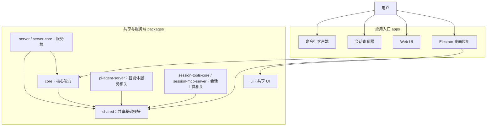

Craft Agents 是一个开源的智能体工作环境：它把会话管理、模型连接、工具调用与外部服务连接整合在同一套应用中。对于初学者，可以先把它理解为“用户通过不同界面发起任务，应用侧负责交互，服务端与共享模块承载会话和智能体能力”。本页提供项目定位、主要组成和建议阅读顺序；具体安装步骤、部署配置和模块实现分别见后续页面。  
Sources: [README.md](README.md#L10-L24)

## 项目能做什么

Craft Agents 面向需要使用 AI 智能体处理任务的工作流程。仓库 README 将其描述为支持多会话、多个模型提供方，以及连接 MCP 服务、REST API 和本地文件等来源；会话也支持权限模式、技能和自动化等能力。初次接触时，不必先理解这些功能的内部实现：先确认项目提供哪些使用入口，再按需要深入相应专题。  
Sources: [README.md](README.md#L10-L24), [README.md](README.md#L33-L57)

## 应用形态与总体关系

仓库提供 Electron 桌面应用、Web UI、会话查看器和 CLI 等应用入口，同时将共享代码和服务端能力拆分到多个工作区包中。下图概括仓库中的组成关系；它表达的是项目结构与功能边界，不代表每种应用形态都必然采用相同的运行或连接方式。  
Sources: [apps](apps#L1-L32), [packages](packages#L1-L39), [README.md](README.md#L149-L172)



## 如何认识仓库

可以先按“应用入口—共享包—服务端与专用能力包”的层次阅读目录。`apps` 下是面向用户的程序入口；`packages` 下按职责组织代码包；根目录的 `package.json` 将 `packages/*` 和 `apps/*` 声明为 Bun 工作区。以下结构只展示主要目录，省略构建脚本、测试和静态资源等细节。  
Sources: [package.json](package.json#L1-L20), [apps](apps#L1-L32), [packages](packages#L1-L39)

```text
craft-agents-oss/
├── apps/                         # 应用入口
│   ├── electron/                 # 桌面应用
│   ├── webui/                    # Web UI
│   ├── viewer/                   # 查看器
│   └── cli/                      # 命令行客户端
├── packages/                     # 可复用模块与服务端包
│   ├── core/
│   ├── shared/
│   ├── ui/
│   ├── server/
│   ├── server-core/
│   ├── pi-agent-server/
│   └── session-*/
├── scripts/                      # 构建与开发脚本
├── docs/                         # 文档
└── package.json                  # Bun 工作区与根级脚本
```

| 组成 | 初步理解 | 后续阅读 |
|---|---|---|
| Electron 桌面应用 | 面向桌面使用的应用入口 | [桌面应用：配置模型、工作区与会话](3-zhuo-mian-ying-yong-pei-zhi-mo-xing-gong-zuo-qu-yu-hui-hua) |
| 无头服务器 | 在服务器环境运行服务端的使用方式 | [无头服务器：启动、鉴权与远程桌面连接](4-wu-tou-fu-wu-qi-qi-dong-jian-quan-yu-yuan-cheng-zhuo-mian-lian-jie) |
| CLI | 命令行交互入口 | [命令行客户端：连接服务器、发送消息与自动化脚本](5-ming-ling-xing-ke-hu-duan-lian-jie-fu-wu-qi-fa-song-xiao-xi-yu-zi-dong-hua-jiao-ben) |
| Web UI 与查看器 | 独立的 Web 应用目录 | [应用形态与模块边界：Electron、Web UI、查看器和 CLI](10-ying-yong-xing-tai-yu-mo-kuai-bian-jie-electron-web-ui-cha-kan-qi-he-cli) |
| 共享模块与服务端包 | 为多个应用或运行环境提供能力 | [核心数据模型与共享基础能力](11-he-xin-shu-ju-mo-xing-yu-gong-xiang-ji-chu-neng-li) |

## 建议阅读顺序

如果你是第一次接触项目，建议先通过[快速开始](2-kuai-su-kai-shi)建立可运行的使用路径，再根据实际使用方式阅读桌面应用、服务器、CLI 或 Docker 部署指南。准备参与开发时，先了解[仓库结构与 Bun 工作区](7-cang-ku-jie-gou-yu-bun-gong-zuo-qu)，再阅读[本地开发、构建、类型检查与测试](8-ben-di-kai-fa-gou-jian-lei-xing-jian-cha-yu-ce-shi)。想建立架构全景，可按“[应用形态与模块边界：Electron、Web UI、查看器和 CLI](10-ying-yong-xing-tai-yu-mo-kuai-bian-jie-electron-web-ui-cha-kan-qi-he-cli) → [核心数据模型与共享基础能力](11-he-xin-shu-ju-mo-xing-yu-gong-xiang-ji-chu-neng-li) → [服务器启动流程、依赖注入与运行时适配](12-fu-wu-qi-qi-dong-liu-cheng-yi-lai-zhu-ru-yu-yun-xing-shi-gua-pei) → [多模型智能体后端与模型解析](14-duo-mo-xing-zhi-neng-ti-hou-duan-yu-mo-xing-jie-xi) → [会话生命周期、消息流与持久化](15-hui-hua-sheng-ming-zhou-qi-xiao-xi-liu-yu-chi-jiu-hua) → [工具注册、权限模式与安全执行](16-gong-ju-zhu-ce-quan-xian-mo-shi-yu-an-quan-zhi-xing)”阅读。  
Sources: [README.md](README.md#L67-L79), [package.json](package.json#L10-L20)

## 下一步

本页是目录中的“概览”，用于建立项目地图，不替代安装、使用或架构专题。想尽快运行项目，请前往[快速开始](2-kuai-su-kai-shi)；想先判断使用哪种入口，请阅读[应用形态与模块边界：Electron、Web UI、查看器和 CLI](10-ying-yong-xing-tai-yu-mo-kuai-bian-jie-electron-web-ui-cha-kan-qi-he-cli)。
