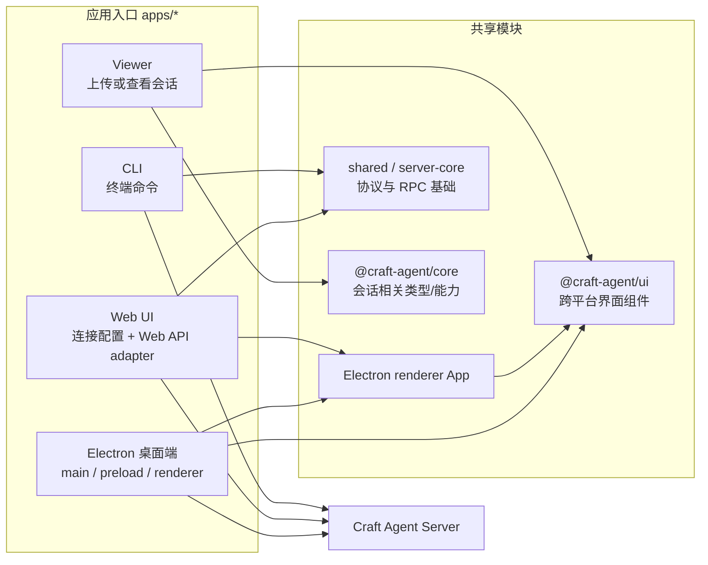

本页解释仓库如何把 Craft Agent 提供为四种应用形态：Electron 桌面端、连接服务器的 Web UI、会话查看器，以及终端 CLI。关键在于区分**产品入口、共享界面、平台适配与服务连接**：它们并非四套彼此独立的应用实现，也不都承担同样的交互或运行职责。本文聚焦这些入口的代码边界和依赖关系；服务内部实现、会话数据模型与具体部署流程分别见[服务器启动流程、依赖注入与运行时适配](12-fu-wu-qi-qi-dong-liu-cheng-yi-lai-zhu-ru-yu-yun-xing-shi-gua-pei)及相关页面。  
Sources: [package.json](package.json#L18-L21), [Electron package.json](apps/electron/package.json#L38-L43), [Web UI package.json](apps/webui/package.json#L13-L22), [Viewer package.json](apps/viewer/package.json#L14-L19), [CLI package.json](apps/cli/package.json#L16-L19)

## 一、先看边界：四种入口，共享部分界面能力

Electron 是完整桌面应用形态，包含主进程、preload、renderer、运行时和传输层；Web UI 通过服务器提供的 WebSocket 配置建立客户端适配，再加载 Electron renderer 中的 App；Viewer 则是独立的只读会话展示站点；CLI 是基于 WebSocket RPC 的终端客户端。它们之间最显著的边界不是“是否用了 React”，而是**是否拥有完整交互工作台、如何接入服务、以及是否通过共享平台无关组件复用界面**。  
Sources: [Electron 源码结构](apps/electron/src#L1), [Web UI App](apps/webui/src/App.tsx#L1-L8), [Viewer App](apps/viewer/src/App.tsx#L1-L10), [CLI RPC 客户端](apps/cli/src/client.ts#L1-L6), [共享 UI 导出](packages/ui/src/index.ts#L1-L15)

图中展示的是**代码依赖与连接职责**，不是全部运行时调用细节。Electron 和 Web UI 共享 renderer 应用入口；Viewer 复用共享 UI 组件，但拥有自己的应用逻辑；CLI 通过 RPC 与服务交互，不依赖 UI 包。CLI 包还依赖 `server-core`，以复用传输相关能力。  
Sources: [Electron package.json](apps/electron/package.json#L38-L43), [Web UI App](apps/webui/src/App.tsx#L11-L19), [Viewer package.json](apps/viewer/package.json#L14-L19), [CLI package.json](apps/cli/package.json#L16-L19), [CLI RPC 客户端](apps/cli/src/client.ts#L8-L15)

## 二、模块关系：共享组件不等于共享应用

| 模块 | 主要职责 | 共享与依赖边界 |
|---|---|---|
| `apps/electron` | 桌面应用入口；包括 Electron main、preload、renderer、运行时和 transport | 依赖 `core`、`server-core`、`shared`、`ui` 等工作区包；renderer 提供完整工作台界面 |
| `apps/webui` | 浏览器中的工作台入口 | 依赖 `shared` 和 `ui`；通过 Web 适配器设置 API，再延迟加载 Electron renderer 的 App |
| `apps/viewer` | 上传或按 URL 查看会话 transcript | 依赖 `core`、`ui`；自有 Viewer App 与页面组件，定位为会话查看界面 |
| `apps/cli` | 终端命令行客户端 | 依赖 `shared`、`server-core`；通过 WebSocket RPC 调用服务 |
| `packages/ui` | 可复用 React UI、会话查看组件与平台动作抽象 | 明确提供给 Electron 与只读 Viewer 使用的平台无关界面能力 |

上述是根据各应用的 package 依赖与入口实现归纳的模块职责。特别要注意：Web UI 不只是“把 Electron 页面装进浏览器”——它需要先取得服务器配置并构造 Web API adapter；而复用 Electron 的 renderer App 并不意味着 Web UI 拥有 Electron main/preload 的桌面能力。  
Sources: [Electron package.json](apps/electron/package.json#L38-L43), [Web UI package.json](apps/webui/package.json#L13-L22), [Viewer package.json](apps/viewer/package.json#L14-L19), [CLI package.json](apps/cli/package.json#L16-L19), [共享 UI 包说明](packages/ui/src/index.ts#L1-L15)

## 三、Electron：桌面壳、renderer 与传输入口

Electron 源码按 `main`、`preload`、`renderer`、`runtime`、`shared` 和 `transport` 分层。主进程入口 `main/index.ts` 引入 Electron API，并连接 server-core 的会话管理、RPC handlers、bootstrap 等能力；renderer 中的 `App.tsx` 承担工作台状态与 UI 入口；preload 则建立客户端传输并向 renderer 提供 API。  
Sources: [Electron 源码结构](apps/electron/src#L1), [Electron 主进程入口](apps/electron/src/main/index.ts#L6-L19), [Electron 主进程服务依赖](apps/electron/src/main/index.ts#L70-L85), [Electron renderer App](apps/electron/src/renderer/App.tsx#L1-L20)

preload 的 bootstrap 代码区分两种连接形态：普通模式使用 `RoutedClient`，把本地专属通道与工作区对应的服务连接组合起来；thin-client 模式则创建单个 `WsRpcClient` 直连远端服务器。两者最终都通过 `buildClientApi` 构建 API 表面，并提供 Electron 的运行环境标记。该设计把 renderer 面向的 API 与底层连接选择分开。  
Sources: [preload 连接模式说明](apps/electron/src/preload/bootstrap.ts#L1-L16), [preload thin-client 连接](apps/electron/src/preload/bootstrap.ts#L56-L92), [preload routed 连接](apps/electron/src/preload/bootstrap.ts#L94-L155), [preload API 构建](apps/electron/src/preload/bootstrap.ts#L188-L195)

## 四、Web UI：Web 适配器复用工作台界面

Web UI 的 `App.tsx` 将其职责写得很清楚：向服务器获取 WebSocket 配置、创建 Web API adapter 并设置 `window.electronAPI`，然后委托给 Electron renderer 的 App。它先请求 `/api/config` 取得 `wsUrl`，再确定工作区，调用 `createWebApi`，将 adapter 暴露到 `window.electronAPI`，随后启动客户端连接并渲染延迟加载的 renderer App。  
Sources: [Web UI App 职责注释](apps/webui/src/App.tsx#L1-L19), [Web UI 配置与工作区获取](apps/webui/src/App.tsx#L69-L104), [Web UI adapter 设置与连接](apps/webui/src/App.tsx#L106-L126), [Web UI 渲染共享 App](apps/webui/src/App.tsx#L141-L148)

因此，**Web UI 的复用边界是工作台 renderer 与共享 UI，而非 Electron 进程结构**。Web UI 的启动入口还初始化 Jotai、主题和国际化资源，再挂载 App；它是独立 Vite 应用，但通过 adapter 与 renderer 约定的 API 接口衔接。  
Sources: [Web UI 入口](apps/webui/src/main.tsx#L1-L16), [Web UI 渲染树](apps/webui/src/main.tsx#L41-L60), [Web UI package.json](apps/webui/package.json#L7-L22)

## 五、Viewer：面向会话展示的独立 Web 应用

Viewer 是独立于工作台的轻量 Web 应用。其入口初始化国际化并挂载自己的 `App`；App 注释声明根路径用于上传界面、`/s/{id}` 用于查看共享会话。存在会话 ID 时，Viewer 请求 `/s/api/{id}` 获取会话数据；它也提供读取 JSON 文件及分享会话的界面路径。  
Sources: [Viewer 入口](apps/viewer/src/main.tsx#L1-L19), [Viewer 路由说明](apps/viewer/src/App.tsx#L1-L10), [Viewer 会话数据请求](apps/viewer/src/App.tsx#L65-L95)

Viewer 使用 `@craft-agent/ui` 中的 `SessionViewer`、overlay 和相关解析能力，并提供受限的 `PlatformActions`，例如打开外部 URL 与复制到剪贴板。共享的是可复用的会话展示组件，不是 Electron 工作台的状态管理、导航或完整 API。  
Sources: [Viewer 共享 UI 导入](apps/viewer/src/App.tsx#L15-L34), [Viewer 平台动作](apps/viewer/src/App.tsx#L175-L193), [共享 UI 平台抽象与 SessionViewer](packages/ui/src/index.ts#L1-L15), [共享 UI 导出 SessionViewer](packages/ui/src/index.ts#L28-L65)

## 六、CLI：终端界面之下的 WebSocket RPC 客户端

CLI 的执行入口是 `apps/cli/src/index.ts`，可执行名称为 `craft-cli`，由 Bun 运行。参数解析支持服务器 URL、token、workspace、超时、JSON 输出等选项，并为 URL、token、TLS CA 等连接参数提供环境变量回退；命令实现则调用 `CliRpcClient`。  
Sources: [CLI 包入口与脚本](apps/cli/package.json#L5-L14), [CLI 参数类型与连接参数解析](apps/cli/src/index.ts#L17-L41), [CLI 参数及环境变量回退](apps/cli/src/index.ts#L67-L157)

`CliRpcClient` 的边界刻意保持精简：连接 WebSocket、完成握手、发送 RPC 请求、等待响应、分发推送事件，并在销毁或断开时清理待处理请求。其代码注释明确指出，相比完整客户端，它不提供自动重连、能力系统或连接状态监听；因此适合“连接、执行、退出”的命令行交互模式。  
Sources: [CLI RPC 客户端定位](apps/cli/src/client.ts#L1-L6), [CLI 握手与连接](apps/cli/src/client.ts#L60-L107), [CLI RPC 请求](apps/cli/src/client.ts#L131-L154), [CLI 清理与状态](apps/cli/src/client.ts#L171-L190)

CLI 还包含可选的本地服务器启动器：若未显式指定 server entry，会从 monorepo 布局中探测 `packages/server/src/index.ts`；启动服务器时绑定 loopback 地址、使用动态端口，并从标准输出读取 `CRAFT_SERVER_URL`，随后返回可停止子进程的句柄。这是 CLI 包内的辅助能力，不应与 CLI 默认的远程 RPC 客户端职责混为一谈。  
Sources: [服务器启动器入口探测](apps/cli/src/server-spawner.ts#L32-L49), [服务器子进程启动参数](apps/cli/src/server-spawner.ts#L55-L73), [从 stdout 发现地址及停止服务](apps/cli/src/server-spawner.ts#L92-L149)

## 七、按职责选择应用形态

| 需求 | 对应形态 | 代码层面的理由 |
|---|---|---|
| 使用 Electron 桌面工作台 | Electron | 有 main、preload、renderer、运行时与桌面连接层 |
| 在浏览器中访问工作台 | Web UI | 经 Web API adapter 接入服务，复用 renderer App |
| 查看或分享会话 transcript | Viewer | 独立 Viewer App，按会话 ID 获取数据并复用只读 UI |
| 从终端自动化调用服务器功能 | CLI | 以 WebSocket RPC 调用命令对应的服务能力 |

这些入口的共享与隔离有明确边界：Electron 和 Web UI 共用工作台 renderer；Viewer 复用偏展示型 UI；CLI 不加载 React 界面，而通过 RPC 访问服务。若要继续追踪服务端如何承接这些入口，可阅读[服务器启动流程、依赖注入与运行时适配](12-fu-wu-qi-qi-dong-liu-cheng-yi-lai-zhu-ru-yu-yun-xing-shi-gua-pei)；若关注 renderer 组件如何跨平台复用，可阅读[共享 UI 组件、桌面渲染与状态交互](22-gong-xiang-ui-zu-jian-zhuo-mian-xuan-ran-yu-zhuang-tai-jiao-hu)。