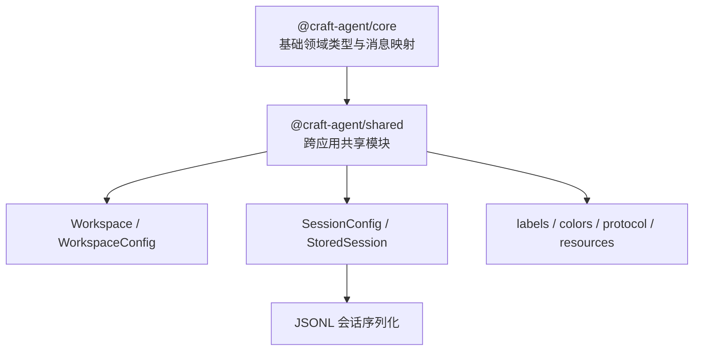

本页聚焦跨应用复用的核心类型、工作区与会话持久化模型，以及共享包提供的基础数据约定。阅读时可先把握一个关键边界：`@craft-agent/core` 汇集基础领域类型，`@craft-agent/shared` 在此之上组织共享业务模块，并提供工作区作用域的数据结构与序列化实现。这里讨论的是数据形状与模块职责，不展开服务器运行时、RPC 通道或会话完整生命周期；相关主题见[服务器启动流程、依赖注入与运行时适配](12-fu-wu-qi-qi-dong-liu-cheng-yi-lai-zhu-ru-yu-yun-xing-shi-gua-pei)、[RPC 通道、WebSocket 传输与推送事件](13-rpc-tong-dao-websocket-chuan-shu-yu-tui-song-shi-jian)和[会话生命周期、消息流与持久化](15-hui-hua-sheng-ming-zhou-qi-xiao-xi-liu-yu-chi-jiu-hua)。  
Sources: [index.ts](packages/shared/src/index.ts#L1-L33) [package.json](packages/shared/package.json#L1-L68)

## 模块边界：领域类型与共享能力

共享包通过子路径导出按职责拆分的模块，例如 `config`、`sessions`、`workspaces`、`labels`、`protocol` 和 `resources`。包根入口仅直接导出品牌相关内容；因此消费者应根据职责导入对应子路径，而不是假设根入口聚合了全部业务 API。`config/types` 则从 `@craft-agent/core/types` 重新导出 Workspace 等配置类型，体现共享包与 core 类型之间的单一来源约定。  
Sources: [package.json](packages/shared/package.json#L11-L68) [index.ts](packages/shared/src/index.ts#L1-L33) [types.ts](packages/shared/src/config/types.ts#L1-L23) [index.ts](packages/core/src/types/index.ts#L1-L68)

图中的边表示类型或模块依赖关系，不表示运行时调用顺序。core 导出 Workspace、Session、Message 等类型及消息持久化映射；shared 定义更具体的工作区配置、会话存储形状以及相关共享能力。  
Sources: [index.ts](packages/core/src/types/index.ts#L1-L68) [types.ts](packages/shared/src/config/types.ts#L1-L23) [types.ts](packages/shared/src/workspaces/types.ts#L1-L92) [types.ts](packages/shared/src/sessions/types.ts#L1-L200)

## 工作区是配置和数据的作用域

`WorkspaceConfig` 是工作区的持久化配置模型，包含 `id`、`name`、`slug`、创建与更新时间，以及可选的默认会话设置。默认设置涵盖模型、LLM 连接、启用的数据源、权限模式、工作目录、思考级别和主题；工作区还可配置本地 MCP 服务是否启用。类型注释明确给出配置文件为 `config.json`，而工作区目录约定中包含 `sources/` 与 `sessions/`，因此工作区是这些资源的组织边界。  
Sources: [types.ts](packages/shared/src/workspaces/types.ts#L1-L62)

模型区分完整配置与轻量摘要：`LoadedWorkspace` 将配置与数据源 slug 列表、会话数并列；`WorkspaceSummary` 仅保留列表展示所需的 slug、名称、资源计数和时间字段。数据源只以 slug 列出，而不是在该摘要类型中展开完整配置，避免轻量列表模型携带完整对象。  
Sources: [types.ts](packages/shared/src/workspaces/types.ts#L63-L92)

## 会话模型：持久化元数据、消息与列表视图

`SessionConfig` 表达会话的持久化元数据，涵盖身份与所属工作区、时间戳、展示状态、标签、未读标记、数据源选择、权限模式、工作目录、模型连接、思考级别、归档、分支锚点以及自动化来源等。`StoredSession` 在此基础上增加消息数组和 token 用量；`SessionMetadata` 则用于轻量列表数据，允许调用方在无需持有完整消息内容时展示会话摘要。  
Sources: [types.ts](packages/shared/src/sessions/types.ts#L20-L200) [types.ts](packages/shared/src/sessions/types.ts#L201-L370)

会话类型通过 `SESSION_PERSISTENT_FIELDS` 显式列出参与持久化的字段，`pickSessionFields()` 按该清单筛选对象属性。这个设计将持久化字段声明集中在一个数组中，并由 JSONL 读写路径复用；添加新字段时，类型注释要求同时更新清单与 `SessionConfig`。列表预计算字段（如消息数、最后消息角色、预览和最后一条最终 assistant 消息 ID）属于 `SessionHeader`，用于在不读取消息正文时提供列表所需信息。  
Sources: [types.ts](packages/shared/src/sessions/types.ts#L20-L57) [utils.ts](packages/shared/src/sessions/utils.ts#L1-L26) [types.ts](packages/shared/src/sessions/types.ts#L201-L277)

| 视图 | 主要内容 | 适用职责 |
|---|---|---|
| `SessionConfig` | 会话身份、配置、状态与工作区归属 | 持久化元数据契约 |
| `StoredSession` | `SessionConfig` 加消息数组与 token 用量 | 完整会话数据 |
| `SessionHeader` | 持久化元数据及列表预计算字段 | JSONL 首行与快速列表读取 |
| `SessionMetadata` | 面向列表的轻量字段集合 | 列表呈现和摘要 |

以上模型的区别来自类型定义：`StoredSession` 继承 `SessionConfig` 并补充消息与 token 用量；`SessionHeader` 明确包含列表预计算字段；`SessionMetadata` 是独立的轻量接口。  
Sources: [types.ts](packages/shared/src/sessions/types.ts#L80-L200) [types.ts](packages/shared/src/sessions/types.ts#L201-L370)

## JSONL 持久化与数据健壮性

会话文件采用 JSONL：第一行是 `SessionHeader`，后续每行对应一个 `StoredMessage`。读取列表元数据时，`readSessionHeader()` 只读取文件开头的有限字节并解析首行；读取完整会话时，`readSessionJsonl()` 才解析后续消息行，并对无法解析的消息行采取跳过策略，避免单条损坏记录导致整个会话读取失败。  
Sources: [types.ts](packages/shared/src/sessions/types.ts#L1-L18) [jsonl.ts](packages/shared/src/sessions/jsonl.ts#L1-L29) [jsonl.ts](packages/shared/src/sessions/jsonl.ts#L70-L140)

写入由 `writeSessionJsonl()` 执行：它构建首行 header 与逐条消息行，先写入临时文件，再重命名为目标文件。`createSessionHeader()` 从会话提取持久化字段，并计算消息数、最后消息角色、预览及 token 用量等列表字段。读写还通过 `{{SESSION_PATH}}` 令牌处理会话目录中的绝对路径，使 JSON 内容中的路径能够在写入时变为可移植形式，并在读取时展开。  
Sources: [jsonl.ts](packages/shared/src/sessions/jsonl.ts#L1-L29) [jsonl.ts](packages/shared/src/sessions/jsonl.ts#L140-L200)

会话 ID 同时承担目录名用途，因此路径边界有明确防护：`validateSessionId()` 检查非空、拒绝路径组件，并要求字符匹配字母数字、连字符和下划线；`getSessionPath()` 还调用 `sanitizeSessionId()` 作为纵深防御。调用方应将验证视为输入校验，将路径函数中的清理视为额外保护，而不应以清理替代验证。  
Sources: [validation.ts](packages/shared/src/sessions/validation.ts#L1-L71) [storage.ts](packages/shared/src/sessions/storage.ts#L1-L59)

## 共享值对象与协议契约

权限模式是跨配置与会话复用的基础值类型：内部存储键为 `safe`、`ask`、`allow-all`，并提供面向用户的规范名称 `explore`、`ask`、`execute`。`parsePermissionMode()` 同时接受规范名称和若干旧别名，并转换为内部键；读 JSONL header 时也会归一化权限字段，无效值则从 header 删除。  
Sources: [mode-types.ts](packages/shared/src/agent/mode-types.ts#L1-L56) [jsonl.ts](packages/shared/src/sessions/jsonl.ts#L35-L68)

颜色以 `EntityColor` 统一表达系统色和自定义颜色：系统色引用设计系统名称，可附带百分比透明度；自定义色以 `light` 为必填值，`dark` 可选。标签配置使用该类型，使不同实体配置能够共享同一颜色契约。标签自身是可递归的树形配置，而会话上的标签则以字符串数组保存，字符串可为裸 ID 或 `id::value`；解析后的 `ParsedLabelEntry` 将原始值与推断出的字符串、数字或日期值分开表示。  
Sources: [types.ts](packages/shared/src/colors/types.ts#L1-L65) [types.ts](packages/shared/src/labels/types.ts#L1-L128) [types.ts](packages/shared/src/sessions/types.ts#L80-L108)

`protocol` 定义跨服务端与客户端共享的线协议形状。`MessageEnvelope` 通过 `type` 区分握手、请求、响应、事件与错误等消息，并使用 `id` 关联请求和响应；可选字段承载 channel、参数、结果、结构化错误、客户端身份、工作区和可靠投递序号等信息。协议错误码以联合类型约束，`isErrorCode()` 提供运行时成员判断；`CodedError` 的注释强调错误经传输后类身份会丢失，接收方应依据 `.code` 判别，而非 `instanceof`。  
Sources: [types.ts](packages/shared/src/protocol/types.ts#L1-L95)

## 资源包：可移植数据而非运行时对象

`ResourceBundle` 定义工作区资源的可移植封装，版本为 `1`，资源桶可包含数据源、技能与自动化。数据源条目由 slug、经过清理的配置和文件组成；技能条目由 slug 与文件组成；自动化条目携带事件和 matcher。类型注释明确这些配置会去除凭据或 webhook 授权信息，因此 bundle 表达的是导入导出的资源数据，而不是完整运行时状态。  
Sources: [types.ts](packages/shared/src/resources/types.ts#L1-L73)

导入冲突模式为 `skip` 或 `overwrite`，结果按资源类别分别记录成功、跳过、失败和警告；`ResourceImportDeps` 通过注入 `clearSourceCredentials` 处理覆盖数据源时的凭据清理，使资源模块不直接依赖凭据存储实现。这是明确的依赖边界：导入流程声明所需能力，由调用方提供实现。  
Sources: [types.ts](packages/shared/src/resources/types.ts#L74-L149)

## 阅读与扩展时的检查点

扩展共享数据模型时，首先确认类型的责任层级：基础领域对象位于 core，面向具体持久化或应用共享流程的模型位于 shared；其次检查序列化是否需要同步更新持久化字段清单、header 预计算或读入归一化逻辑。对于工作区和会话文件路径，应同时审视标识符验证与路径可移植化；对于跨进程传输对象，则要考虑线协议上可序列化的字段与错误判别约定。  
Sources: [index.ts](packages/core/src/types/index.ts#L1-L68) [types.ts](packages/shared/src/sessions/types.ts#L20-L57) [utils.ts](packages/shared/src/sessions/utils.ts#L1-L26) [jsonl.ts](packages/shared/src/sessions/jsonl.ts#L35-L68) [types.ts](packages/shared/src/protocol/types.ts#L1-L95)

后续可按关注点继续阅读：[会话生命周期、消息流与持久化](15-hui-hua-sheng-ming-zhou-qi-xiao-xi-liu-yu-chi-jiu-hua)了解会话运行流程；[服务器启动流程、依赖注入与运行时适配](12-fu-wu-qi-qi-dong-liu-cheng-yi-lai-zhu-ru-yu-yun-xing-shi-gua-pei)了解共享能力如何进入运行时；[RPC 通道、WebSocket 传输与推送事件](13-rpc-tong-dao-websocket-chuan-shu-yu-tui-song-shi-jian)了解协议类型的传输语境。