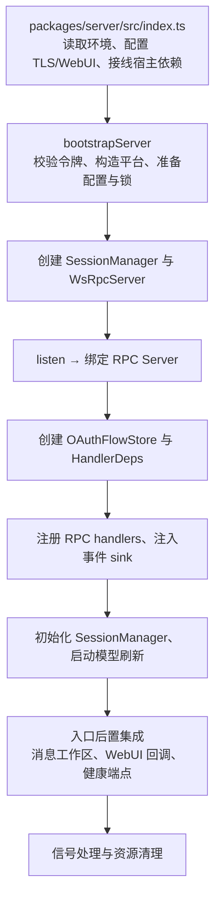

本页解释无头服务器如何从进程入口进入通用 bootstrap、构造平台与处理器依赖、启动 RPC 服务，并在关闭时释放资源。重点是 `packages/server` 与 `packages/server-core` 之间的边界；客户端协议细节、部署步骤及会话内部行为分别属于[RPC 通道、WebSocket 传输与推送事件](13-rpc-tong-dao-websocket-chuan-shu-yu-tui-song-shi-jian)、[无头服务器：启动、鉴权与远程桌面连接](4-wu-tou-fu-wu-qi-qi-dong-jian-yuan-cheng-zhuo-mian-lian-jie)等页面。  
Sources: [index.ts](packages/server/src/index.ts#L1-L25), [headless-start.ts](packages/server-core/src/bootstrap/headless-start.ts#L18-L56)

## 架构假设与模块分工

启动架构的核心假设是：**server-core 提供可复用的启动编排，宿主入口负责提供具体实现和产品集成**。通用层通过 `ServerBootstrapOptions` 接收 SessionManager、处理器依赖、平台适配和生命周期钩子；无头入口再把这些钩子连接到实际的 `SessionManager`、RPC handlers、凭据与消息网关。该分层让通用 bootstrap 不必依赖服务器入口中的具体业务实现。  
Sources: [headless-start.ts](packages/server-core/src/bootstrap/headless-start.ts#L18-L55), [index.ts](packages/server/src/index.ts#L166-L250)

图中顺序体现两层职责：`bootstrapServer` 管理共享启动阶段，入口在其返回后完成依赖于已启动服务器实例的集成；关闭则由入口清理外围资源，再调用实例的 `stop()`。  
Sources: [headless-start.ts](packages/server-core/src/bootstrap/headless-start.ts#L258-L351), [index.ts](packages/server/src/index.ts#L257-L354)

## 启动阶段：从入口到可服务状态

服务器入口先处理令牌生成快捷路径、调试设置、环境值解析、TLS 证书读取和 WebUI 配置；随后调用 `bootstrapServer`。在 bootstrap 内，服务器令牌是必需项，并在监听前进行强度校验；平台创建后设置 bundled assets 根目录，将平台应用到子系统，再初始化配置目录与全局配置，并获取进程锁。锁文件记录 PID 和启动时间，用于判断已有实例或过期锁。  
Sources: [index.ts](packages/server/src/index.ts#L40-L120), [headless-start.ts](packages/server-core/src/bootstrap/headless-start.ts#L79-L116), [headless-start.ts](packages/server-core/src/bootstrap/headless-start.ts#L171-L213), [headless-start.ts](packages/server-core/src/bootstrap/headless-start.ts#L238-L286)

其后 bootstrap 初始化模型刷新服务并创建 SessionManager，解析并校验 RPC 端口，再构造要求认证的 `WsRpcServer`。令牌验证通过与服务器令牌相等的比较实现；可选的 Cookie session validator、TLS、HTTP handler 和客户端连接回调也从 options 传入。`listen()` 完成后才调用 `bindRpcServer`，然后创建 OAuthFlowStore 与 HandlerDeps、注册 RPC handlers、设置会话事件 sink、初始化 SessionManager，最后启动模型刷新服务。  
Sources: [headless-start.ts](packages/server-core/src/bootstrap/headless-start.ts#L288-L351)

## 依赖注入：通用编排与宿主装配

依赖注入的主要入口是 `ServerBootstrapOptions`：宿主提供 `createSessionManager`、`createHandlerDeps`、`registerAllRpcHandlers`、`initializeSessionManager` 与 `setSessionEventSink` 等函数。bootstrap 只依赖这些操作的约定，不要求泛型 SessionManager 或 handler deps 采用特定具体类。`HandlerDeps` 则将处理器运行时需要的对象聚合起来，核心字段包括 session manager、platform 和 OAuth flow store；窗口、浏览器面板及消息注册表等依赖是可选项。  
Sources: [headless-start.ts](packages/server-core/src/bootstrap/headless-start.ts#L18-L43), [handler-deps.ts](packages/server-core/src/handlers/handler-deps.ts#L8-L30)

无头入口把这些抽象映射到实际实现：以 `new SessionManager()` 创建会话管理器；创建 handler deps 时启动 messaging bootstrap 并注入其 registry；将 `registerCoreRpcHandlers` 作为注册函数，并通过 `sessionManager.initialize()` 完成初始化。事件 sink 在 messaging 存在时由 `wrapSink` 包装，否则直接传给 SessionManager。该装配说明 bootstrap 的扩展点用于协调生命周期，而业务实现仍由宿主明确提供。  
Sources: [index.ts](packages/server/src/index.ts#L207-L250)

## 运行时适配：PlatformServices 接缝

`PlatformServices` 是核心代码与宿主运行环境之间的依赖注入接缝。接口集中描述路径与应用元数据、图像处理、可选 OS/应用生命周期操作及可观测性能力。核心处理器和 SessionManager 可消费这一接口，而不必直接绑定 Electron API；无头实现中 GUI 专属方法留空，调用方应按可选能力处理。  
Sources: [platform.ts](packages/server-core/src/runtime/platform.ts#L1-L65), [platform-headless.ts](packages/server-core/src/runtime/platform-headless.ts#L1-L7)

默认情况下，`bootstrapServer` 使用 `createHeadlessPlatform`；也可通过 `platformFactory` 提供另一种实现。无头平台从环境变量或默认值取得 app root、resources path、打包状态与版本，使用 console logger，并通过动态导入的 `sharp` 实现图像元数据读取及处理。入口还将该平台分发给模型 fetcher、会话、搜索与图像处理子系统，说明接口实例不仅注入 handlers，也会同步配置其他全局子系统。  
Sources: [headless-start.ts](packages/server-core/src/bootstrap/headless-start.ts#L258-L282), [platform-headless.ts](packages/server-core/src/runtime/platform-headless.ts#L34-L88), [index.ts](packages/server/src/index.ts#L181-L193)

| 适配面 | `PlatformServices` 契约 | 无头实现 |
|---|---|---|
| 路径与元数据 | `appRootPath`、`resourcesPath`、`isPackaged`、`appVersion` | 环境变量优先，否则使用 cwd、`cwd/resources` 与开发默认版本 |
| 图像处理 | `imageProcessor.getMetadata()`、`process()` | 动态导入 `sharp`，按选项调整尺寸并编码为 PNG/JPEG |
| OS 与应用操作 | 可选的路径打开、外链打开、退出、深色模式等 | GUI 操作不提供，由调用方按可选能力处理 |
| 日志与错误 | `logger`、`isDebugMode`、可选 `captureError` | 时间戳 console logger；错误捕获记录消息与堆栈 |

Sources: [platform.ts](packages/server-core/src/runtime/platform.ts#L39-L65), [platform-headless.ts](packages/server-core/src/runtime/platform-headless.ts#L16-L32), [platform-headless.ts](packages/server-core/src/runtime/platform-headless.ts#L44-L87)

## Bootstrap 扩展点与启动后集成

通用 bootstrap 在 `listen()` 后支持 `bindRpcServer`，用于将已监听的 RPC server 交给 SessionManager 等组件；并通过 `onClientDisconnected` 调用可选清理函数及 SessionManager 的断连钩子。客户端断连通知采用可选方法检查和异常隔离，避免清理钩子失败中断 transport 回调。  
Sources: [headless-start.ts](packages/server-core/src/bootstrap/headless-start.ts#L35-L43), [headless-start.ts](packages/server-core/src/bootstrap/headless-start.ts#L298-L326)

入口在 bootstrap 返回后执行需要完整实例的集成：为 messaging handle 设置 WebSocket publisher，并初始化非远程 workspace；WebUI 健康检查和 OAuth 回调依赖此时已创建的 session manager、flow store 与服务器实例，因此在此阶段补齐；健康 HTTP 服务则依据 `CRAFT_HEALTH_PORT` 启动。`startHealthHttpServer` 仅在端口大于零且运行时存在 Bun 时启动，否则返回 `null`。  
Sources: [index.ts](packages/server/src/index.ts#L257-L306), [headless-start.ts](packages/server-core/src/bootstrap/headless-start.ts#L414-L460)

## 关闭与资源所有权

入口接收 `SIGINT` 与 `SIGTERM` 后，先释放 WebUI、健康 HTTP 服务和 messaging handle，再调用 bootstrap 返回的 `instance.stop()`。`stop()` 具备幂等保护：先向已连接客户端发送 shutdown 通知并等待短暂 drain，再停止模型刷新服务、执行可选 SessionManager 清理、关闭 RPC server、释放 OAuthFlowStore，最后释放服务器锁。每类清理分别捕获错误并记录日志，避免单项清理失败跳过后续步骤。  
Sources: [index.ts](packages/server/src/index.ts#L338-L354), [headless-start.ts](packages/server-core/src/bootstrap/headless-start.ts#L353-L398)

锁文件还注册了进程退出时的同步释放兜底；释放操作只在锁仍属于当前 PID 时删除。这个兜底与正常 `stop()` 的显式释放互补，但不替代入口对 messaging、健康服务或 WebUI 的清理。  
Sources: [headless-start.ts](packages/server-core/src/bootstrap/headless-start.ts#L207-L232), [headless-start.ts](packages/server-core/src/bootstrap/headless-start.ts#L391-L398)

## 设计边界

`bootstrapServer` 是启动编排器，不是所有服务的统一容器：它创建并返回平台、SessionManager、RPC server 和 OAuth flow store，同时通过回调将宿主实现接入；消息网关初始化、WebUI OAuth 回调、健康端口和进程信号处理则留在服务器入口。阅读启动相关代码时，沿“入口配置 → bootstrap 顺序 → 回调注入 → 入口后置集成 → 分层关闭”的链路检查，能清楚区分共享生命周期与宿主职责。  
Sources: [headless-start.ts](packages/server-core/src/bootstrap/headless-start.ts#L258-L411), [index.ts](packages/server/src/index.ts#L166-L354)

后续可阅读[RPC 通道、WebSocket 传输与推送事件](13-rpc-tong-dao-websocket-chuan-shu-yu-tui-song-shi-jian)，理解 bootstrap 创建的 RPC server 如何承载调用与推送；若关注服务器实际部署和连接配置，请转至[无头服务器：启动、鉴权与远程桌面连接](4-wu-tou-fu-wu-qi-qi-dong-jian-yuan-cheng-zhuo-mian-lian-jie)。