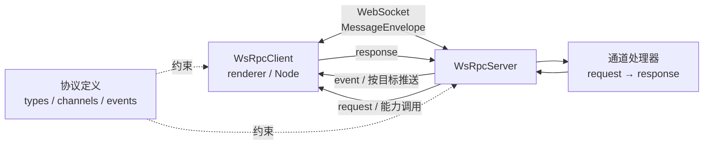

本页解释服务端与客户端如何通过 WebSocket 承载双向 RPC，以及通道、事件推送和断线重放如何建立在同一消息信封之上。重点是传输层的可验证行为：握手与鉴权、请求关联、推送定向、能力调用和重连可靠性；业务处理器的具体职责不在本页范围内。  
Sources: [types.ts](packages/shared/src/protocol/types.ts#L11-L63) [server.ts](packages/server-core/src/transport/server.ts#L1-L8)

## 架构：一条连接承载三种消息流

**核心模式**是用统一的 `MessageEnvelope` 区分协议控制、请求/响应和服务端事件。客户端可发起 RPC，也可注册能力供服务端反向调用；服务端则负责连接状态、分发、目标路由与事件缓冲。通道字符串是跨端 API 契约，类型化事件映射则为推送参数提供编译期约束。  
Sources: [types.ts](packages/shared/src/protocol/types.ts#L11-L63) [types.ts](packages/server-core/src/transport/types.ts#L7-L35) [channels.ts](packages/shared/src/protocol/channels.ts#L1-L5) [push.ts](packages/server-core/src/transport/push.ts#L1-L15)

该图中的服务端—客户端反向调用仍使用 `request`/`response` 消息，只是请求方向相反；事件则是独立的 `event` 消息，不对应 RPC 返回值。传输接口将这些操作明确分为 `handle`、`invoke`、`push` 与客户端的 `invoke`、`on`、`handleCapability`。  
Sources: [types.ts](packages/server-core/src/transport/types.ts#L13-L35) [types.ts](packages/shared/src/protocol/types.ts#L11-L31)

## 消息信封与线协议

信封以 `id` 关联请求与响应，`type` 表示消息种类；请求参数和事件负载放在 `args`，响应值放在 `result`，结构化错误放在 `error`。握手字段携带协议版本、工作区、认证令牌、客户端能力等信息；可靠推送字段包含每客户端序号、客户端确认位置及重连身份。  
Sources: [types.ts](packages/shared/src/protocol/types.ts#L11-L63)

编码器将信封序列化为 JSON，并递归地把 `Uint8Array`、其他 ArrayBuffer 视图及 `ArrayBuffer` 转为带标记的 Base64 表示，解码时还原为字节数组。解码会检查已知消息类型、必需字符串字段及错误形状；不符合信封结构时抛出异常。  
Sources: [codec.ts](packages/server-core/src/transport/codec.ts#L3-L20) [codec.ts](packages/server-core/src/transport/codec.ts#L48-L61) [codec.ts](packages/server-core/src/transport/codec.ts#L68-L114) [codec.ts](packages/server-core/src/transport/codec.ts#L122-L156)

| 消息类型 | 主要方向 | 传输层用途 |
|---|---|---|
| `handshake` / `handshake_ack` | 客户端 ↔ 服务端 | 建立连接身份、协商版本并返回注册通道 |
| `request` / `response` | 双向 | 以请求 ID 关联调用及结果或错误 |
| `event` | 服务端 → 客户端 | 单向推送，可包含事件序号 |
| `error` | 服务端 → 客户端 | 握手等协议级错误 |
| `sequence_ack` | 客户端 → 服务端 | 确认已处理的事件序号 |

表中消息种类及职责由信封类型和传输处理逻辑定义；`sequence_ack` 的确认字段是 `lastSeq`。  
Sources: [types.ts](packages/shared/src/protocol/types.ts#L11-L31) [types.ts](packages/shared/src/protocol/types.ts#L49-L63) [client.ts](packages/server-core/src/transport/client.ts#L514-L619) [server.ts](packages/server-core/src/transport/server.ts#L602-L627)

## 握手、连接身份与运行方式

`WsRpcServer` 默认绑定 `127.0.0.1`，默认端口为 `0`（由系统选择可用端口）；可配置绑定地址、端口、认证校验、TLS、客户端上限及版本。TLS 配置存在时使用 HTTPS 服务器承载 WebSocket，协议标记为 `wss`；配置 HTTP 处理器时，普通 HTTP 请求也可由同端口处理。  
Sources: [server.ts](packages/server-core/src/transport/server.ts#L68-L114) [server.ts](packages/server-core/src/transport/server.ts#L149-L162) [server.ts](packages/server-core/src/transport/server.ts#L264-L334)

客户端 WebSocket 打开后发送握手，包含协议版本和可选的工作区、`webContentsId`、令牌、能力，以及重连时的客户端 ID 与最后序号。服务端要求客户端先握手，并检查协议主版本；若启用认证，则尝试验证 bearer token，未通过时可再验证升级请求中的 session cookie。握手成功后服务端分配或恢复客户端 ID，并在确认消息中返回注册通道和服务端版本等信息。  
Sources: [client.ts](packages/server-core/src/transport/client.ts#L398-L415) [server.ts](packages/server-core/src/transport/server.ts#L371-L390) [server.ts](packages/server-core/src/transport/server.ts#L401-L449) [server.ts](packages/server-core/src/transport/server.ts#L557-L581)

连接身份保存工作区、`webContentsId` 和能力集合。服务端处理请求时据此构造 `RequestContext`；客户端则能从握手确认中读取服务端注册通道，并通过 `isChannelAvailable` 检查通道是否可用。若服务端未发送注册通道列表，客户端按向后兼容规则视为可用。  
Sources: [server.ts](packages/server-core/src/transport/server.ts#L41-L55) [server.ts](packages/server-core/src/transport/server.ts#L656-L660) [client.ts](packages/server-core/src/transport/client.ts#L229-L237) [client.ts](packages/server-core/src/transport/client.ts#L515-L525)

## RPC 调用与错误边界

客户端 `invoke(channel, ...args)` 在发送前确保连接可用，为请求生成唯一 ID，并登记待处理 Promise 和超时；收到匹配 ID 的响应后清除计时器，解析 `result` 或以携带 `code`、`data` 的普通 `Error` 拒绝。默认请求超时来自共享协议常量，客户端可通过配置覆盖。  
Sources: [client.ts](packages/server-core/src/transport/client.ts#L82-L103) [client.ts](packages/server-core/src/transport/client.ts#L177-L206) [client.ts](packages/server-core/src/transport/client.ts#L570-L585) [types.ts](packages/shared/src/protocol/types.ts#L157-L158)

服务端按通道查找处理器，缺失通道返回 `CHANNEL_NOT_FOUND`；处理器执行有 60 秒服务端超时，异常被转换为结构化错误，无法识别的错误码归为 `HANDLER_ERROR`。服务端错误码集合还包括认证、版本、能力不可用、客户端断开等传输场景；错误类实例跨线后不保留，因此接收方应检查 `err.code`，不应依赖 `instanceof`。  
Sources: [server.ts](packages/server-core/src/transport/server.ts#L639-L683) [types.ts](packages/shared/src/protocol/types.ts#L65-L93) [types.ts](packages/shared/src/protocol/types.ts#L120-L134)

反向能力调用由服务端 `invokeClient` 发起：服务端先检查客户端在线状态与其握手声明的能力，再发送带 ID 的 `request` 并等待响应；客户端用 `handleCapability` 注册对应处理器，收到请求后返回结果或结构化错误。能力缺失和等待超时分别以 `CAPABILITY_UNAVAILABLE`、`CLIENT_REQUEST_TIMEOUT` 拒绝。  
Sources: [server.ts](packages/server-core/src/transport/server.ts#L219-L257) [client.ts](packages/server-core/src/transport/client.ts#L225-L227) [client.ts](packages/server-core/src/transport/client.ts#L604-L610) [client.ts](packages/server-core/src/transport/client.ts#L655-L689)

## 推送事件：通道、参数与目标

推送通道集中定义于 `RPC_CHANNELS`，其字符串值是线协议契约；`BroadcastEventMap` 将事件通道映射到参数元组，`pushTyped` 据此限制调用端的事件参数类型。事件既可按工作区广播，也可全局广播或定向到单个客户端，服务端还支持排除特定客户端的目标形式。  
Sources: [channels.ts](packages/shared/src/protocol/channels.ts#L1-L5) [events.ts](packages/shared/src/protocol/events.ts#L18-L73) [types.ts](packages/shared/src/protocol/types.ts#L136-L143) [push.ts](packages/server-core/src/transport/push.ts#L8-L15)

客户端通过 `on(channel, callback)` 订阅单一通道，也可用 `onAnyEvent` 监听全部推送；事件回调异常被隔离，不会中断其他监听器或传输处理。事件到达时，客户端更新已见序号后分发 `args`；序号出现间隙时会输出警告。  
Sources: [client.ts](packages/server-core/src/transport/client.ts#L209-L223) [client.ts](packages/server-core/src/transport/client.ts#L260-L266) [client.ts](packages/server-core/src/transport/client.ts#L612-L649)

## 断线重连与事件重放

服务端为每个客户端维护事件缓冲和单调递增序号。事件按目标匹配后，为目标客户端分配序号、编码并写入缓冲；在线客户端立即发送，断线但仍保留状态的客户端只缓冲。缓冲上限为每客户端 500 条，事件保留时间上限为 30 秒，断线客户端状态保留 60 秒。  
Sources: [server.ts](packages/server-core/src/transport/server.ts#L34-L55) [server.ts](packages/server-core/src/transport/server.ts#L190-L202) [server.ts](packages/server-core/src/transport/server.ts#L746-L773) [types.ts](packages/shared/src/protocol/types.ts#L160-L173)

客户端重连握手带回原客户端 ID 和最后处理序号。若服务端找到原连接状态且工作区与 `webContentsId` 身份匹配，就重放序号更大的缓冲事件；若缓冲无法覆盖缺失区间，则确认消息标记 `stale`，提示客户端需要完整刷新。重放完成后服务端才将客户端状态从断线集合移回在线集合，以避免新推送插入重放序列中。  
Sources: [client.ts](packages/server-core/src/transport/client.ts#L278-L286) [client.ts](packages/server-core/src/transport/client.ts#L398-L415) [server.ts](packages/server-core/src/transport/server.ts#L451-L547)

客户端每 5 秒发送一次序号确认；服务端收到更高的 `lastSeq` 后，更新确认位置并移除已确认缓冲事件。重连时服务端仍受缓冲数量、TTL 和断线保留期限约束，因此该机制提供的是有限窗口内的重放能力；当确认消息表明状态已过期，客户端通过 `__transport:reconnected` 监听获知是否需要按 stale 路径恢复。  
Sources: [types.ts](packages/shared/src/protocol/types.ts#L49-L60) [types.ts](packages/shared/src/protocol/types.ts#L160-L173) [client.ts](packages/server-core/src/transport/client.ts#L612-L619) [server.ts](packages/server-core/src/transport/server.ts#L613-L626) [server.ts](packages/server-core/src/transport/server.ts#L775-L788) [client.ts](packages/server-core/src/transport/client.ts#L554-L565)

## 运行时健康与接口边界

服务端每 30 秒发送心跳；客户端连续漏回 Pong 达到两次时连接会被终止，断线清理逻辑随后保留可用于重连的状态。客户端定义 `idle`、`connecting`、`connected`、`reconnecting`、`disconnected`、`failed` 等连接状态，并提供状态订阅；自动重连默认开启，且连接关闭和失败信息会纳入状态对象。  
Sources: [types.ts](packages/shared/src/protocol/types.ts#L149-L158) [server.ts](packages/server-core/src/transport/server.ts#L689-L708) [server.ts](packages/server-core/src/transport/server.ts#L714-L744) [client.ts](packages/server-core/src/transport/client.ts#L37-L75) [client.ts](packages/server-core/src/transport/client.ts#L82-L103) [client.ts](packages/server-core/src/transport/client.ts#L244-L257)

协议层还包含混合本地/远程场景的通道路由分类：每个 RPC 通道应归入只在本地运行的 `LOCAL_ONLY` 或允许远端处理的 `REMOTE_ELIGIBLE`。这是调用路由策略，与 WebSocket 本身的信封格式和推送序号机制相互独立。  
Sources: [routing.ts](packages/shared/src/protocol/routing.ts#L1-L9)

## 延伸阅读

若要继续追踪传输与系统其余部分的边界，可阅读 [服务器启动流程、依赖注入与运行时适配](12-fu-wu-qi-qi-dong-liu-cheng-yi-lai-zhu-ru-yu-yun-xing-shi-gua-pei) 了解传输服务的装配位置，再阅读 [会话生命周期、消息流与持久化](15-hui-hua-sheng-ming-zhou-qi-xiao-xi-liu-yu-chi-jiu-hua) 理解会话事件的业务语义。