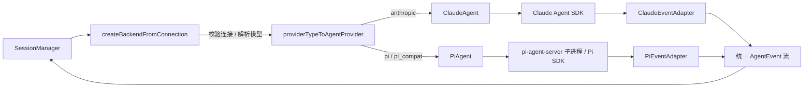
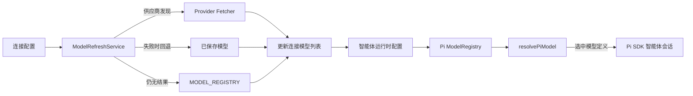
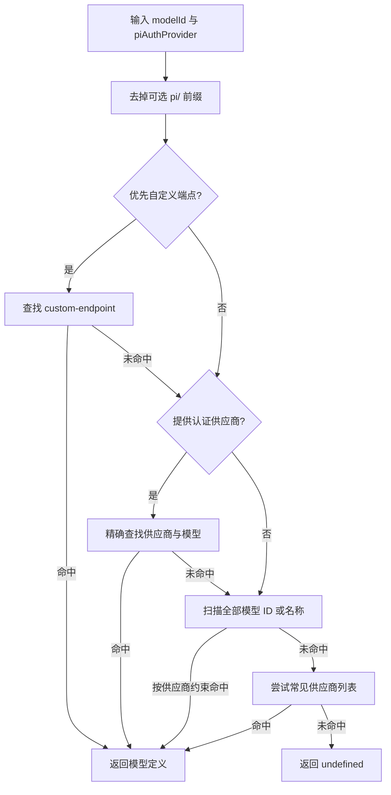

本页先解释 Claude 与 Pi 两个 Agent 后端怎样通过统一接口接入会话运行时，再说明 Pi 后端内部的模型解析、模型列表刷新和自定义端点能力。这里的“后端”指 Agent 执行实现；Pi 后端还能经 Pi SDK 接入多种模型供应商，因此不要把 Agent 后端数量和底层模型供应商数量混为一谈。会话生命周期、凭据配置和工具权限分别见[会话生命周期、消息流与持久化](15-hui-hua-sheng-ming-zhou-qi-xiao-xi-liu-yu-chi-jiu-hua)、[工作区配置、凭据管理与 OAuth 流程](19-gong-zuo-qu-pei-zhi-ping-ju-guan-li-yu-oauth-liu-cheng)和[工具注册、权限模式与安全执行](16-gong-ju-zhu-ce-quan-xian-mo-shi-yu-an-quan-zhi-xing)。Sources: [factory.ts](packages/shared/src/agent/backend/factory.ts#L132-L145), [model-resolution.ts](packages/pi-agent-server/src/model-resolution.ts#L1-L15)

## 统一契约：AgentBackend 隔离 SDK 差异

`AgentBackend` 定义会话层使用的公共操作，例如流式 `chat`、中断与重定向、初始化和资源释放。`BaseAgent` 实现跨后端复用的会话工具上下文、权限模式、来源管理、规划逻辑、配置监听和用量跟踪；`ClaudeAgent` 与 `PiAgent` 在此基础上分别接入 Claude Agent SDK 和 Pi 运行时。Sources: [types.ts](packages/shared/src/agent/backend/types.ts#L329-L355), [base-agent.ts](packages/shared/src/agent/base-agent.ts#L145-L162), [claude-agent.ts](packages/shared/src/agent/claude-agent.ts#L464-L488), [pi-agent.ts](packages/shared/src/agent/pi-agent.ts#L145-L158)

两个 SDK 的事件格式不同，后端各自用事件适配器将其转换成 `@craft-agent/core` 的 `AgentEvent`。会话管理器因此可以消费一致的事件流，而无需在通用会话代码里解析 Claude 或 Pi 的原生事件。Pi 客户端还通过 JSONL 子进程与 `pi-agent-server` 通信；这是 Pi 的运行边界，不是所有 Agent 后端共有的通信方式。Sources: [Claude 事件适配器](packages/shared/src/agent/backend/claude/event-adapter.ts#L91-L105), [Pi 事件适配器](packages/shared/src/agent/backend/pi/event-adapter.ts#L1-L15), [PiAgent](packages/shared/src/agent/pi-agent.ts#L1066-L1112), [Pi 后端模块](packages/shared/src/agent/backend/pi/index.ts#L1-L13)

连接工厂会校验供应商与认证方式的组合，解析连接对应的模型和能力，再根据宿主运行时构造配置并调用 `createBackend`。当前后端映射只有 `anthropic -> ClaudeAgent` 与 `pi` / `pi_compat -> PiAgent`；`pi` 是 Agent 执行后端标识，不代表只能调用 Pi 自有模型。Sources: [SessionManager.ts](packages/server-core/src/sessions/SessionManager.ts#L4962-L4971), [factory.ts](packages/shared/src/agent/backend/factory.ts#L132-L145), [factory.ts](packages/shared/src/agent/backend/factory.ts#L251-L267), [factory.ts](packages/shared/src/agent/backend/factory.ts#L528-L574)

## 架构关系：列表刷新与 Pi 模型解析是两条路径

**模型列表刷新**由 `server-core` 中的 `ModelRefreshService` 管理：它为可抓取的连接请求供应商模型，必要时回退到已持久化列表或静态注册表，并更新连接配置。**模型解析**发生在 Pi 智能体服务一侧：它根据模型 ID、认证供应商和自定义端点优先级，从 Pi SDK 的 `ModelRegistry` 中选出具体定义。前者维护“有哪些模型可选”，后者决定“当前请求使用哪一个模型定义”。Sources: [index.ts](packages/server-core/src/model-fetchers/index.ts#L1-L14), [index.ts](packages/server-core/src/model-fetchers/index.ts#L33-L44), [model-resolution.ts](packages/pi-agent-server/src/model-resolution.ts#L16-L61)

图中刷新服务只对非兼容型供应商执行抓取；兼容型供应商由用户手动配置模型，因此不会进入该抓取链。图示展示的是代码中的职责关系，不代表模型请求的完整会话或消息流程。Sources: [index.ts](packages/server-core/src/model-fetchers/index.ts#L53-L87), [registry.ts](packages/server-core/src/model-fetchers/registry.ts#L1-L26)

## 模型列表刷新：实时发现优先，离线数据兜底

刷新服务通过类型化的 `MODEL_FETCHERS` 映射为 `anthropic` 和 `pi` 提供 fetcher。执行 `refreshConnection` 时，同一连接 slug 的并发请求共享进行中的 Promise，避免重复抓取。连接不存在、属于兼容型供应商，或没有对应 fetcher 时，服务会记录警告或直接跳过。Sources: [registry.ts](packages/server-core/src/model-fetchers/registry.ts#L9-L26), [index.ts](packages/server-core/src/model-fetchers/index.ts#L33-L80)

实际刷新依次尝试**供应商 API/SDK、连接中已保存的模型列表、静态 `MODEL_REGISTRY` 数据**。如果在线抓取失败但连接已有模型，服务保留旧列表并结束本次刷新；若旧列表也不可用，则查询静态注册表。所有来源均无可用模型时，不更新连接。Sources: [index.ts](packages/server-core/src/model-fetchers/index.ts#L82-L121)

当模型列表准备更新时，服务保留仍存在于新列表中的 `defaultModel`；否则依次采用 fetcher 提供的 `serverDefault`，或新列表中的第一个模型。Pi 连接若使用 `userDefined3Tier`，后台刷新会保留用户管理的列表；`github-copilot` 是例外，因为其模型列表由服务端策略管理。Sources: [index.ts](packages/server-core/src/model-fetchers/index.ts#L123-L155)

| 情况 | 行为 |
|---|---|
| 在线抓取成功 | 使用供应商返回的模型列表与可选服务端默认值。 |
| 在线抓取失败，但已保存列表非空 | 保留已有列表，本次不更新。 |
| 没有可用的已保存列表 | 尝试静态 `MODEL_REGISTRY`。 |
| 列表更新且当前默认模型仍有效 | 保留当前默认模型。 |
| 列表更新且当前默认模型无效 | 选择服务端默认值，否则选择首个模型。 |
| Pi 用户自定义三层模型列表 | 普通 Pi 连接不被后台列表覆盖；Copilot 例外。 |

Sources: [index.ts](packages/server-core/src/model-fetchers/index.ts#L82-L155)

## Pi 模型解析：按优先级消除歧义

`resolvePiModel` 将传入模型 ID 开头的 `pi/` 前缀去掉，因为 Pi SDK 注册表使用不带此前缀的 ID。若设置了 `preferCustomEndpoint`，解析会先尝试 `custom-endpoint`；之后在已知 `piAuthProvider` 时优先做精确的“供应商 + 模型 ID”查找，避免同一 ID 存在于多个供应商时选错路由。Sources: [model-resolution.ts](packages/pi-agent-server/src/model-resolution.ts#L16-L41)

精确查找未命中时，函数扫描注册表全部模型，按 ID 或名称匹配；如果指定了认证供应商，扫描结果仅接受该供应商或 `custom-endpoint`。最后再检查常见供应商顺序 `custom-endpoint`、`anthropic`、`openai`、`google`，且继续遵守认证供应商限制。全部未命中则返回 `undefined`。Sources: [model-resolution.ts](packages/pi-agent-server/src/model-resolution.ts#L43-L61)

解析器还处理一个供应商特例：当认证供应商为 `minimax-cn`，且精确命中的模型 ID 以 `MiniMax-` 开头，会返回去掉该前缀后的 ID。测试覆盖了自定义端点优先级、认证供应商精确匹配、`pi/` 前缀去除及常见供应商回退。Sources: [model-resolution.ts](packages/pi-agent-server/src/model-resolution.ts#L32-L40), [model-resolution.test.ts](packages/pi-agent-server/src/model-resolution.test.ts#L27-L95), [model-resolution.test.ts](packages/pi-agent-server/src/model-resolution.test.ts#L98-L126)

## 自定义端点：合成模型定义与能力声明

自定义端点模型配置既可使用字符串 ID，也可使用包含 `id`、`contextWindow` 和 `supportsImages` 的对象。规范化函数统一去除 `pi/` 前缀，并保留明确设置的能力覆盖值；显式的 `supportsImages: false` 不会被丢弃，因此可覆盖端点级的图像支持默认值。Sources: [custom-endpoint-models.ts](packages/pi-agent-server/src/custom-endpoint-models.ts#L1-L33)

由于端点实际能力无法通过此处的注册逻辑查询，`buildCustomEndpointModelDef` 会构造合成定义：默认上下文窗口为 131,072，最大输出 token 为 8,192，推理标记为 `false`，各项费用为 0。图像输入仅在模型级或端点级明确启用时纳入 `input`；否则定义只声明文本输入。Sources: [custom-endpoint-models.ts](packages/pi-agent-server/src/custom-endpoint-models.ts#L35-L58)

| 字段 | 规则 |
|---|---|
| `id` | 删除可选的 `pi/` 前缀。 |
| `contextWindow` | 使用模型级覆盖值；未提供时为 `131_072`。 |
| `supportsImages` | 模型级值优先于端点默认值；两者均未设置时为 `false`。 |
| `input` | 始终包含 `text`；仅图像支持为真时增加 `image`。 |
| `maxTokens` | 合成定义固定为 `8_192`。 |

Sources: [custom-endpoint-models.ts](packages/pi-agent-server/src/custom-endpoint-models.ts#L14-L33), [custom-endpoint-models.ts](packages/pi-agent-server/src/custom-endpoint-models.ts#L35-L58)

## Mini 模型选择与模型不可用判断

默认 mini 模型不能脱离认证供应商单独决定：首选列表来自 `PI_PREFERRED_DEFAULTS[authProvider]`。`pickProviderAppropriateMiniModel` 按列表顺序跳过被拒绝的候选项，并通过同一 `resolvePiModel` 检查候选是否能在当前注册表和自定义端点优先级下解析；返回首个命中的候选。没有可用候选时返回 `undefined`，调用方可回退至 `getDefaultSummarizationModel()`。Sources: [pick-mini-model.ts](packages/pi-agent-server/src/pick-mini-model.ts#L1-L36)

`isModelNotFoundError` 将错误消息转为小写，并检查 `model_not_found`、`does not exist`、`no such model`、`is not supported` 等文本特征，以识别请求模型不可用的错误形态。它返回的是布尔判断；是否切换模型由调用方决定。Sources: [model-resolution.ts](packages/pi-agent-server/src/model-resolution.ts#L64-L79)

## 阅读边界与后续导航

模型运行时签名会区分必须重建后端的字段与可通过运行时配置更新的字段：重启必需签名包含 provider、认证类型、连接 slug、供应商类型和 `piAuthProvider`；兼容型连接的运行时签名还纳入端点设置及规范化后的模型列表。这用于判断既有运行时配置变化是否需要重建，不等同于模型注册表查找本身。Sources: [runtime-config.ts](packages/server-core/src/sessions/runtime-config.ts#L1-L75)

继续阅读可前往[会话生命周期、消息流与持久化](15-hui-hua-sheng-ming-zhou-qi-xiao-xi-liu-yu-chi-jiu-hua)，了解模型选择进入会话后的运行过程；或查看[工作区配置、凭据管理与 OAuth 流程](19-gong-zuo-qu-pei-zhi-ping-ju-guan-li-yu-oauth-liu-cheng)，了解连接与认证配置。Sources: [runtime-config.ts](packages/server-core/src/sessions/runtime-config.ts#L1-L75)
