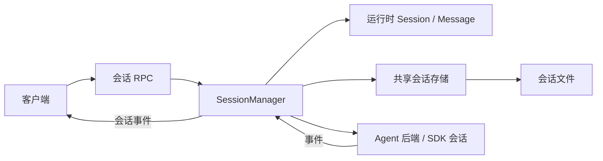
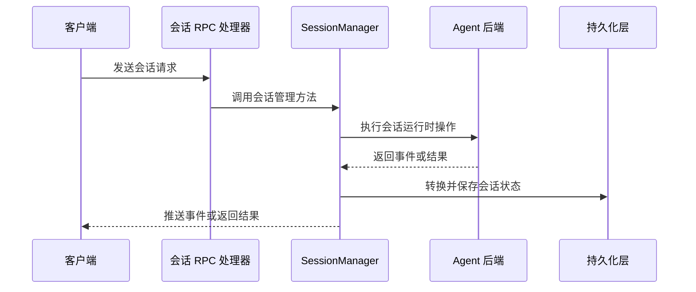

会话是对话状态的隔离边界：每个会话关联一个工作区，并可在首次消息后关联智能体 SDK 会话。运行时消息与磁盘存储消息并非同一表示；理解这两层之间的转换，以及会话创建、分支和 RPC 访问的边界，是分析生命周期与恢复行为的基础。本页聚焦这些可从代码确认的路径，不展开模型解析、工具权限或传输协议本身。 Sources: [session.ts](packages/core/src/types/session.ts#L1-L61), [SessionManager.ts](packages/server-core/src/sessions/SessionManager.ts#L1-L16)

## 核心对象与边界

`Session` 描述会话的身份及会话列表所需状态，例如 `id`、`workspaceId`、时间戳、归档标记和读取位置；`StoredSession` 在其上增加消息数组和 token 用量。另有 `SessionMetadata` 面向列表场景，包含消息数量与预览等字段，因此“会话列表条目”和“完整会话内容”是不同的数据形态。源码注释明确指出，会话与 CraftAgent 实例及 SDK 对话一一对应；SDK 会话 ID 可以尚未存在。 Sources: [session.ts](packages/core/src/types/session.ts#L1-L61)

图中表达的是代码可见的职责关系：RPC 会话处理器调用 `SessionManager`，而 `SessionManager` 导入共享会话持久化 API、消息映射函数及智能体后端接口。图示不表示所有消息事件的具体时序；此处只描述模块边界。 Sources: [sessions.ts](packages/server-core/src/handlers/rpc/sessions.ts#L1-L20), [SessionManager.ts](packages/server-core/src/sessions/SessionManager.ts#L1-L15)

## 创建、加载与分支

创建会话时，`SessionManager.createSession` 先解析工作区；工作区不存在时抛出错误。随后从调用参数、工作区配置和全局默认值解析权限模式、思考级别、模型和来源配置等创建上下文，并进一步解析工作目录与后端目标。最终由共享存储层的 `createSession` 创建并持久化会话。由此可见，创建不是单纯在内存中分配对象，而是以工作区配置为输入并进入持久化层。 Sources: [SessionManager.ts](packages/server-core/src/sessions/SessionManager.ts#L2461-L2525), [SessionManager.ts](packages/server-core/src/sessions/SessionManager.ts#L2721-L2730)

分支创建会先验证源会话、分支消息位置及分支上下文策略，再创建新的存储会话。实现将源消息复制到分支点（包含该消息），记录源消息 ID；若采用 SDK fork 策略，还会保存对应的 SDK 会话、路径、工作目录和 turn 锚点信息。复制过程中还会把嵌入消息的源会话目录路径替换为新分支目录路径，然后保存分支会话。特定 Pi 分支还会尝试传播 turn-anchor sidecar，以支持后续分支继续解析锚点。 Sources: [SessionManager.ts](packages/server-core/src/sessions/SessionManager.ts#L2721-L2785)

## 消息表示与持久化转换

运行时 `Message` 使用 `role` 字段；持久化 `StoredMessage` 使用 `type` 字段。`messageToStored` 将 `role` 映射为 `type`，并剔除仅供运行时使用的 `isStreaming`、`isPending` 字段；`storedToMessage` 执行反向映射，并在旧数据缺少时间戳时以当前时间补齐。这个映射层明确区分了可持久化内容与临时 UI/运行时状态。 Sources: [message-mapper.ts](packages/core/src/types/message-mapper.ts#L1-L24)

该图是模块交互概览，而非对每次发送消息都必然执行相同持久化步骤的断言。现有材料能确认管理器同时依赖 Agent 事件类型、会话存储 API 与消息转换函数；精确的发送消息逐步时序应以具体处理分支为准。 Sources: [SessionManager.ts](packages/server-core/src/sessions/SessionManager.ts#L1-L15), [message-mapper.ts](packages/core/src/types/message-mapper.ts#L1-L24)

## RPC 访问与按需读取

RPC 会话处理器提供会话列表、单个会话消息读取、创建、删除及发送消息等通道。列表查询会等待 `sessionManager.waitForInit()`，随后依据请求上下文或窗口工作区确定筛选范围，并调用 `getSessions`。单会话消息读取则调用 `getSession(sessionId)`，对应注释所述的延迟加载路径：列表不必先载入完整消息，客户端需要内容时再读取。 Sources: [sessions.ts](packages/server-core/src/handlers/rpc/sessions.ts#L79-L115), [sessions.ts](packages/server-core/src/handlers/rpc/sessions.ts#L145-L179)

| 访问路径 | RPC 层行为 | 会话管理边界 |
|---|---|---|
| 获取列表 | 等待初始化，解析工作区范围后读取会话列表 | `getSessions` |
| 获取消息 | 以会话 ID 请求完整会话 | `getSession` |
| 创建会话 | 传入工作区 ID 与可选创建参数 | `createSession` |
| 删除会话 | 传入会话 ID | `deleteSession` |

此表归纳 RPC handler 中可见的调用关系；它不代表存储格式或所有操作的错误语义。 Sources: [sessions.ts](packages/server-core/src/handlers/rpc/sessions.ts#L79-L115), [sessions.ts](packages/server-core/src/handlers/rpc/sessions.ts#L145-L179)

## 阅读路径

要继续追踪会话状态如何抵达客户端，可阅读 [RPC 通道、WebSocket 传输与推送事件](13-rpc-tong-dao-websocket-chuan-shu-yu-tui-song-shi-jian)；若要研究 Agent 后端及模型连接如何参与运行时执行，可阅读 [多模型智能体后端与模型解析](14-duo-mo-xing-zhi-neng-ti-hou-duan-yu-mo-xing-jie-xi)。 Sources: [sessions.ts](packages/server-core/src/handlers/rpc/sessions.ts#L79-L115), [SessionManager.ts](packages/server-core/src/sessions/SessionManager.ts#L1-L15)