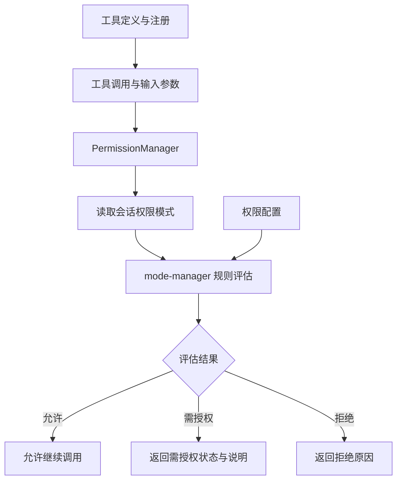

本页聚焦智能体工具的权限控制边界：**权限模式决定调用如何被评估，集中式权限管理器统一执行评估，工具定义则提供可用能力的入口**。重点在权限语义与安全检查，不展开会话生命周期或文件系统沙箱；后者见[会话工具沙箱、文件系统隔离与网络安全](18-hui-hua-gong-ju-sha-xiang-wen-jian-xi-tong-an-quan)。Sources: [mode-manager.ts](packages/shared/src/agent/mode-manager.ts#L1-L40) [permission-manager.ts](packages/shared/src/agent/core/permission-manager.ts#L1-L25)

## 权限控制的分层关系

工具权限不是单一的“允许/拒绝”开关。仓库将模式状态、工具调用评估以及具体执行边界拆为不同层：`PermissionManager` 面向智能体后端提供统一评估入口，并委托 `mode-manager` 执行模式规则；权限配置可以为特定命令、MCP 工具、API 端点及写入路径提供额外规则。Sources: [permission-manager.ts](packages/shared/src/agent/core/permission-manager.ts#L1-L25) [permissions-config.ts](packages/shared/src/agent/permissions-config.ts#L1-L18) [mode-types.ts](packages/shared/src/agent/mode-types.ts#L92-L132)



该图表示权限评估关系，而非某个具体后端的完整执行时序。`PermissionManager.evaluateToolCall` 根据当前会话模式调用 `shouldAllowToolInMode`，并把允许、需授权、拒绝三类结果转换为 `ToolPermissionResult`；配置上下文以当前工作目录构造。Sources: [permission-manager.ts](packages/shared/src/agent/core/permission-manager.ts#L70-L146)

## 模式语义与兼容名称

内部模式键为 `safe`、`ask`、`allow-all`，面向用户和会话状态的规范名称分别是 `explore`、`ask`、`execute`。解析函数也接受旧别名，包括 `ask-to-edit`、`ask_to_edit` 和 `ask to edit`；因此调用方若处理存储值或外部输入，应通过解析/映射逻辑而不是假设名称完全一致。Sources: [mode-types.ts](packages/shared/src/agent/mode-types.ts#L14-L61)

| 内部键 | 规范名称 | 可验证语义 |
|---|---|---|
| `safe` | `explore` | 只读探索模式；核心写入工具受阻，且该模式不提示用户授权。 |
| `ask` | `ask` | 危险操作按权限规则请求授权。 |
| `allow-all` | `execute` | 跳过常规权限检查，允许全部操作。 |

模式定义的语义及 UI 名称映射由 `mode-types.ts` 声明；`PermissionManager.checkBashCommand` 也明确对 `allow-all` 直接放行、对 `ask` 返回无拒绝原因，而 `safe` 才进入只读命令规则检查。Sources: [mode-manager.ts](packages/shared/src/agent/mode-manager.ts#L1-L15) [mode-types.ts](packages/shared/src/agent/mode-types.ts#L14-L40) [permission-manager.ts](packages/shared/src/agent/core/permission-manager.ts#L159-L184)

模式状态按会话 ID 组织，记录当前与先前模式、递增版本、变更时间、变更来源，以及可选状态变更回调。该数据结构明确体现模式状态的会话作用域，而不是一个跨会话共享的全局当前模式。Sources: [mode-manager.ts](packages/shared/src/agent/mode-manager.ts#L65-L90)

## 工具权限评估与授权结果

`PermissionManager` 是 Claude 与 Pi 等后端可以复用的集中式检查接口。调用方传入工具名和参数，评估结果以 `allowed` 为基础；允许结果还可能带 `requiresPermission` 与说明文本，拒绝结果则包含 `reason`。因此，“可以继续执行”与“无需用户批准”不是同一个状态，调用方必须检查需授权字段，而不能只判断 `allowed`。Sources: [permission-manager.ts](packages/shared/src/agent/core/permission-manager.ts#L1-L12) [permission-manager.ts](packages/shared/src/agent/core/permission-manager.ts#L92-L146)

```text
evaluateToolCall(toolName, toolInput)
  ├─ 读取当前会话模式
  ├─ 调用 shouldAllowToolInMode(...)
  ├─ allowed + requiresPermission → 返回需授权及说明
  ├─ allowed → 返回允许
  └─ not allowed → 返回拒绝原因
```

评估时传给模式逻辑的上下文包含计划目录、数据目录和工作区权限上下文；权限上下文中的 `workspaceRootPath` 来自管理器配置的工作目录。评估允许或拒绝时均会记录会话、模式及工具相关信息；拒绝日志还包含原因和输入参数。Sources: [permission-manager.ts](packages/shared/src/agent/core/permission-manager.ts#L54-L68) [permission-manager.ts](packages/shared/src/agent/core/permission-manager.ts#L92-L146)

## 可配置规则与安全边界

权限配置 schema 支持 Bash 命令正则、MCP 工具正则、API 方法与路径规则、Explore 模式写入路径、附加阻止工具，以及针对被阻止命令的提示信息。配置注释明确指出：核心写入工具 `Write`、`Edit`、`MultiEdit`、`NotebookEdit` 在安全模式配置中硬编码阻止；`blockedTools` 用于在默认阻止项之外继续增加限制。Sources: [mode-types.ts](packages/shared/src/agent/mode-types.ts#L92-L132)

配置文件可来自应用默认权限、工作区权限及来源级权限；自定义规则用于扩展默认规则，文档注释说明其规则是附加式且更宽松。默认权限安装逻辑支持首次安装、无效文件修复及版本迁移；迁移时会合并新增 Bash/MCP 模式与阻止提示，并对已有内容去重。Sources: [permissions-config.ts](packages/shared/src/agent/permissions-config.ts#L1-L18) [permissions-config.ts](packages/shared/src/agent/permissions-config.ts#L35-L153)

文件路径检查不仅处理模式匹配，也考虑路径规范化、目录边界与符号链接：`mode-manager` 中的实现先用 `path.relative` 语义判断目录包含关系，再对存在的路径解析真实路径，以防止符号链接越界。此处是权限模式实现中的路径检查；更全面的沙箱隔离边界见[会话工具沙箱、文件系统隔离与网络安全](18-hui-hua-gong-ju-sha-xiang-wen-jian-xi-tong-an-quan)。Sources: [mode-manager.ts](packages/shared/src/agent/mode-manager.ts#L103-L171)

对于 Bash，`PermissionManager` 提供专门的命令检查入口：`allow-all` 不检查，`ask` 不在该方法中直接拒绝，`safe` 则读取合并后的权限配置并查询拒绝原因。另有一组危险命令集合，源码注释说明这些命令在 `ask` 模式下始终需要授权，不因用户配置而自动放行。Sources: [permission-manager.ts](packages/shared/src/agent/core/permission-manager.ts#L32-L46) [permission-manager.ts](packages/shared/src/agent/core/permission-manager.ts#L159-L184)

## 工具注册与执行接入点

本仓库的工具实现分布于共享智能体层与会话工具包：共享智能体目录包含会话级工具定义、回调注册表和后端适配器；`session-tools-core` 提供工具定义、过滤逻辑、验证器及处理器。由这些模块边界可确认工具定义与运行处理逻辑并非集中在单一文件，但具体注册顺序和各后端如何逐项安装工具，应以相应后端实现为准。Sources: [session-scoped-tools.ts](packages/shared/src/agent/session-scoped-tools.ts#L1-L1) [session-scoped-tool-callback-registry.ts](packages/shared/src/agent/session-scoped-tool-callback-registry.ts#L1-L1) [tool-defs.ts](packages/session-tools-core/src/tool-defs.ts#L1-L1) [index.ts](packages/session-tools-core/src/index.ts#L1-L1)

`PermissionManager` 文档将工具检查设计为后端调用工具前可复用的入口，但仅凭该接口定义不能推断所有工具均由同一注册函数接入，或所有后端都以完全相同的时序调用权限检查。维护新工具时，应分别核对工具定义/过滤逻辑、后端注册代码及调用前检查路径；不要将“工具已注册”误认为“执行已获授权”。Sources: [permission-manager.ts](packages/shared/src/agent/core/permission-manager.ts#L28-L52) [tool-defs.ts](packages/session-tools-core/src/tool-defs.ts#L1-L1) [session-scoped-tools.ts](packages/shared/src/agent/session-scoped-tools.ts#L1-L1)

## 阅读边界

本页解释模式与权限评估如何约束工具调用，不覆盖工具沙箱的文件系统、网络隔离实现；该主题见[会话工具沙箱、文件系统隔离与网络安全](18-hui-hua-gong-ju-sha-xiang-wen-jian-xi-tong-an-quan)。技能、来源与 MCP 服务的发现和生命周期则属于[技能、来源连接与 MCP 服务管理](17-ji-neng-lai-yuan-lian-jie-yu-mcp-fu-wu-guan-li)。Sources: [mode-manager.ts](packages/shared/src/agent/mode-manager.ts#L1-L15) [tool-defs.ts](packages/session-tools-core/src/tool-defs.ts#L1-L1)