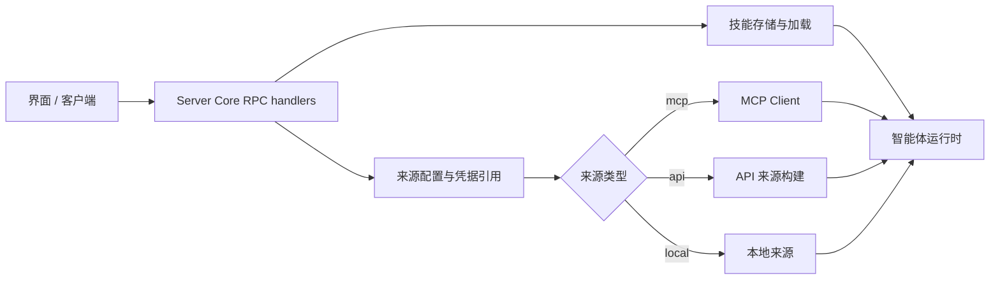

本页聚焦三类彼此关联、但职责不同的扩展机制：**技能**为智能体提供可复用的指令；**来源**描述工作区可连接的外部服务或数据；**MCP 客户端**负责与 MCP 服务建立连接并发现、调用工具。它们通过共享层存储与处理，再由服务器 RPC 提供给界面或会话运行时。本文不展开工具权限策略、凭据/OAuth 的通用机制或会话工具沙箱。  
Sources: [skills/storage.ts](packages/shared/src/skills/storage.ts#L65-L95), [sources/types.ts](packages/shared/src/sources/types.ts#L1-L16), [client.ts](packages/shared/src/mcp/client.ts#L1-L10)

## 概念关系与模块边界

从架构上看，技能、来源配置和 MCP 连接分别解决“智能体遵循什么指引”“有哪些外部能力可用”以及“如何与 MCP 服务通信”。来源不必然是 MCP：类型还包括 API 和本地来源；只有 MCP 类型来源才会走 MCP 客户端路径。  
Sources: [sources/types.ts](packages/shared/src/sources/types.ts#L1-L27), [sources.ts](packages/server-core/src/handlers/rpc/sources.ts#L151-L173)

共享层负责文件格式、加载与连接抽象；`server-core` 将这些能力封装为 RPC；智能体侧的 `SourceManager` 跟踪来源的实际启用状态与界面意图状态，并可格式化来源状态供上下文使用。  
Sources: [skills.ts](packages/server-core/src/handlers/rpc/skills.ts#L16-L34), [sources.ts](packages/server-core/src/handlers/rpc/sources.ts#L21-L47), [source-manager.ts](packages/shared/src/agent/core/source-manager.ts#L40-L47), [source-manager.ts](packages/shared/src/agent/core/source-manager.ts#L64-L84)

## 技能：文件格式、来源优先级与加载

技能以目录形式存放，每个技能目录通过 `SKILL.md` 提供内容与 YAML frontmatter 元数据。解析器要求 `name` 和 `description` 存在；可选字段包括 `globs`、`alwaysAllow`、图标和 `requiredSources`。`requiredSources` 接受单个字符串或字符串数组，并会去除空白、过滤非字符串及重复项。  
Sources: [skills/storage.ts](packages/shared/src/skills/storage.ts#L38-L59), [skills/storage.ts](packages/shared/src/skills/storage.ts#L65-L95)

`loadAllSkills(workspaceRoot, projectRoot?)` 汇总全局、工作区和项目技能；同一 slug 冲突时，项目覆盖工作区，工作区覆盖全局。结果以 `(workspaceRoot, projectRoot)` 为键缓存，安全 TTL 为五分钟；实现也提供 `invalidateSkillsCache()`，供工作目录变化或技能文件事件触发失效。  
Sources: [skills/storage.ts](packages/shared/src/skills/storage.ts#L192-L203), [skills/storage.ts](packages/shared/src/skills/storage.ts#L205-L247)

| 层级 | 目录 | 冲突优先级 |
|---|---|---:|
| 全局 | `~/.agents/skills/` | 最低 |
| 工作区 | 工作区的 skills 目录 | 中 |
| 项目 | `{projectRoot}/.agents/skills/` | 最高 |

Sources: [skills/storage.ts](packages/shared/src/skills/storage.ts#L32-L36), [skills/storage.ts](packages/shared/src/skills/storage.ts#L205-L242)

技能 RPC 根据 workspace 标识解析工作区，再调用 `loadAllSkills`。传入的 `workingDirectory` 只有在服务器本机存在时才会作为项目目录使用；远程客户端传来的本地路径若在服务器端不存在，会被忽略。技能文件列表接口只枚举技能目录内非隐藏项，并按目录优先、名称排序。  
Sources: [skills.ts](packages/server-core/src/handlers/rpc/skills.ts#L16-L34), [skills.ts](packages/server-core/src/handlers/rpc/skills.ts#L36-L83)

## 来源：工作区范围的配置对象

来源是工作区范围的外部连接配置，存放在工作区的 `sources/{sourceSlug}/` 目录中，主要文件为 `config.json`，并可配有 `guide.md`。配置类型区分 `mcp`、`api` 与 `local`；MCP 来源的认证类型定义为 `oauth`、`bearer` 或 `none`。保存配置时会先验证；本地来源路径在读取时展开，在写入时转换为可移植路径。  
Sources: [sources/types.ts](packages/shared/src/sources/types.ts#L1-L27), [sources/storage.ts](packages/shared/src/sources/storage.ts#L1-L9), [sources/storage.ts](packages/shared/src/sources/storage.ts#L64-L85), [sources/storage.ts](packages/shared/src/sources/storage.ts#L113-L142)

RPC 提供来源读取、创建与删除等操作。创建时默认名称为 `New Source`、provider 为 `custom`、类型为 `mcp`，且默认启用；删除来源后，处理器还会从工作区默认启用来源列表中清理对应 slug，避免留下失效引用。  
Sources: [sources.ts](packages/server-core/src/handlers/rpc/sources.ts#L24-L47), [sources.ts](packages/server-core/src/handlers/rpc/sources.ts#L50-L64)

| 来源类型 | 作用 | MCP 客户端 |
|---|---|---|
| `mcp` | 连接 MCP 服务并获取工具 | 使用 |
| `api` | 由 API 来源逻辑提供能力 | 不经 MCP 客户端 |
| `local` | 描述本地来源 | 不经 MCP 客户端 |

Sources: [sources/types.ts](packages/shared/src/sources/types.ts#L13-L27), [sources.ts](packages/server-core/src/handlers/rpc/sources.ts#L151-L173)

## MCP：传输、健康检查与工具发现

`CraftMcpClient` 基于官方 MCP SDK，支持两种传输：`stdio` 通过命令启动本地子进程，HTTP 通过 Streamable HTTP transport 连接远程服务。`connect()` 建立连接后会调用 `listTools()` 做健康检查；检查失败时关闭客户端并抛出连接失败错误。后续列举或调用工具时，若尚未连接，会先连接。  
Sources: [client.ts](packages/shared/src/mcp/client.ts#L1-L10), [client.ts](packages/shared/src/mcp/client.ts#L12-L34), [client.ts](packages/shared/src/mcp/client.ts#L111-L163)

stdio 客户端将进程环境与来源显式提供的环境合并，但先从继承环境中过滤一组敏感变量，例如部分模型服务密钥、AWS 凭据和 GitHub token。这里的过滤针对继承的 `process.env`；配置中显式传入的 `config.env` 随后合并。  
Sources: [client.ts](packages/shared/src/mcp/client.ts#L37-L60), [client.ts](packages/shared/src/mcp/client.ts#L83-L107)

来源的 MCP 工具查询 RPC 会先确认工作区、来源存在、来源类型为 MCP 且 MCP 配置存在，再根据连接状态拒绝尚未测试、认证缺失或连接失败的来源。stdio 配置要求 `command`；HTTP/SSE 路径要求 URL。对于 OAuth 或 bearer 类型，处理器按工作区与来源标识读取对应凭据，再构造客户端。  
Sources: [sources.ts](packages/server-core/src/handlers/rpc/sources.ts#L151-L173), [sources.ts](packages/server-core/src/handlers/rpc/sources.ts#L176-L200)

| 环节 | 可验证行为 |
|---|---|
| 连接 | HTTP 使用 URL 与请求头；stdio 使用 command、args、env |
| 健康检查 | 连接后执行工具列表请求 |
| 失败处理 | 健康检查异常时关闭客户端并报错 |
| 工具操作 | 支持列出工具、调用工具与关闭连接 |

Sources: [client.ts](packages/shared/src/mcp/client.ts#L12-L34), [client.ts](packages/shared/src/mcp/client.ts#L111-L163)

## 来源状态如何进入智能体上下文

`SourceManager` 分别保存实际活动来源和预期活动来源：实际状态由运行中的 MCP/API 服务名称组成；预期状态可以来自 UI，即使来源构建失败也能保留“用户希望启用”的信息。格式化状态时，预期启用但没有可用工具的来源会标记为 `no tools`；已启用来源若连接状态为 `needs_auth` 或 `failed`，会进入需要关注的集合。  
Sources: [source-manager.ts](packages/shared/src/agent/core/source-manager.ts#L40-L47), [source-manager.ts](packages/shared/src/agent/core/source-manager.ts#L57-L84), [source-manager.ts](packages/shared/src/agent/core/source-manager.ts#L153-L199)

这一区分有助于排查“界面显示启用但工具不可用”的情况：检查预期启用来源是否也出现在实际活动集合，并检查该来源的连接状态。`SourceManager` 还记录本会话中已介绍过的来源，用于控制来源介绍文本是否重复出现。  
Sources: [source-manager.ts](packages/shared/src/agent/core/source-manager.ts#L86-L147), [source-manager.ts](packages/shared/src/agent/core/source-manager.ts#L163-L185)

## 阅读路径

理解本页后，可继续阅读 [工具注册、权限模式与安全执行](16-gong-ju-zhu-ce-quan-xian-mo-shi-yu-an-quan-zhi-xing)，了解工具如何进入智能体执行与权限控制；若关注来源凭据及 OAuth 生命周期，可参阅 [工作区配置、凭据管理与 OAuth 流程](19-gong-zuo-qu-pei-zhi-ping-ju-guan-li-yu-oauth-liu-cheng)。