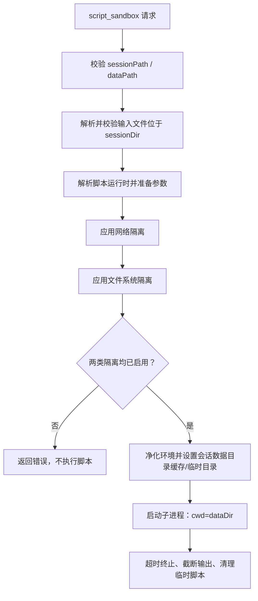

本页聚焦会话工具中的脚本执行边界：输入文件如何限定在会话目录内、子进程如何获得文件系统与网络隔离，以及隔离不可用时执行器如何拒绝运行。这里描述的是 `script_sandbox` 的实际实现，不将它等同于覆盖所有会话工具的通用沙箱。  
Sources: [script-sandbox.ts](packages/session-tools-core/src/handlers/script-sandbox.ts#L1-L48)

## 安全边界由多层措施组成

脚本安全不是单一的路径检查或运行时包装，而是由**输入路径校验、操作系统隔离、子进程环境净化和执行资源限制**共同构成。路径校验约束输入文件的位置；平台后端负责限制脚本对文件系统及网络的访问；环境净化减少凭据泄露；超时和输出截断限制执行时间与返回内容规模。执行器要求网络与文件系统隔离均已启用，否则返回错误，不会按未隔离模式继续执行。  
Sources: [script-sandbox.ts](packages/session-tools-core/src/handlers/script-sandbox.ts#L24-L48) [script-sandbox.ts](packages/session-tools-core/src/handlers/script-sandbox.ts#L62-L116) [sandbox-env.ts](packages/session-tools-core/src/runtime/sandbox-env.ts#L1-L80)

## 文件系统隔离：只允许会话目录写入

`applyFilesystemIsolation` 按操作系统选择后端。macOS 使用经探测可用的 `sandbox-exec`，配置默认拒绝规则，并允许读取文件、进程相关操作及对当前会话目录的写入；Linux 优先使用 `bwrap`，将根文件系统只读绑定并将会话目录作为可写绑定，若不可用则尝试 Firejail。未找到可用后端时返回 `unavailable`，而不是宣称已隔离。  
Sources: [filesystem-isolation.ts](packages/session-tools-core/src/runtime/filesystem-isolation.ts#L1-L30) [filesystem-isolation.ts](packages/session-tools-core/src/runtime/filesystem-isolation.ts#L32-L126)

| 平台 / 后端 | 文件系统策略 | 代码中的降级或失败行为 |
|---|---|---|
| macOS `sandbox-exec` | 默认拒绝；允许文件读取；仅放行会话目录写入 | 探测不可用则继续查找其他平台适用后端，最终可能返回 `unavailable` |
| Linux `bwrap` | 根目录只读绑定；会话目录可写绑定；提供 `/proc` 与 `/dev` | 优先于 Firejail |
| Linux Firejail | 使用 `--private` 和会话目录白名单参数 | 仅在 `bwrap` 不可用时尝试 |
| 其他情形 | 无已实现的文件系统隔离后端 | 返回 `unavailable`；`script_sandbox` 拒绝执行 |

Sources: [filesystem-isolation.ts](packages/session-tools-core/src/runtime/filesystem-isolation.ts#L32-L126) [script-sandbox.ts](packages/session-tools-core/src/handlers/script-sandbox.ts#L95-L116)

文件路径检查为已有路径同时执行词法包含判断和真实路径判断，以阻止目录前缀伪装及符号链接逃逸。创建路径检查先验证词法范围；目标尚不存在时，沿父目录向上找到最近的已存在目录，并检查其真实路径是否仍在允许目录下。这个辅助函数提供应用层路径防护；在脚本执行链路中，`inputFiles` 使用的是 `isPathWithinDirectory`，而不是创建路径专用函数。  
Sources: [path-security.ts](packages/session-tools-core/src/runtime/path-security.ts#L1-L67) [script-sandbox.ts](packages/session-tools-core/src/handlers/script-sandbox.ts#L37-L49)

## 网络隔离：不可用时失败关闭

macOS 网络限制通过 `sandbox-exec` 的 `(deny network*)` 规则实现。Linux 优先探测 `unshare -n` 是否实际可用，再尝试 Firejail 的 `--net=none`。其他平台或后端均不可用时，计划状态为 `unavailable`。执行器会把 `networkIsolation.status !== 'enforced'` 视为错误条件，因此不会在没有网络隔离的情况下启动脚本。  
Sources: [network-isolation.ts](packages/session-tools-core/src/runtime/network-isolation.ts#L1-L82) [script-sandbox.ts](packages/session-tools-core/src/handlers/script-sandbox.ts#L70-L116)

**macOS 有意将网络与文件系统规则合并到同一个 `sandbox-exec` profile**，避免嵌套包装；Linux 则先包装网络隔离命令，再将其作为文件系统隔离命令的输入。执行结果会报告网络和文件系统隔离状态及后端，便于定位运行时策略是否生效。  
Sources: [script-sandbox.ts](packages/session-tools-core/src/handlers/script-sandbox.ts#L70-L116) [script-sandbox.ts](packages/session-tools-core/src/handlers/script-sandbox.ts#L145-L170)

## 子进程环境与执行资源控制

启动前，执行器复制环境变量并删除明确列出的密钥变量，包括 Anthropic、AWS、GitHub、OpenAI、Google、Stripe 和 npm 相关凭据。临时目录被重定向至 `dataDir/.tmp`；Python 运行时还将 uv、XDG 与 Python 字节码缓存目录放入数据目录，避免默认写入用户主目录。该列表是代码中明确处理的变量集合，不代表对所有可能凭据名称的通用识别。  
Sources: [sandbox-env.ts](packages/session-tools-core/src/runtime/sandbox-env.ts#L1-L80)

运行时支持 `python3`、`node` 和 `bun`；参数中包含运行时固定前缀、临时脚本路径及已校验的输入文件路径。执行工作目录设为 `dataDir`，标准输入输出通过管道连接。超时默认 5 秒、上限 15 秒；stdout 与 stderr 分别截断至 20,000 字符。临时脚本在 `finally` 中尝试删除。  
Sources: [script-sandbox.ts](packages/session-tools-core/src/handlers/script-sandbox.ts#L12-L22) [script-sandbox.ts](packages/session-tools-core/src/handlers/script-sandbox.ts#L50-L69) [script-sandbox.ts](packages/session-tools-core/src/handlers/script-sandbox.ts#L118-L212)

## 适用范围与验证重点

实现测试覆盖了路径前缀绕过、已有文件符号链接逃逸和创建路径符号链接逃逸；脚本沙箱测试则检查输入路径拒绝、隔离成功或明确报错，以及隔离可用时的越界写入防护。部分执行测试允许在主机缺少隔离后端或权限不足时以清晰错误结束，因此测试通过不等于每种开发环境都具备可运行的沙箱后端。  
Sources: [path-security.test.ts](packages/session-tools-core/src/runtime/path-security.test.ts#L1-L60) [script-sandbox.test.ts](packages/session-tools-core/src/handlers/script-sandbox.test.ts#L1-L172)

阅读实现时应区分三种结果：**路径被应用层拒绝**、**平台隔离后端成功启用**、**后端不可用而执行失败**。现有代码明确覆盖 macOS 与 Linux 的隔离后端路径；对于其他平台，不能据此推断存在等价的操作系统级隔离能力。