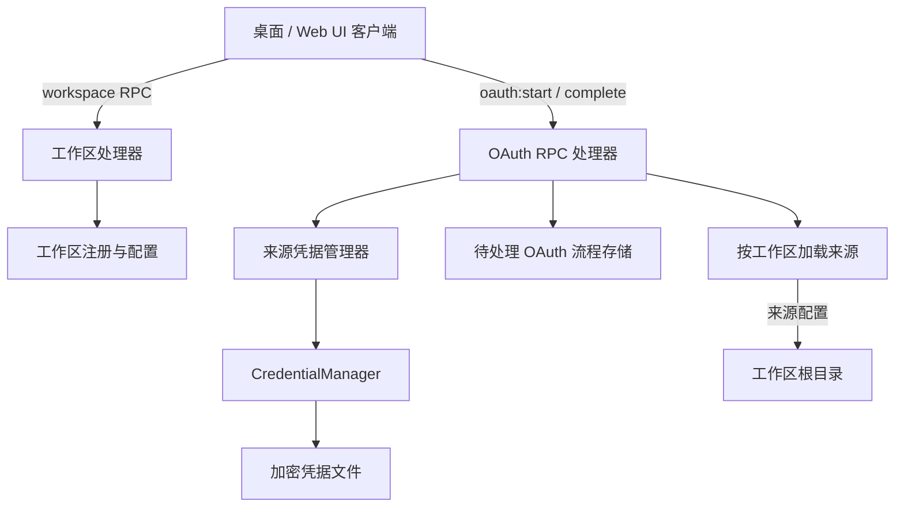
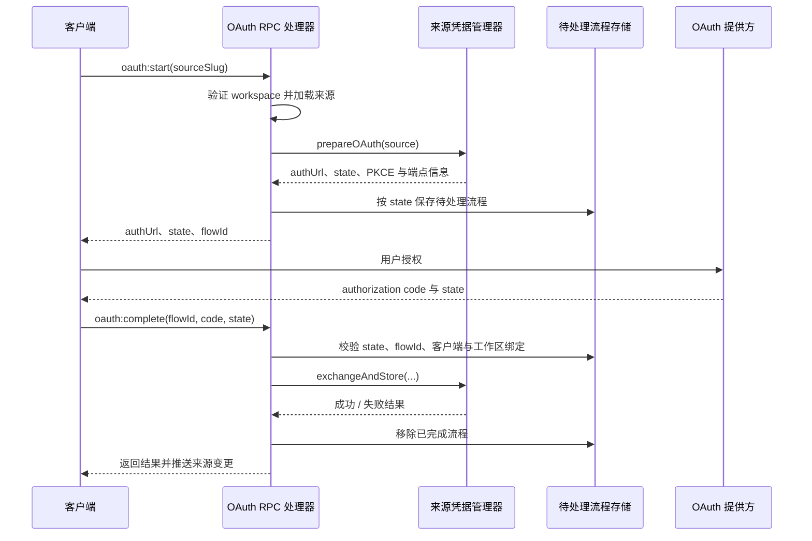

本页说明三条相互关联但边界不同的机制：**工作区提供配置与数据的组织范围，凭据管理器负责保存认证材料，OAuth 流程则在服务端协调授权码交换与凭据落盘**。重点是这些机制在代码中的实际职责和关联方式，不涉及会话执行或服务器部署细节。  
Sources: [工作区类型](packages/shared/src/workspaces/types.ts#L1-L15) [凭据管理器](packages/shared/src/credentials/manager.ts#L1-L10) [OAuth RPC 处理器](packages/server-core/src/handlers/rpc/oauth.ts#L1-L13)

## 概念关系

工作区配置、来源配置和凭据并不存放在同一份配置文件中。工作区配置描述工作区本身及其默认行为；来源配置位于工作区的数据范围内；凭据由独立的凭据存储后端管理。OAuth 处理器使用工作区标识解析来源，并将 OAuth 结果交给来源凭据管理器保存。  
Sources: [工作区存储](packages/shared/src/workspaces/storage.ts#L1-L19) [全局配置存储](packages/shared/src/config/storage.ts#L51-L60) [OAuth RPC 处理器](packages/server-core/src/handlers/rpc/oauth.ts#L5-L13)

Sources: [工作区 RPC 处理器](packages/server-core/src/handlers/rpc/workspace.ts#L1-L14) [OAuth RPC 处理器](packages/server-core/src/handlers/rpc/oauth.ts#L1-L13) [OAuth 流程存储](packages/shared/src/auth/oauth-flow-store.ts#L1-L13) [凭据管理器](packages/shared/src/credentials/manager.ts#L1-L10)

## 工作区配置与存储边界

工作区是顶层组织单元。其配置类型包含工作区 ID、名称、slug、创建与更新时间，以及可选的 `defaults` 和 `localMcpServers`。默认项可以指定新会话使用的模型、默认 LLM connection、默认启用的来源、权限模式、工作目录、思考级别和主题；本页仅说明这些字段作为工作区配置的职责，不展开模型或权限的运行机制。  
Sources: [工作区类型](packages/shared/src/workspaces/types.ts#L14-L55)

工作区目录的默认位置是 `~/.craft-agent/workspaces/`，但工作区可以位于任意磁盘路径。存储模块提供来源、会话和技能子目录的路径构造函数，并从工作区根目录读取或写入 `config.json`。读取时会展开默认工作目录中的路径变量，并对权限模式等字段做兼容规范化；保存时将工作目录转换为可移植形式，并以原子写入方式更新配置文件。  
Sources: [工作区存储](packages/shared/src/workspaces/storage.ts#L1-L18) [工作区存储](packages/shared/src/workspaces/storage.ts#L35-L63) [工作区存储](packages/shared/src/workspaces/storage.ts#L112-L160)

工作区创建入口由 RPC 处理器校验根目录，再调用工作区注册逻辑并将新工作区设为活动工作区。界面提供创建新工作区、打开现有文件夹和连接远程工作区等路径；这些入口最终不是同一种存储形态，远程连接信息也由独立的远程配置更新处理。  
Sources: [工作区 RPC 处理器](packages/server-core/src/handlers/rpc/workspace.ts#L33-L64) [工作区创建界面](apps/electron/src/renderer/components/workspace/WorkspaceCreationScreen.tsx#L15-L34)

| 数据 | 主要用途 | 存储位置或作用域 |
|---|---|---|
| 工作区配置 | 工作区元数据及新会话默认值 | 工作区根目录下的 `config.json` |
| 全局配置 | 工作区列表、活动工作区及应用级设置 | `~/.craft-agent` 配置目录下的配置文件 |
| 来源配置 | 描述工作区中的来源及其连接设置 | 工作区范围，由来源存储逻辑管理 |
| 认证凭据 | API key、Bearer/OAuth 等秘密材料 | `~/.craft-agent/credentials.enc` |

Sources: [工作区存储](packages/shared/src/workspaces/storage.ts#L35-L63) [全局配置存储](packages/shared/src/config/storage.ts#L51-L60) [来源凭据管理器](packages/shared/src/sources/credential-manager.ts#L1-L12) [加密存储后端](packages/shared/src/credentials/backends/secure-storage.ts#L1-L17)

## 凭据管理：接口与加密文件后端

`CredentialManager` 是凭据后端的统一入口。它支持异步初始化，所有主要异步操作会自动确保初始化完成；当前实现将 `SecureStorageBackend` 作为可用后端，并按优先级选择写入后端。读取会依次尝试后端，删除则遍历后端；同步删除路径用于可能要求立即完成清理的同步调用方。  
Sources: [凭据管理器](packages/shared/src/credentials/manager.ts#L1-L10) [凭据管理器](packages/shared/src/credentials/manager.ts#L17-L82) [凭据管理器](packages/shared/src/credentials/manager.ts#L91-L178)

来源凭据管理器在通用凭据入口之上处理来源相关逻辑：根据来源类型和认证方式解析凭据 ID，再调用底层管理器读写。例如，非 stdio 且需要认证的 MCP 来源会优先尝试 OAuth 凭据，再回退到 Bearer 凭据；公开 API 来源不会读取可能遗留在共享存储槽中的凭据。  
Sources: [来源凭据管理器](packages/shared/src/sources/credential-manager.ts#L100-L111) [来源凭据管理器](packages/shared/src/sources/credential-manager.ts#L143-L200)

加密后端将凭据存为 `~/.craft-agent/credentials.enc`。文件载荷使用 AES-256-GCM 加密，密钥由系统机器标识经过 SHA-256 与 PBKDF2 派生；写入时使用随机 IV，并设置文件权限为仅所有者读写。读取时会尝试当前密钥派生方式，并为旧格式提供迁移解密路径；若两种方式均无法解密，则按损坏文件处理并清除该文件。  
Sources: [加密存储后端](packages/shared/src/credentials/backends/secure-storage.ts#L1-L17) [加密存储后端](packages/shared/src/credentials/backends/secure-storage.ts#L200-L255) [加密存储后端](packages/shared/src/credentials/backends/secure-storage.ts#L277-L317) [加密存储后端](packages/shared/src/credentials/backends/secure-storage.ts#L319-L360)

## OAuth 流程：准备、回调与凭据写入

来源 OAuth 由 `oauth:start` 开始。处理器要求调用端绑定工作区，按工作区 ID 查找工作区，再从该工作区加载目标来源并调用来源凭据管理器准备授权流程。准备结果中的 state、PKCE verifier、redirect URI、客户端信息及 token endpoint 等数据被放入服务端待处理流程存储；客户端得到授权 URL、state 和 flow ID。  
Sources: [OAuth RPC 处理器](packages/server-core/src/handlers/rpc/oauth.ts#L70-L117) [OAuth 流程存储](packages/shared/src/auth/oauth-flow-store.ts#L14-L36)

Sources: [OAuth RPC 处理器](packages/server-core/src/handlers/rpc/oauth.ts#L70-L157) [OAuth 流程存储](packages/shared/src/auth/oauth-flow-store.ts#L14-L61)

待处理流程只保存在服务端内存中，以 state 为键；流程默认有效期为 5 分钟，并由定期清理与访问时的惰性检查清除过期项。流程对象包含调用客户端、工作区、来源 slug 的绑定信息；若由会话认证请求触发，还可携带 session ID 与 auth request ID。  
Sources: [OAuth 流程存储](packages/shared/src/auth/oauth-flow-store.ts#L1-L13) [OAuth 流程存储](packages/shared/src/auth/oauth-flow-store.ts#L14-L61) [OAuth 流程存储](packages/shared/src/auth/oauth-flow-store.ts#L76-L99)

完成阶段先依据 state 查找流程，并验证 flow ID；公共完成逻辑还会在 RPC 调用场景下核对客户端所有权，并在提供工作区上下文时核对工作区匹配。随后凭据管理器交换授权码并保存结果，流程被移除；如果流程关联会话认证请求，则通知会话管理器完成该请求，最后向该工作区推送来源变更。取消操作仅在 flow ID 与调用客户端所有权匹配时移除流程。  
Sources: [OAuth RPC 处理器](packages/server-core/src/handlers/rpc/oauth.ts#L15-L68) [OAuth RPC 处理器](packages/server-core/src/handlers/rpc/oauth.ts#L119-L190)

OAuth 本地回调实现使用 PKCE：verifier 由随机字节生成，challenge 为 verifier 的 SHA-256 编码；state 由随机字节生成以支持 CSRF 校验。授权码交换请求包含 redirect URI、client ID 和 code verifier；若提供方未返回 `expires_in`，代码按 3600 秒计算到期时间。  
Sources: [OAuth 实现](packages/shared/src/auth/oauth.ts#L20-L38) [OAuth 实现](packages/shared/src/auth/oauth.ts#L61-L121)

| 操作 | 关键约束 | 结果 |
|---|---|---|
| 开始授权 | 客户端须绑定工作区，来源须能从该工作区加载 | 返回授权 URL、state、flow ID |
| 完成授权 | state 必须对应有效流程；RPC 还核对 flow ID、客户端及工作区 | 交换授权码、保存凭据、推送来源变更 |
| 取消授权 | flow ID 与调用客户端所有权须匹配 | 移除待处理流程 |
| 撤销来源授权 | 客户端须绑定有效工作区，来源须存在 | 删除来源凭据并标记需要重新认证 |

Sources: [OAuth RPC 处理器](packages/server-core/src/handlers/rpc/oauth.ts#L70-L190)

## 相关页面

工作区配置和 OAuth 的边界在于：本页聚焦工作区作用域、认证材料存储和授权流程；模型连接配置、运行时会话行为及 RPC 传输机制分别属于其他主题。  
Sources: [全局配置存储](packages/shared/src/config/storage.ts#L51-L60) [工作区类型](packages/shared/src/workspaces/types.ts#L14-L55)

- 了解工作区与会话的桌面端使用方式：[桌面应用：配置模型、工作区与会话](3-zhuo-mian-ying-yong-pei-zhi-mo-xing-gong-zuo-qu-yu-hui-hua)
- 了解来源连接与 MCP 服务管理：[技能、来源连接与 MCP 服务管理](17-ji-neng-lai-yuan-lian-jie-yu-mcp-fu-wu-guan-li)
- 了解模型解析与智能体后端：[多模型智能体后端与模型解析](14-duo-mo-xing-zhi-neng-ti-hou-duan-yu-mo-xing-jie-xi)
- 了解 RPC 与 WebSocket 传输：[RPC 通道、WebSocket 传输与推送事件](13-rpc-tong-dao-websocket-chuan-shu-yu-tui-song-shi-jian)