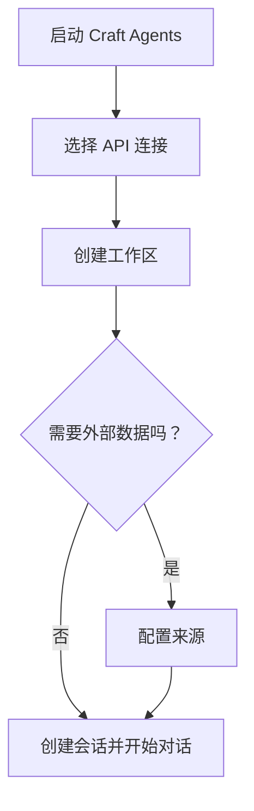
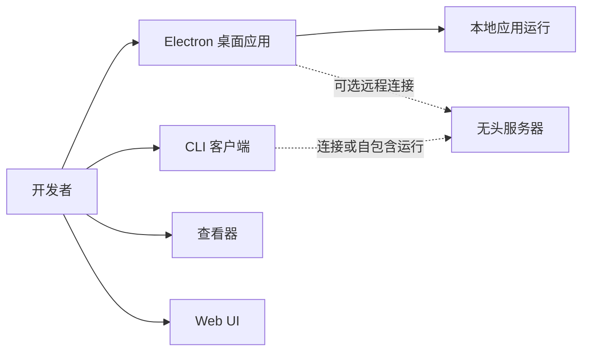

本页帮助初次接触 Craft Agents 的开发者选择一种运行方式，并完成从安装到首次对话的最短路径。这里聚焦于**桌面应用的快速体验**与**从源码启动桌面应用**；服务器部署、CLI 使用和开发环境验证请按后续页面继续阅读。Sources: [README.md](README.md#L65-L86) [README.md](README.md#L105-L111)

## 先选择运行方式

如果你只是想试用，使用项目 README 提供的一键安装方式；如果你希望阅读或修改代码，则从源码安装依赖并启动 Electron 桌面应用。源码路径使用 Bun 工作区，并由 `electron:start` 脚本先构建应用、再启动 Electron。Sources: [README.md](README.md#L65-L86) [package.json](package.json#L18-L22) [package.json](package.json#L63-L67)

| 方式 | 适用场景 | 开始操作 |
|---|---|---|
| 一键安装 | 希望直接体验桌面应用 | Windows 使用 PowerShell；macOS/Linux 使用 shell |
| 从源码启动 | 希望本地运行仓库版本或修改代码 | 克隆仓库、安装依赖，再运行 Electron |
| CLI 自包含运行 | 希望在终端中发送一次提示词，不需要先单独启动服务器 | 参考[命令行客户端：连接服务器、发送消息与自动化脚本](5-ming-ling-xing-ke-hu-duan-lian-jie-fu-wu-qi-fa-song-xiao-xi-yu-zi-dong-hua-jiao-ben) |

Sources: [README.md](README.md#L67-L86) [docs/cli.md](docs/cli.md#L29-L36)

## 路径一：安装并启动桌面应用

在 Windows 上打开 PowerShell，执行仓库提供的一键安装命令；macOS/Linux 用户执行对应的 shell 命令。安装完成后启动应用，即可进入连接模型和创建工作区的步骤。Sources: [README.md](README.md#L65-L77) [README.md](README.md#L105-L111)

```powershell
irm https://agents.craft.do/install-app.ps1 | iex
```

```bash
curl -fsSL https://agents.craft.do/install-app.sh | bash
```

## 路径二：从源码启动

从源码启动需要先准备 Git 与 Bun。以下命令来自项目 README：克隆仓库、进入目录、安装依赖，然后运行桌面应用。`bun run electron:start` 会执行桌面应用构建并启动 Electron。Sources: [README.md](README.md#L79-L86) [package.json](package.json#L63-L67)

```bash
git clone https://github.com/lukilabs/craft-agents-oss.git
cd craft-agents-oss
bun install
bun run electron:start
```

源码仓库是 Bun monorepo：根 `package.json` 将 `packages/*` 与 `apps/*` 声明为工作区；Electron 应用位于 `apps/electron`，其界面由 Electron 与 React 构成。Sources: [package.json](package.json#L18-L22) [apps/electron/README.md](apps/electron/README.md#L1-L11)

```text
craft-agents-oss/
├── apps/
│   ├── electron/       桌面应用：Electron 主进程、预加载层与 React 界面
│   ├── cli/            命令行客户端
│   ├── viewer/         查看器应用
│   └── webui/          Web 界面
├── packages/           可复用包与服务端模块
├── scripts/            构建、安装及开发脚本
├── docs/               项目文档
├── package.json        Bun 工作区与根级脚本
└── bun.lock            依赖锁定文件
```

Sources: [package.json](package.json#L18-L22) [apps/electron/README.md](apps/electron/README.md#L13-L47)

## 首次启动：连接模型并创建工作区

应用启动后，按顺序选择可用的 API 连接、创建工作区，然后创建会话并开始对话。连接来源（例如 MCP 服务器、REST API 或本地文件系统）是可选步骤，可在需要访问外部数据时再配置。README 列出的模型连接选项包括 Anthropic（API key 或 Claude Max）、Google AI Studio、ChatGPT Plus（Codex OAuth）和 GitHub Copilot OAuth。Sources: [README.md](README.md#L105-L111)



Sources: [README.md](README.md#L105-L111)

## 运行方式与应用形态

快速开始默认指向桌面应用；仓库还提供服务端、CLI、查看器和 Web UI 等代码入口，但它们的启动与部署步骤不属于本页范围。需要远程服务器时，继续阅读[无头服务器：启动、鉴权与远程桌面连接](4-wu-tou-fu-wu-qi-qi-dong-jian-quan-yu-yuan-cheng-zhuo-mian-lian-jie)；需要部署服务端时，阅读[Docker 与生产环境部署](6-docker-yu-sheng-chan-huan-jing-bu-shu)。Sources: [README.md](README.md#L154-L184) [package.json](package.json#L29-L35) [package.json](package.json#L82-L93)



Sources: [apps/electron/README.md](apps/electron/README.md#L1-L11) [docs/cli.md](docs/cli.md#L1-L9) [package.json](package.json#L82-L93)

## 常见问题与边界

| 现象或目标 | 建议 |
|---|---|
| 只想快速体验桌面端 | 使用对应操作系统的一键安装命令。 |
| 想从源码运行桌面端 | 在仓库根目录执行 `bun install` 与 `bun run electron:start`。 |
| 想在终端中直接运行提示词 | 查看[命令行客户端：连接服务器、发送消息与自动化脚本](5-ming-ling-xing-ke-hu-duan-lian-jie-fu-wu-qi-fa-song-xiao-xi-yu-zi-dong-hua-jiao-ben)。 |
| 想让桌面端连接远程服务器 | 查看[无头服务器：启动、鉴权与远程桌面连接](4-wu-tou-fu-wu-qi-qi-dong-jian-quan-yu-yuan-cheng-zhuo-mian-lian-jie)。 |
| 想配置桌面端模型、工作区与会话 | 查看[桌面应用：配置模型、工作区与会话](3-zhuo-mian-ying-yong-pei-zhi-mo-xing-gong-zuo-qu-yu-hui-hua)。 |
| 想参与仓库开发 | 继续阅读[仓库结构与 Bun 工作区](7-cang-ku-jie-gou-yu-bun-gong-zuo-qu)及[本地开发、构建、类型检查与测试](8-ben-di-kai-fa-gou-jian-lei-xing-jian-cha-yu-ce-shi)。 |