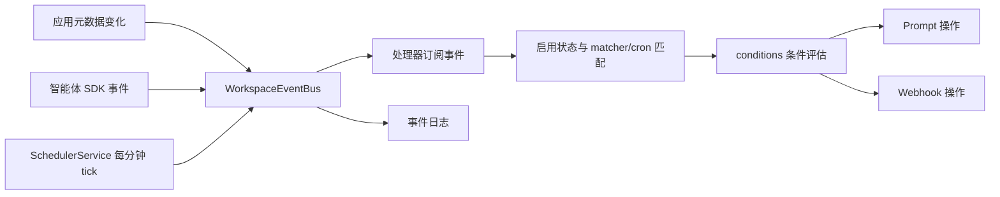
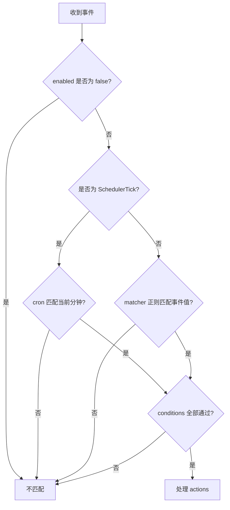

自动化的核心模型是 **事件 → 匹配器 → 条件 → 操作**：工作区事件总线接收应用或智能体事件，匹配器先判断启用状态及事件匹配规则，再评估可选条件，最后由处理器收集提示操作或执行 Webhook。调度自动化并非独立执行路径，而是由每分钟产生的 `SchedulerTick` 事件进入同一条匹配管线。本文聚焦事件类型、过滤语义和调度实现。 Sources: [types.ts](packages/shared/src/automations/types.ts#L14-L52), [utils.ts](packages/shared/src/automations/utils.ts#L145-L193), [automation-system.ts](packages/shared/src/automations/automation-system.ts#L243-L302)

## 架构：事件如何变成操作

`AutomationSystem` 按工作区持有配置、事件总线和处理器；配置从工作区的 `automations.json` 加载并验证。它订阅提示、Webhook 和事件日志处理器；启用调度时，调度器回调会向同一事件总线发出 `SchedulerTick`。因此，事件生产、匹配和操作处理由明确的模块边界连接，而不是由单一全局调度器直接调用每项自动化。 Sources: [automation-system.ts](packages/shared/src/automations/automation-system.ts#L65-L94), [automation-system.ts](packages/shared/src/automations/automation-system.ts#L111-L142), [automation-system.ts](packages/shared/src/automations/automation-system.ts#L243-L302)

事件总线按工作区实例化，提供事件类型与载荷的类型映射，并支持事件专属或全事件处理器。其 `emit` 会将处理器并行调用；事件速率受每分钟窗口限制：常规事件默认每分钟 10 次，`SchedulerTick` 为每分钟 60 次，超出时该次事件会被丢弃。 Sources: [event-bus.ts](packages/shared/src/automations/event-bus.ts#L24-L102), [event-bus.ts](packages/shared/src/automations/event-bus.ts#L121-L132), [event-bus.ts](packages/shared/src/automations/event-bus.ts#L174-L199)

## 事件类别与载荷

代码将事件分为 **应用事件**（由 Craft 侧产生）和 **智能体事件**（与 SDK 智能体生命周期或工具相关）。工作区事件总线为应用事件定义结构化载荷；智能体事件使用通用载荷，其中包含 `data` 字段。事件名称是配置映射的键，匹配器则是该事件下的数组。 Sources: [types.ts](packages/shared/src/automations/types.ts#L14-L52), [event-bus.ts](packages/shared/src/automations/event-bus.ts#L24-L102), [types.ts](packages/shared/src/automations/types.ts#L185-L187)

| 类别 | 事件 | 关键匹配值或载荷 |
|---|---|---|
| 应用 | `LabelAdd`、`LabelRemove` | `label` |
| 应用 | `PermissionModeChange` | `oldMode`、`newMode`；匹配值取新模式 |
| 应用 | `FlagChange` | `isFlagged` |
| 应用 | `SessionStatusChange` | `oldState`、`newState`；匹配值取新状态 |
| 应用 | `LabelConfigChange` | 无额外字段；匹配值为空字符串 |
| 应用 | `SchedulerTick` | 本地时间、UTC 时间；使用 cron 而非正则匹配 |
| 智能体 | `PreToolUse`、`PostToolUse`、`PostToolUseFailure`、`PermissionRequest` | 工具名 |
| 智能体 | `Notification` | 消息 |
| 智能体 | `SessionStart` | 来源 |
| 智能体 | `SubagentStart`、`SubagentStop` | 智能体类型 |
| 智能体 | `UserPromptSubmit`、`SessionEnd`、`Stop`、`PreCompact`、`Setup` | 由 SDK 输入适配器决定；部分事件没有有意义的匹配字段 |

匹配值映射由共享工具实现：例如 `LabelAdd` / `LabelRemove` 读取 `label`，`PermissionModeChange` 读取 `newMode`，而工具类智能体事件读取工具名。因而配置中的 `matcher` 是针对该事件的匹配值做正则筛选，不是对任意事件载荷 JSON 的通用查询。 Sources: [utils.ts](packages/shared/src/automations/utils.ts#L81-L109), [utils.ts](packages/shared/src/automations/utils.ts#L111-L133)

当会话元数据变化时，`AutomationSystem.updateSessionMetadata` 对前后快照做差分，并按变化发出权限模式、标签增删、标记状态和会话状态事件。标签以集合差异识别新增或移除项；对状态转换，载荷提供旧值和新值。 Sources: [automation-system.ts](packages/shared/src/automations/automation-system.ts#L320-L370), [automation-system.ts](packages/shared/src/automations/automation-system.ts#L374-L399)

## 匹配器、条件与操作的执行顺序

匹配器定义包括可选 `enabled`、正则 `matcher`、定时用 `cron` 和 `timezone`、`conditions`、提示会话相关设置及 `actions`。普通事件若省略正则匹配器，则视为匹配所有该事件；定时事件必须有 cron 表达式。`enabled: false` 会在后续筛选前阻止匹配。 Sources: [types.ts](packages/shared/src/automations/types.ts#L151-L183), [utils.ts](packages/shared/src/automations/utils.ts#L145-L162)

执行顺序由统一匹配入口保证：先检查启用状态与基础匹配（正则或 cron），再评估 `conditions`。顶层条件数组采用 AND 语义；空数组或未设置条件不构成额外过滤。正则表达式无效时不匹配。未知条件类型会失败关闭，即返回不通过。 Sources: [utils.ts](packages/shared/src/automations/utils.ts#L145-L193), [conditions.ts](packages/shared/src/automations/conditions.ts#L53-L85)

条件支持 `time`、`state` 和逻辑组合。时间条件可检查时刻范围、星期及 IANA 时区；时区优先级是条件自身的 `timezone`，再到匹配器时区，最后回退到系统本地时间。`after` 包含边界，`before` 不包含边界；当起始时间晚于结束时间时按跨午夜窗口计算。 Sources: [types.ts](packages/shared/src/automations/types.ts#L108-L145), [conditions.ts](packages/shared/src/automations/conditions.ts#L92-L128), [conditions.ts](packages/shared/src/automations/conditions.ts#L136-L165)

状态条件读取事件载荷字段，支持精确值、数组成员、非指定值和状态转换的 `from` / `to`。对于 `permissionMode` 与 `sessionStatus`，转换字段会映射到载荷中的 `oldMode`/`newMode` 和 `oldState`/`newState`。逻辑条件可以嵌套 `and`、`or`、`not`；实现对递归深度设上限，超过上限返回不通过。 Sources: [types.ts](packages/shared/src/automations/types.ts#L121-L145), [conditions.ts](packages/shared/src/automations/conditions.ts#L20-L28), [conditions.ts](packages/shared/src/automations/conditions.ts#L172-L200), [conditions.ts](packages/shared/src/automations/conditions.ts#L69-L85)

匹配成功后，提示处理器只接收应用事件，逐个检查该事件的匹配器并提取其中的提示操作；提示及标签中的环境变量会根据事件载荷展开，提示中的 `@` 引用也会被解析，随后以待处理提示回调交给调用方。自动化操作类型还包括 Webhook；系统会为这些操作注册专门处理器。 Sources: [prompt-handler.ts](packages/shared/src/automations/handlers/prompt-handler.ts#L33-L53), [prompt-handler.ts](packages/shared/src/automations/handlers/prompt-handler.ts#L63-L80), [prompt-handler.ts](packages/shared/src/automations/handlers/prompt-handler.ts#L88-L131), [automation-system.ts](packages/shared/src/automations/automation-system.ts#L246-L279), [types.ts](packages/shared/src/automations/types.ts#L57-L102)

## SchedulerTick 与 cron 调度

调度服务在启动时先计算到下一个整分钟边界的等待时间，然后执行首次 tick 并按 60 秒间隔继续触发。若上一次 tick 仍在执行，新 tick 会跳过；停止服务会清除对齐定时器和周期定时器。 Sources: [scheduler-service.ts](packages/shared/src/scheduler/scheduler-service.ts#L23-L56), [scheduler-service.ts](packages/shared/src/scheduler/scheduler-service.ts#L58-L87)

每个 tick 生成时间载荷并调用回调；`AutomationSystem` 将其转换为 `SchedulerTick` 事件，附上工作区 ID 和当前时间戳，再交由事件总线处理。调度器只有在 `AutomationSystem` 选项 `enableScheduler` 为真时才会启动。 Sources: [scheduler-service.ts](packages/shared/src/scheduler/scheduler-service.ts#L65-L85), [automation-system.ts](packages/shared/src/automations/automation-system.ts#L49-L59), [automation-system.ts](packages/shared/src/automations/automation-system.ts#L286-L314)

cron 匹配使用 `croner` 的五字段表达式（分、时、月日、月份、星期）和可选时区。实现从当前分钟起点前一秒查询下一次运行时间，并判断结果是否落入当前分钟区间；无下一次运行或解析出错时返回不匹配。注意，服务每分钟发出一次 tick，cron 匹配器在每次 tick 时判断当前分钟是否命中，而非为每个匹配器单独安排计时器。 Sources: [cron-matcher.ts](packages/shared/src/automations/cron-matcher.ts#L13-L56), [scheduler-service.ts](packages/shared/src/scheduler/scheduler-service.ts#L33-L45), [utils.ts](packages/shared/src/automations/utils.ts#L151-L156)

| 配置项 | 作用 |
|---|---|
| `cron` | `SchedulerTick` 匹配器的五字段计划表达式；没有该字段时不会命中 |
| `timezone` | 传给 cron 匹配器的时区选项；时间条件也可使用匹配器时区作为回退值 |
| `conditions` | cron 命中后继续评估的条件过滤 |
| `enabled` | 显式设为 `false` 时禁用匹配器 |

Sources: [types.ts](packages/shared/src/automations/types.ts#L156-L169), [utils.ts](packages/shared/src/automations/utils.ts#L151-L179), [cron-matcher.ts](packages/shared/src/automations/cron-matcher.ts#L25-L37)

## 运行边界与排查重点

调度器和事件总线都有各自的边界：调度器避免 tick 重叠，事件总线按事件类型执行速率限制。排查“没有运行”时，可以沿调用顺序核对：调度是否启用、配置是否通过验证、匹配器是否禁用、cron 是否命中当前分钟、正则是否匹配对应事件值，以及条件是否全部通过。配置加载失败或验证无效时，系统不会使用无效配置继续执行。 Sources: [scheduler-service.ts](packages/shared/src/scheduler/scheduler-service.ts#L58-L86), [event-bus.ts](packages/shared/src/automations/event-bus.ts#L184-L200), [automation-system.ts](packages/shared/src/automations/automation-system.ts#L123-L142), [utils.ts](packages/shared/src/automations/utils.ts#L151-L179)

可从 [会话生命周期、消息流与持久化](15-hui-hua-sheng-ming-zhou-qi-xiao-xi-liu-yu-chi-jiu-hua) 继续了解提示操作创建会话的上下文，再阅读 [消息网关、平台适配器与 WhatsApp 工作进程](21-xiao-xi-wang-guan-ping-tai-gua-pei-qi-yu-whatsapp-gong-zuo-jin-cheng) 了解消息平台相关集成边界。 Sources: [prompt-handler.ts](packages/shared/src/automations/handlers/prompt-handler.ts#L100-L131), [automation-system.ts](packages/shared/src/automations/automation-system.ts#L246-L279)