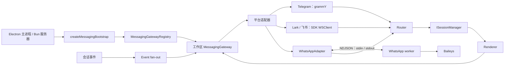
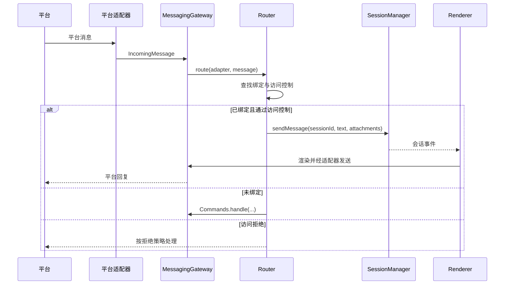
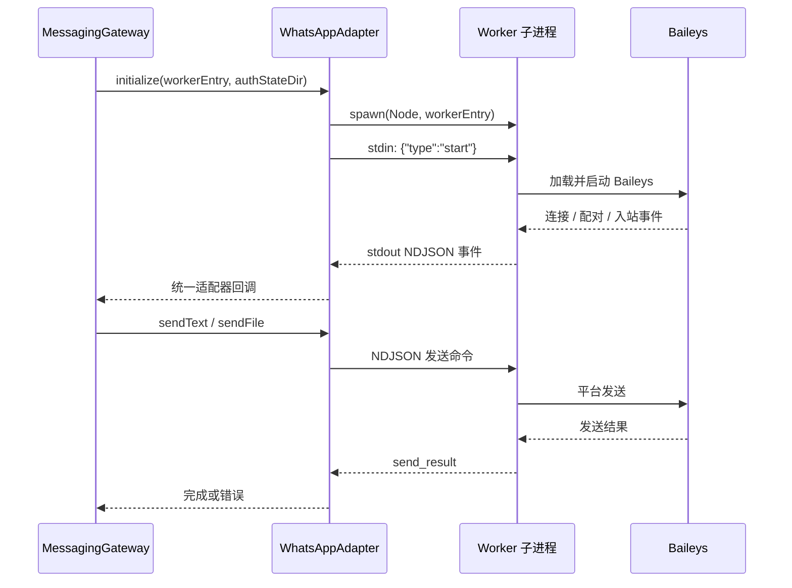

消息网关将 Telegram、Lark/飞书和 WhatsApp 的平台事件接入工作区会话，并将会话事件转换为外部消息。核心边界是：**网关负责统一路由与消息交互，平台适配器屏蔽各平台接口差异，WhatsApp 适配器再通过独立工作进程隔离 Baileys 的运行时状态**。本文聚焦这套消息集成的模块职责、事件流与进程通信，不展开会话内部生命周期或部署配置。 Sources: [gateway.ts](packages/messaging-gateway/src/gateway.ts#L1-L8), [types.ts](packages/messaging-gateway/src/types.ts#L1-L5), [whatsapp/index.ts](packages/messaging-gateway/src/adapters/whatsapp/index.ts#L1-L17)

## 架构与职责边界

消息栈按工作区组织：`MessagingGatewayRegistry` 管理工作区级网关、配置与平台连接生命周期；每个 `MessagingGateway` 组合适配器、路由器、命令处理器及会话消息渲染器。适配器遵循共同的 `PlatformAdapter` 接口，向网关提供消息与按钮事件，并承接发送、编辑、文件和输入状态等操作。 Sources: [registry.ts](packages/messaging-gateway/src/registry.ts#L1-L26), [gateway.ts](packages/messaging-gateway/src/gateway.ts#L1-L8), [types.ts](packages/messaging-gateway/src/types.ts#L139-L200)

宿主通过 `createMessagingBootstrap` 创建注册表、组合会话事件 sink，并在服务启动后初始化工作区；它还提供延迟设置推送发布器的接口。注册表负责按工作区初始化网关，并根据配置启动 Telegram、Lark 或 WhatsApp 连接。网关只接受统一的平台适配器接口，因此平台 SDK 的具体调用留在适配器实现内。 Sources: [bootstrap.ts](packages/messaging-gateway/src/bootstrap.ts#L1-L18), [bootstrap.ts](packages/messaging-gateway/src/bootstrap.ts#L56-L119), [registry.ts](packages/messaging-gateway/src/registry.ts#L120-L200), [gateway.ts](packages/messaging-gateway/src/gateway.ts#L218-L296)

## 统一适配器契约与平台差异

`PlatformAdapter` 将平台操作抽象为连接生命周期、消息与按钮回调、文本/文件发送及消息编辑等能力；`AdapterCapabilities` 则明确标记编辑、内联按钮、长度上限、Markdown 方言和 webhook 支持。它让上层能够查询能力，而不必假定每个平台都支持相同功能。 Sources: [types.ts](packages/messaging-gateway/src/types.ts#L35-L53), [types.ts](packages/messaging-gateway/src/types.ts#L139-L200)

| 平台 | 接入方式与实现特点 | 能力差异（代码声明） |
|---|---|---|
| Telegram | 适配器使用 grammY；接收端采用 polling。私聊默认接受；配置了工作区超级群后，只额外接受对应群聊。 | 支持编辑、内联按钮；按钮上限 10；消息长度上限 4096；Markdown v2；未声明 webhook 支持。 |
| Lark / 飞书 | 适配器使用 Lark SDK 的 `WSClient` 长连接；凭据包括 `appId`、`appSecret` 与 `lark`/`feishu` 域选择。 | 实际能力由适配器的能力声明提供；支持卡片等交互的实现位于适配器及其卡片模块。 |
| WhatsApp | 网关侧适配器启动独立 worker，由 worker 持有 Baileys 状态。 | 不支持编辑和内联按钮；消息长度上限 4096；Markdown 方言标记为 `whatsapp`；不支持 webhook。 |

Sources: [telegram/index.ts](packages/messaging-gateway/src/adapters/telegram/index.ts#L1-L8), [telegram/index.ts](packages/messaging-gateway/src/adapters/telegram/index.ts#L108-L140), [lark/index.ts](packages/messaging-gateway/src/adapters/lark/index.ts#L1-L12), [lark/index.ts](packages/messaging-gateway/src/adapters/lark/index.ts#L51-L81), [whatsapp/index.ts](packages/messaging-gateway/src/adapters/whatsapp/index.ts#L1-L17), [whatsapp/index.ts](packages/messaging-gateway/src/adapters/whatsapp/index.ts#L89-L100)

这些能力是接口层的功能声明，不代表跨平台行为完全一致。例如 Telegram 的超级群接收范围由配置的 chat ID 限定；Lark 需解析平台凭据；WhatsApp 的发送依赖 worker 返回对应结果。上层仍应通过统一契约调用，并以能力字段判断可用功能。 Sources: [telegram/index.ts](packages/messaging-gateway/src/adapters/telegram/index.ts#L128-L140), [lark/index.ts](packages/messaging-gateway/src/adapters/lark/index.ts#L51-L81), [whatsapp/index.ts](packages/messaging-gateway/src/adapters/whatsapp/index.ts#L89-L100)

## 入站路由与会话事件回流

入站消息先按 `(platform, channelId, threadId)` 查询绑定；若找到绑定，路由器执行访问控制，将本地附件路径转换为会话可用的附件，再调用 `SessionManager.sendMessage`。未绑定时，消息转交命令处理器，以处理绑定或其他网关命令。路由失败会记录结构化错误，并尝试向来源频道发送错误提示。 Sources: [router.ts](packages/messaging-gateway/src/router.ts#L1-L8), [router.ts](packages/messaging-gateway/src/router.ts#L52-L117), [router.ts](packages/messaging-gateway/src/router.ts#L145-L166)

`IncomingMessage` 采用平台无关的基础字段，并保留可选线程 ID、发送者信息、附件和原始平台负载。Telegram 的论坛主题 ID 参与绑定查找；附件只有携带本地路径时才会被路由器读取并转换，缺少路径或读取失败的附件会被跳过。 Sources: [types.ts](packages/messaging-gateway/src/types.ts#L75-L118), [router.ts](packages/messaging-gateway/src/router.ts#L55-L61), [router.ts](packages/messaging-gateway/src/router.ts#L129-L166)

反向链路由 `Renderer` 与网关中的适配器共同完成：网关创建渲染器并记录与外发消息相关的绑定信息；宿主将会话事件 sink 包装为 fan-out，使既有 sink 与网关事件处理器都能收到事件。fan-out 对每个 sink 单独捕获同步异常，避免一个 sink 出错阻断其他 sink。 Sources: [gateway.ts](packages/messaging-gateway/src/gateway.ts#L218-L255), [bootstrap.ts](packages/messaging-gateway/src/bootstrap.ts#L93-L107), [event-fanout.ts](packages/messaging-gateway/src/event-fanout.ts#L1-L37)

## WhatsApp：适配器与独立工作进程

WhatsApp 适配器是平台接口与子进程协议之间的桥接层。初始化时，它启动配置指定的 Node 可执行文件和 worker 入口，通过 stdin/stdout 管理进程，并将标准输出解析为 worker 事件；标准错误用于日志。适配器还跟踪待处理的发送请求，以便把 worker 返回的发送结果对应到调用方。 Sources: [whatsapp/index.ts](packages/messaging-gateway/src/adapters/whatsapp/index.ts#L1-L17), [whatsapp/index.ts](packages/messaging-gateway/src/adapters/whatsapp/index.ts#L29-L47), [whatsapp/index.ts](packages/messaging-gateway/src/adapters/whatsapp/index.ts#L108-L200)

worker 独占 Baileys 状态并通过 NDJSON 与主进程通信：主进程向 stdin 写入 `start`、发送文本、发送文件、配对手机号或关闭命令；worker 向 stdout 输出就绪、配对、连接状态、入站消息、发送结果和错误等事件。协议以换行分隔 JSON，stdout 专供机器可解析的消息，worker 日志写入 stderr。 Sources: [protocol.ts](packages/messaging-whatsapp-worker/src/protocol.ts#L1-L13), [protocol.ts](packages/messaging-whatsapp-worker/src/protocol.ts#L17-L65), [protocol.ts](packages/messaging-whatsapp-worker/src/protocol.ts#L67-L174), [worker.ts](packages/messaging-whatsapp-worker/src/worker.ts#L1-L14), [worker.ts](packages/messaging-whatsapp-worker/src/worker.ts#L50-L63)

worker 启动逻辑通过动态加载 Baileys，并在加载失败时发出不可用事件；连接重试使用有上限的指数退避。worker 还跟踪近期发送的消息 ID，用于识别自身回声；在启用 self-chat 模式时，会额外以响应前缀处理自聊消息。它们属于 worker 的协议与消息处理实现，不改变网关统一的消息接口。 Sources: [worker.ts](packages/messaging-whatsapp-worker/src/worker.ts#L16-L24), [worker.ts](packages/messaging-whatsapp-worker/src/worker.ts#L120-L167), [worker.ts](packages/messaging-whatsapp-worker/src/worker.ts#L177-L218), [protocol.ts](packages/messaging-whatsapp-worker/src/protocol.ts#L17-L40)

WhatsApp 采用子进程隔离的实现说明中列出了三项直接考虑：避免 Baileys 崩溃或段错误直接影响 Electron 主进程、使宿主为 Bun 时仍可在 Node 中运行 Baileys，以及隔离认证状态和信号 ratchet 等内存状态。该实现使用非官方 Baileys 协议库；代码明确提示其不受 WhatsApp/Meta 背书，可能停止工作且存在账号封禁风险。 Sources: [whatsapp/index.ts](packages/messaging-gateway/src/adapters/whatsapp/index.ts#L1-L17), [bootstrap.ts](packages/messaging-gateway/src/bootstrap.ts#L34-L43)

## 工作区生命周期与状态

注册表按工作区初始化状态；配置启用后启动网关，再分别尝试连接已配置的平台。平台运行状态使用 `disconnected`、`connecting`、`connected`、`reconnect_required`、`error` 等状态，并携带配置标记、连接标记、身份、错误信息与更新时间。WhatsApp 恢复连接时会检查认证状态；缺少认证状态时报告需要重新连接。 Sources: [registry.ts](packages/messaging-gateway/src/registry.ts#L120-L200), [types.ts](packages/messaging-gateway/src/types.ts#L23-L33)

适配器的替换与停止由网关集中管理：注册同平台的新适配器时，会尝试销毁旧实例；网关启动后将回调接入路由与按钮处理；注销和停止过程负责销毁适配器。注册表在配置变化时也会注销不再配置的平台，并更新相应运行状态。 Sources: [gateway.ts](packages/messaging-gateway/src/gateway.ts#L267-L296), [registry.ts](packages/messaging-gateway/src/registry.ts#L250-L289)

## 延伸阅读

要进一步理解网关依赖的消息与会话事件来源，可阅读[会话生命周期、消息流与持久化](15-hui-hua-sheng-ming-zhou-qi-xiao-xi-liu-yu-chi-jiu-hua)与[RPC 通道、WebSocket 传输与推送事件](13-rpc-tong-dao-websocket-chuan-shu-yu-tui-song-shi-jian)。若关注宿主如何创建注册表及运行时依赖，可参阅[服务器启动流程、依赖注入与运行时适配](12-fu-wu-qi-qi-dong-liu-cheng-yi-lai-zhu-ru-yu-yun-xing-shi-gua-pei)。 Sources: [bootstrap.ts](packages/messaging-gateway/src/bootstrap.ts#L1-L18), [event-fanout.ts](packages/messaging-gateway/src/event-fanout.ts#L1-L18)