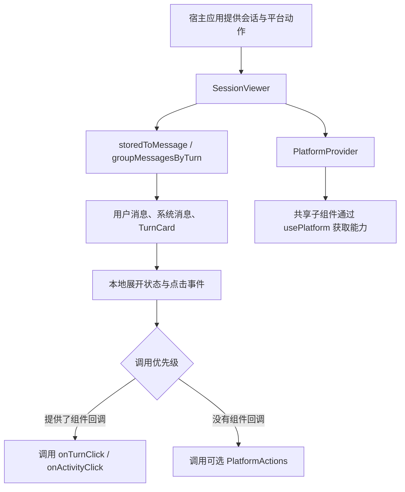
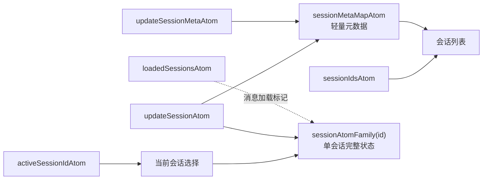

本页说明共享 React UI 如何在 Electron 桌面端与 Web UI 中复用，以及桌面渲染器如何通过 Jotai 管理会话状态并将更新限制在相关会话。重点是组件边界、平台能力注入和状态订阅；Electron 主进程通信与完整会话业务流程不在本页展开。Sources: [package.json](packages/ui/package.json#L1-L78)

## 架构假设与验证

**架构假设：**共享 UI 作为独立工作区包提供跨平台组件；Electron 渲染器负责应用级状态与交互，平台相关能力则通过 context 注入，避免共享组件直接依赖 Electron API。代码验证了这一分层：`@craft-agent/ui` 导出聊天、Markdown、基础 UI 与平台 context；`PlatformContext` 的动作均为可选项，调用方可按运行环境提供实现。Sources: [package.json](packages/ui/package.json#L1-L78) [index.ts](packages/ui/src/index.ts#L1-L200) [PlatformContext.tsx](packages/ui/src/context/PlatformContext.tsx#L1-L184)

## 组件复用与平台适配

共享包的边界是可复用的展示与交互组件，而不是完整桌面应用。包入口公开 `SessionViewer`、`TurnCard`、Markdown 渲染器、代码/终端查看器、预览覆盖层和 UI 基础组件；包的 peer dependencies 则声明 React、Jotai、Radix、Markdown 等宿主侧依赖。应用可以从统一入口或包提供的子路径导入组件。Sources: [package.json](packages/ui/package.json#L1-L78) [index.ts](packages/ui/src/index.ts#L1-L200)

`PlatformProvider` / `usePlatform` 是平台能力的依赖注入点。共享组件通过 `PlatformActions` 接收诸如打开文件、打开 URL、剪贴板、读取文件和打开预览等可选回调；未实现的动作可以保持缺省，而不是要求 Web 环境模拟 Electron 行为。`SessionViewer` 也接受 `platformActions`，并将其放入 Provider，再将相应回调传给消息和 turn 子组件。Sources: [PlatformContext.tsx](packages/ui/src/context/PlatformContext.tsx#L1-L184) [SessionViewer.tsx](packages/ui/src/components/chat/SessionViewer.tsx#L75-L150) [SessionViewer.tsx](packages/ui/src/components/chat/SessionViewer.tsx#L190-L246)

| 关注点 | 共享组件提供的边界 | 宿主需要提供或决定的内容 |
|---|---|---|
| 文件、URL 与剪贴板 | 可选动作接口 | 具体打开方式及权限 |
| 文件内容与预览 | 可选读取、预览动作 | 本地文件访问或 Web 侧替代方案 |
| 会话展示 | turn 分组、消息展示与展开状态 | 会话数据来源及页面级交互 |
| 只读/交互差异 | `SessionViewer` 的 `mode` 与回调接口 | 传入模式、回调与 footer 内容 |

表中“可选”表示接口定义使用可选属性，不代表组件会自动提供宿主实现。Sources: [PlatformContext.tsx](packages/ui/src/context/PlatformContext.tsx#L15-L105) [SessionViewer.tsx](packages/ui/src/components/chat/SessionViewer.tsx#L30-L74)

## 会话展示与交互状态

`SessionViewer` 接收 `StoredSession`，用 `storedToMessage` 转换消息，再用 `groupMessagesByTurn` 生成 turn 列表。渲染时按用户消息、系统消息和 assistant turn 分支；组件本地维护展开的 turn 集合与活动组集合，并将展开变化传给 `TurnCard`。点击 turn 或活动详情时，组件优先调用显式传入的回调；没有回调时才尝试调用平台动作。Sources: [SessionViewer.tsx](packages/ui/src/components/chat/SessionViewer.tsx#L1-L150) [SessionViewer.tsx](packages/ui/src/components/chat/SessionViewer.tsx#L150-L246)

`mode` 影响注释交互：`readonly` 时向 `TurnCard` 传入 `tooltip-only`，其他模式传入 `interactive`。它与 `platformActions` 分别控制交互策略和宿主能力，并非同一开关。共享 Markdown 组件另提供 `terminal`、`minimal`、`full` 三种渲染模式，并接收 URL 与文件点击回调；自定义渲染器包含代码块及多种富内容块。Sources: [SessionViewer.tsx](packages/ui/src/components/chat/SessionViewer.tsx#L30-L74) [SessionViewer.tsx](packages/ui/src/components/chat/SessionViewer.tsx#L190-L246) [Markdown.tsx](packages/ui/src/components/markdown/Markdown.tsx#L1-L100)

图中表达的是组件的数据与回调关系：消息转换和 turn 分组发生在 `SessionViewer` 内，平台动作由宿主注入，且详情点击具有显式回调优先级。Sources: [SessionViewer.tsx](packages/ui/src/components/chat/SessionViewer.tsx#L75-L150) [SessionViewer.tsx](packages/ui/src/components/chat/SessionViewer.tsx#L190-L246) [PlatformContext.tsx](packages/ui/src/context/PlatformContext.tsx#L110-L184)

## Electron 渲染器与 Web UI 复用

Electron 渲染器入口在 React 树外层初始化 Jotai Provider，并在其下读取工作区 ID、挂载主题 Provider 与应用组件；应用树还包含共享 UI 的 TooltipProvider、焦点、模态及可关闭层等上下文。实际应用组件组合共享包导出的预览覆盖层和主题能力。Sources: [main.tsx](apps/electron/src/renderer/main.tsx#L1-L119) [App.tsx](apps/electron/src/renderer/App.tsx#L1-L75)

Web UI 的 `App` 是适配层：它先获取服务端配置、创建 Web API adapter 并设置 `window.electronAPI`，随后才懒加载 Electron renderer 的 `App`。因此两种运行形态共用渲染器应用代码，但 Web 入口通过适配器提供其 API 环境；这并不意味着 Web 直接运行 Electron 原生能力。Sources: [App.tsx](apps/webui/src/App.tsx#L1-L150)

## Jotai 会话状态隔离

会话状态采用按 ID 分片的结构：`sessionAtomFamily` 为每个会话创建独立 atom；`sessionMetaMapAtom` 保存会话列表所需的轻量元数据；`sessionIdsAtom` 保存有序 ID，`loadedSessionsAtom` 跟踪消息是否已加载；`activeSessionIdAtom` 表示当前展示的会话。文件注释明确指出，按会话隔离更新是为了避免一个会话的流式更新导致另一个会话重渲染及输入焦点丢失。Sources: [sessions.ts](apps/electron/src/renderer/atoms/sessions.ts#L1-L35) [sessions.ts](apps/electron/src/renderer/atoms/sessions.ts#L105-L160)

`updateSessionAtom` 更新指定 ID 对应的 session atom；当新会话存在时，也提取并更新元数据 Map。`updateSessionMetaAtom` 则只改列表元数据，不触碰完整 session atom。该分离使列表展示数据与单个会话的完整消息状态拥有不同更新路径。Sources: [sessions.ts](apps/electron/src/renderer/atoms/sessions.ts#L160-L205)

该图展示 atom 的职责划分与更新路径；`loadedSessionsAtom` 记录消息加载状态，完整加载逻辑由应用代码负责，本图不推断其触发时机。Sources: [sessions.ts](apps/electron/src/renderer/atoms/sessions.ts#L105-L205)

## 样式与主题入口

共享 UI 提供 `@craft-agent/ui/styles` 样式入口，定义 Tailwind CSS v4 基础主题、颜色 token、明暗主题变量及层级尺度；消费应用可以导入该样式，再声明应用自身的源码扫描范围。共享组件因此复用主题变量与样式约定，而桌面应用仍保留自己的 renderer 样式入口。Sources: [styles/index.css](packages/ui/src/styles/index.css#L1-L30)

## 延伸阅读

若要理解该页面之外的应用边界，可继续阅读[应用形态与模块边界：Electron、Web UI、查看器和 CLI](10-ying-yong-xing-tai-yu-mo-kuai-bian-jie-electron-web-ui-cha-kan-qi-he-cli)；若关注共享模型和运行时数据，可阅读[核心数据模型与共享基础能力](11-he-xin-shu-ju-mo-xing-yu-gong-xiang-ji-chu-neng-li)；若进一步追踪事件驱动的会话更新，则可转到[会话生命周期、消息流与持久化](15-hui-hua-sheng-ming-zhou-qi-xiao-xi-liu-yu-chi-jiu-hua)。Sources: [index.ts](packages/ui/src/index.ts#L1-L200) [sessions.ts](apps/electron/src/renderer/atoms/sessions.ts#L105-L205)