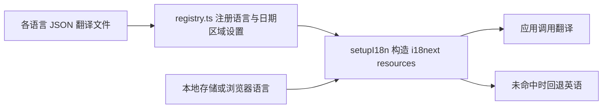
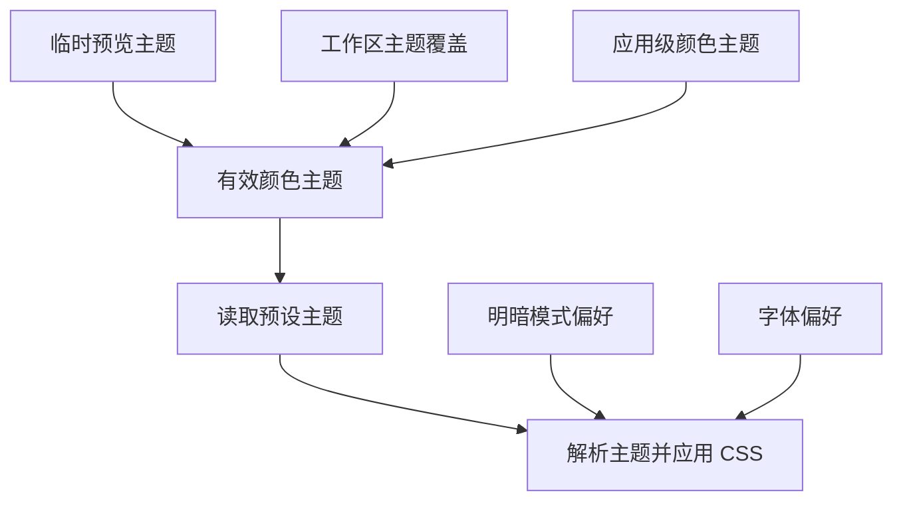

本页介绍应用界面文本如何组织和加载、主题如何应用，以及开发者可以从哪些位置定制界面资源。核心思路是：**共享国际化模块集中管理语言资源；桌面端主题上下文负责组合用户偏好与工作区设置；共享 UI 和应用自身的样式、组件构成定制入口。**本页不展开应用架构或完整开发流程，可分别参考[应用形态与模块边界：Electron、Web UI、查看器和 CLI](10-ying-yong-xing-tai-yu-mo-kuai-bian-jie-electron-web-ui-cha-kan-qi-he-cli)和[本地开发、构建、类型检查与测试](8-ben-di-kai-fa-gou-jian-lei-xing-jian-cha-yu-ce-shi)。  
Sources: [setupI18n.ts](packages/shared/src/i18n/setupI18n.ts#L1-L51) [registry.ts](packages/shared/src/i18n/registry.ts#L1-L60) [ThemeContext.tsx](apps/electron/src/renderer/context/ThemeContext.tsx#L1-L60)

## 国际化资源的组织方式

翻译资源位于 `packages/shared/src/i18n/locales`，以 JSON 文件按语言保存。`registry.ts` 是支持语言的集中登记点：每种语言关联显示用的本地名称、翻译消息和对应的 `date-fns` 日期区域设置。支持语言代码等信息由此注册表派生，避免在多个位置重复维护语言清单。  
Sources: [registry.ts](packages/shared/src/i18n/registry.ts#L1-L60) [en.json](packages/shared/src/i18n/locales/en.json#L1) [languages.ts](packages/shared/src/i18n/languages.ts#L1)

启动时，`setupI18n` 将注册表中的消息构造成 i18next 资源，并设置英语为回退语言。初始化函数接受可选插件数组，注释中说明可用于接入 React 国际化或浏览器语言检测等集成；初始化采用同步方式，并通过模块级标记避免重复初始化。语言检测配置优先读取本地存储，再读取浏览器语言，并将结果缓存到 `i18nextLng`。  
Sources: [setupI18n.ts](packages/shared/src/i18n/setupI18n.ts#L1-L51)

图中展示的是资源注册与初始化关系：语言文件提供消息，注册表将消息与语言元数据关联，初始化模块再向 i18next 提供资源和语言检测设置。  
Sources: [registry.ts](packages/shared/src/i18n/registry.ts#L1-L60) [setupI18n.ts](packages/shared/src/i18n/setupI18n.ts#L1-L51)

## 添加或维护翻译

新增语言时，注册表注释给出的基本步骤是：在 `locales` 目录新增 JSON 文件、在 `registry.ts` 导入翻译和对应日期区域设置，然后向 `LOCALE_REGISTRY` 添加条目。语言代码、语言列表、i18next 资源和日期区域设置查找均依赖注册表，因此应优先在此处完成登记。  
Sources: [registry.ts](packages/shared/src/i18n/registry.ts#L1-L60)

仓库提供 `scripts/check-i18n-parity.ts` 检查英语与其他语言的键一致性。脚本允许不同语言根据复数规则使用不同的复数后缀，但要求英语中的基础键在其他语言中存在；它只检查语言 JSON 的键，不负责扫描代码中的硬编码文本。  
Sources: [check-i18n-parity.ts](scripts/check-i18n-parity.ts#L1-L92)

| 维护事项 | 对应位置 | 注意点 |
|---|---|---|
| 新增翻译文件 | `packages/shared/src/i18n/locales/` | JSON 消息资源 |
| 登记语言 | `packages/shared/src/i18n/registry.ts` | 同时提供本地名称、消息和日期区域设置 |
| 检查键一致性 | `scripts/check-i18n-parity.ts` | 检查语言文件键，不检查源代码硬编码文本 |

Sources: [registry.ts](packages/shared/src/i18n/registry.ts#L1-L60) [check-i18n-parity.ts](scripts/check-i18n-parity.ts#L1-L92)

## 主题如何应用

桌面渲染器的 `ThemeContext` 暴露主题模式、颜色主题、字体和工作区主题覆盖等状态。主题模式支持 `light`、`dark` 与 `system`；系统模式会根据系统偏好计算实际明暗模式。颜色主题则按临时预览、工作区覆盖、应用默认值的顺序确定有效值。  
Sources: [ThemeContext.tsx](apps/electron/src/renderer/context/ThemeContext.tsx#L1-L60) [ThemeContext.tsx](apps/electron/src/renderer/context/ThemeContext.tsx#L90-L190)

这里的关键区别是：**颜色主题选择与明暗模式是不同的偏好维度**。工作区可以覆盖应用级颜色主题；预览值仅用于临时呈现。`ThemeContext` 还声明了预设主题、解析后的主题覆盖、Shiki 主题信息及非致命加载错误等状态，具体主题解析与 CSS 应用逻辑位于同一上下文实现中。  
Sources: [ThemeContext.tsx](apps/electron/src/renderer/context/ThemeContext.tsx#L1-L60) [ThemeContext.tsx](apps/electron/src/renderer/context/ThemeContext.tsx#L90-L190)

主题预设由渲染器通过 `import.meta.glob` 从 `apps/electron/resources/themes/*.json` 收集，并以文件名作为主题 ID。用户偏好通过本地存储读写；应用级颜色主题也可从 Electron API 获取，工作区主题覆盖则通过对应的工作区 API 加载。  
Sources: [ThemeContext.tsx](apps/electron/src/renderer/context/ThemeContext.tsx#L60-L110) [ThemeContext.tsx](apps/electron/src/renderer/context/ThemeContext.tsx#L120-L190)

## 面向开发者的定制入口

若要调整共享组件的通用外观，可从 `packages/ui` 的组件与样式入口开始；桌面应用专属的界面和主题行为则集中在 `apps/electron/src/renderer`。主题上下文通过 `@config/theme` 引入主题解析、CSS 转换及默认主题相关能力，因此修改主题机制时，应同时检查该配置模块、主题 JSON 资源和上下文中的加载逻辑。  
Sources: [ThemeContext.tsx](apps/electron/src/renderer/context/ThemeContext.tsx#L1-L110) [共享 UI 目录](packages/ui/src#L1) [共享 UI 样式入口](packages/ui/src/styles/index.css#L1)

| 想要定制的内容 | 建议检查的位置 | 可验证的职责 |
|---|---|---|
| 翻译文本与语言 | `packages/shared/src/i18n/locales/`、`registry.ts` | 语言消息及语言注册 |
| 应用主题状态与优先级 | `apps/electron/src/renderer/context/ThemeContext.tsx` | 应用、工作区和预览主题状态 |
| 主题设置界面 | `apps/electron/src/renderer/pages/settings/AppearanceSettingsPage.tsx` | 外观设置页面组件 |
| 共享 UI 组件与样式 | `packages/ui/src/components/`、`packages/ui/src/styles/index.css` | 共享组件与样式入口 |

Sources: [registry.ts](packages/shared/src/i18n/registry.ts#L1-L60) [ThemeContext.tsx](apps/electron/src/renderer/context/ThemeContext.tsx#L1-L110) [AppearanceSettingsPage.tsx](apps/electron/src/renderer/pages/settings/AppearanceSettingsPage.tsx#L1) [共享 UI 样式入口](packages/ui/src/styles/index.css#L1)

## 建议阅读顺序

若要了解这些定制点在产品中的位置，可继续阅读[共享 UI 组件、桌面渲染与状态交互](22-gong-xiang-ui-zu-jian-zhuo-mian-xuan-ran-yu-zhuang-tai-jiao-hu)；若准备修改代码并验证变更，可参考[本地开发、构建、类型检查与测试](8-ben-di-kai-fa-gou-jian-lei-xing-jian-cha-yu-ce-shi)。