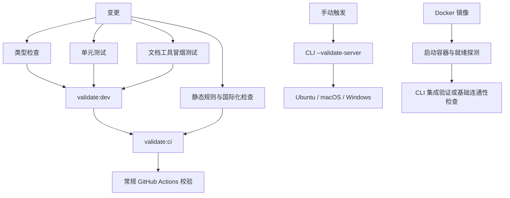

本页聚焦仓库如何通过自动化测试、静态校验和服务器集成验证降低变更风险：从本地可执行的验证入口，到 GitHub Actions 的持续集成，再到跨平台服务器验证和 Docker 冒烟测试。这里讨论的是验证机制及其边界，不展开各产品模块的实现或部署操作。  
Sources: [package.json](package.json#L23-L55) [validate.yml](.github/workflows/validate.yml#L1-L42) [validate-server.yml](.github/workflows/validate-server.yml#L1-L44)

## 验证层次与职责

仓库的验证并非单一测试命令，而是由不同粒度的检查组成：单元测试覆盖代码行为，TypeScript 检查验证类型约束，ESLint 与仓库专用脚本执行静态规则，文档工具冒烟测试验证 Python 工具链；服务器集成工作流则从 CLI 调用真实服务器验证端到端行为。需要注意，根目录 `test` 脚本与 `validate:dev` 的测试集合并不相同：后者实际串联类型检查、指定的共享包测试和文档工具冒烟测试。  
Sources: [package.json](package.json#L24-L43) [validate-server.yml](.github/workflows/validate-server.yml#L34-L44)

## 本地测试与校验入口

根目录提供多个面向不同目标的脚本。`bun run test` 执行 Bun 测试发现，并继续查找 `.isolated.ts` 文件逐个执行；`bun run typecheck:all` 按顺序检查多个核心包、服务端、Electron 与 UI；`bun run test:shared:all` 将共享包的 LLM 连接、模型和配置测试分组运行；`bun run test:doc-tools` 则使用 Python `unittest` 执行文档工具的 smoke tests。开发者可按变更范围选择较小的检查，也可运行 `bun run validate:dev` 执行其集成集合。  
Sources: [package.json](package.json#L23-L43)

| 入口 | 覆盖内容 | 适用场景 |
|---|---|---|
| `bun run test` | Bun 测试及 `.isolated.ts` 文件 | 快速执行仓库测试发现入口 |
| `bun run typecheck:all` | 多个核心包、服务端、Electron、UI 的 TypeScript 检查 | 涉及跨包类型或接口变更 |
| `bun run test:shared:all` | 共享包的连接、模型及配置相关测试 | 修改共享配置或模型逻辑 |
| `bun run test:doc-tools` | Python 文档工具 smoke tests | 修改文档处理工具 |
| `bun run validate:dev` | 全量类型检查、上述共享包测试和文档工具测试 | 提交前执行开发验证集合 |
| `bun run validate:ci` | `validate:dev` 加国际化一致性、排序、覆盖检查 | 对齐常规 CI 验证入口 |

这些入口的范围有明确差异：根目录 `test` 并未被 `validate:dev` 直接调用；而 `validate:ci` 也没有调用根目录 `lint` 脚本。阅读或扩展验证流程时，应以脚本定义和 CI 工作流中的实际命令为准，不应把名称相近的命令视为等价。  
Sources: [package.json](package.json#L24-L55) [validate.yml](.github/workflows/validate.yml#L36-L42)

## 常规 CI：推送与拉取请求校验

`.github/workflows/validate.yml` 在拉取请求、推送到 `main` 和手动触发时运行。工作流使用 Ubuntu，安装 Bun `1.3.10` 与 `uv`，随后检查 Git 跟踪文件名中是否含 Windows 非法字符，使用 `bun install --frozen-lockfile` 安装依赖，最后运行 `bun run validate:ci`。同一工作流、同一 ref 的并发运行会被分组，并配置为新运行开始时取消旧运行。  
Sources: [validate.yml](.github/workflows/validate.yml#L1-L42)

常规 CI 的主要校验链为 `validate:dev`，之后追加国际化资源校验：`lint:i18n:parity` 检查语言资源一致性，`lint:i18n:sorted` 以检查模式确认排序，`lint:i18n:coverage` 检查覆盖情况。工作流中的 Windows 文件名检查是另一项独立保护；它并不意味着常规验证矩阵会在 Windows 上执行，因为该工作流明确配置为 `ubuntu-latest`。  
Sources: [package.json](package.json#L42-L43) [validate.yml](.github/workflows/validate.yml#L14-L42)

## 服务器集成验证与跨平台矩阵

服务器集成验证由单独的 `validate-server.yml` 工作流承担，触发方式是 `workflow_dispatch`，即手动启动。该工作流通过矩阵分别在 `ubuntu-latest`、`macos-latest` 与 `windows-latest` 上执行，安装 Bun `1.3.10` 和冻结锁文件依赖后，调用 CLI 的 `--validate-server` 参数；同时传入 `--no-spinner`、超时值 `180000` 和工作区目录 `.github/agents`。工作流把 Anthropic 与 Stitch API 凭据从 GitHub Secrets 注入环境。  
Sources: [validate-server.yml](.github/workflows/validate-server.yml#L1-L44)

与常规 CI 的静态和单元级检查不同，这条验证路径通过 CLI 对服务器执行集成验证；工作流步骤说明还指出验证包含自动化条件的通过与失败场景。矩阵配置 `fail-fast: true`，且作业超时为 15 分钟。因为它只由手动触发，不能据此推断每个拉取请求都会自动运行跨平台服务器集成测试。  
Sources: [validate-server.yml](.github/workflows/validate-server.yml#L8-L12) [validate-server.yml](.github/workflows/validate-server.yml#L34-L44)

## Docker 冒烟测试的验证边界

`scripts/docker-smoke-test.sh` 接受镜像标签作为参数，并支持通过 `SMOKE_TEST_TIMEOUT` 调整等待服务就绪的时限，默认值为 30 秒。脚本启动容器时配置服务器令牌以及 RPC 监听地址和端口，通过容器日志中的 `CRAFT_SERVER_URL=` 标记判断服务是否就绪；容器提前退出或超时未就绪时，会输出容器日志并失败。  
Sources: [docker-smoke-test.sh](scripts/docker-smoke-test.sh#L18-L20) [docker-smoke-test.sh](scripts/docker-smoke-test.sh#L39-L78)

就绪后，脚本优先在本地具备 Bun 且 CLI 源文件存在时调用 `--validate-server` 验证镜像中的服务器；若 CLI 不可用，则退回基础端口连通性检查。该 fallback 的验证强度较低：它只能确认端口可达，不能替代 CLI 集成验证。因此，判断镜像是否通过了完整集成验证时，应确认脚本走的是 CLI 分支，而不是仅依赖连通性检查。  
Sources: [docker-smoke-test.sh](scripts/docker-smoke-test.sh#L81-L115)

## 如何选用验证路径

对于局部改动，先执行与受影响模块匹配的测试或类型检查；涉及多个工作区包时运行 `bun run typecheck:all`，提交前可用 `bun run validate:dev` 覆盖其配置的开发验证集合。需要对齐常规 CI 时运行 `bun run validate:ci`。若变更涉及服务器与 CLI 的端到端行为，或需要确认跨操作系统兼容性，则使用手动触发的服务器集成工作流；若验证的是容器镜像启动和 RPC 可达性，则使用 Docker smoke test，并区分 CLI 验证与端口检查两个结果。  
Sources: [package.json](package.json#L28-L43) [validate.yml](.github/workflows/validate.yml#L14-L42) [validate-server.yml](.github/workflows/validate-server.yml#L1-L44) [docker-smoke-test.sh](scripts/docker-smoke-test.sh#L81-L109)

后续可继续阅读 [本地开发、构建、类型检查与测试](8-ben-di-kai-fa-gou-jian-lei-xing-jian-cha-yu-ce-shi) 了解开发机上的工作流，或阅读 [跨平台打包、资源构建与发布流程](25-kua-ping-tai-da-bao-zi-yuan-gou-jian-yu-fa-bu-liu) 了解验证之后的构建与交付。