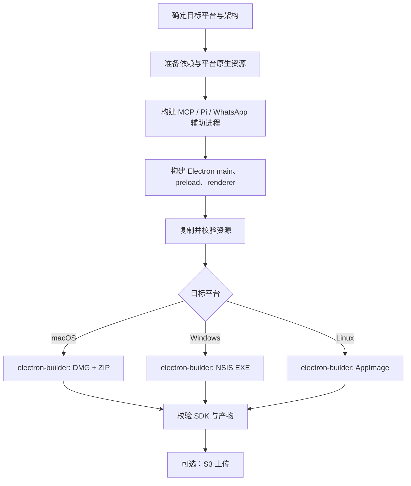

本页说明 Electron 桌面应用如何从源码构建主进程、预加载脚本、渲染器及随包资源，再由 electron-builder 生成 macOS、Windows、Linux 安装产物；同时梳理构建脚本中对原生二进制的暂存和校验，以及可选的 S3 上传入口。重点是**构建产物如何形成、平台差异如何处理、打包如何验证**，不展开服务器部署或应用运行时配置。Sources: [package.json](package.json#L35-L86) [electron-builder.yml](apps/electron/electron-builder.yml#L1-L80)

## 构建链路：应用代码、辅助进程与平台资源

桌面发布并非单一步骤的 Electron 编译。构建前需要准备辅助服务及其原生依赖；Electron 应用构建脚本再生成 main、preload、renderer、网络拦截器与资源副本；最后 electron-builder 根据目标平台选择文件、原生二进制和安装格式。跨平台构建脚本把这些阶段组织成共同准备流程与平台专属打包流程。Sources: [package.json](package.json#L52-L86) [common.ts](scripts/build/common.ts#L530-L650) [electron-builder.yml](apps/electron/electron-builder.yml#L1-L80)

Sources: [common.ts](scripts/build/common.ts#L530-L650) [darwin.ts](scripts/build/darwin.ts#L20-L78) [win32.ts](scripts/build/win32.ts#L200-L295) [linux.ts](scripts/build/linux.ts#L20-L83)

## Electron 应用构建与资源落点

根目录 `electron:build` 按顺序执行 main、preload、renderer、resources 和 assets 构建；Electron 的 package 脚本还定义 toolbar preload、interceptor 与构建后资产校验。`electron-build-resources.ts` 将 `apps/electron/resources` 递归复制到 `apps/electron/dist/resources`，而 electron-builder 将 `dist/**/*` 纳入应用文件，因此资源复制是源码资源进入打包文件集的关键环节。Windows 构建流程也会复制资源，并单独复制共享文档资产到 `dist/assets/docs`。Sources: [package.json](package.json#L58-L76) [apps/electron/package.json](apps/electron/package.json#L15-L32) [electron-build-resources.ts](scripts/electron-build-resources.ts#L1-L20) [win32.ts](scripts/build/win32.ts#L200-L215) [electron-builder.yml](apps/electron/electron-builder.yml#L10-L23)

| 阶段 | 产物或输入 | 构建定义 |
|---|---|---|
| 主进程 | `dist/main.cjs` | esbuild 以 Node 平台、CJS 格式打包，并将 Electron 标记为外部依赖 |
| 预加载 | `dist/bootstrap-preload.cjs` | esbuild 输出 CJS，Electron 保持外部依赖 |
| 渲染器 | `dist/renderer` | Vite build |
| 资源 | `dist/resources` | 将 `apps/electron/resources` 递归复制 |
| 辅助进程 | MCP、Pi agent、WhatsApp worker 文件 | 由共同构建逻辑生成并暂存到 resources 或 extraResources 对应来源 |
Sources: [apps/electron/package.json](apps/electron/package.json#L15-L32) [electron-build-resources.ts](scripts/electron-build-resources.ts#L1-L20) [common.ts](scripts/build/common.ts#L530-L650) [electron-builder.yml](apps/electron/electron-builder.yml#L10-L43)

electron-builder 配置将 `dist/**/*`、应用 `package.json`、MCP 与 Pi server 资源、Python 工具脚本和跨平台命令包装脚本纳入文件集；原生 SDK、ripgrep 和 WhatsApp worker 则通过 `extraResources` 单独复制。配置明确排除 `node_modules/**/*`，因此不能仅依赖常规文件收集机制来携带这些运行时依赖。macOS、Windows、Linux 配置分别选择适用平台资源，并排除其他平台的二进制目录。Sources: [electron-builder.yml](apps/electron/electron-builder.yml#L10-L60) [electron-builder.yml](apps/electron/electron-builder.yml#L80-L141) [electron-builder.yml](apps/electron/electron-builder.yml#L143-L216)

## 平台与架构差异

跨平台构建的目标类型由 `common.ts` 定义为 `darwin | win32 | linux` 与 `x64 | arm64`。配置映射 Bun、uv 的下载命名与平台目录；其中 Windows 和 Linux 的 x64 Bun 选择 baseline 构建。uv 下载后会使用发布方 SHA-256 校验文件，再解压并放入 `resources/bin/<platform>-<arch>`。Bun 同样下载校验和清单并验证 SHA-256，之后复制到 `vendor/bun`。Sources: [common.ts](scripts/build/common.ts#L1-L80) [common.ts](scripts/build/common.ts#L90-L200)

| 平台 | 架构与打包目标 | 主要平台差异 |
|---|---|---|
| macOS | arm64、x64；DMG 与 ZIP | 支持签名身份与公证凭据检测；验证 `.app` 内 SDK 原生二进制，并检查 DMG、提示 ZIP 是否存在 |
| Windows | x64；NSIS 安装器 | 使用 Node.js 构建逻辑、hoisted linker，并对 electron-builder 失败进行最多 3 次重试 |
| Linux | x64；AppImage | 验证 unpacked 应用中的 SDK；将 electron-builder 生成的 `x86_64` 命名改为统一的 `x64` 命名 |
Sources: [electron-builder.yml](apps/electron/electron-builder.yml#L90-L141) [electron-builder.yml](apps/electron/electron-builder.yml#L143-L216) [darwin.ts](scripts/build/darwin.ts#L20-L78) [win32.ts](scripts/build/win32.ts#L220-L295) [linux.ts](scripts/build/linux.ts#L20-L83)

配置中的安装与运行约束也会影响打包方式：Windows NSIS 设置为 per-user 安装，而非 per-machine；配置注释说明，这是因为 Bun 子进程无法在 `Program Files` 中读写文件。Windows 打包还将 Bun、uv 从普通 `files` 收集路径排除，再通过 `extraResources` 复制，以规避 electron-builder 收集 `.exe` 时遇到的文件锁定问题。Sources: [electron-builder.yml](apps/electron/electron-builder.yml#L143-L191) [win32.ts](scripts/build/win32.ts#L1-L6)

macOS 目标为 arm64 和 x64，分别生成 `Craft-Agents-<arch>.dmg` 与 ZIP；DMG 配置包含背景、应用程序目录快捷方式和窗口布局。Windows 只定义 x64 NSIS，Linux 只定义 x64 AppImage。Linux 构建脚本将 electron-builder 默认的 `x86_64` 输出重命名为 `Craft-Agents-x64.AppImage`，使应用产物命名保持统一。Sources: [electron-builder.yml](apps/electron/electron-builder.yml#L90-L141) [electron-builder.yml](apps/electron/electron-builder.yml#L143-L216) [linux.ts](scripts/build/linux.ts#L48-L83)

## 原生依赖暂存与完整性校验

Claude Agent SDK 的 native CLI 与 SDK 主包分开。共同构建逻辑把 SDK core 复制到 Electron 的 `node_modules/@anthropic-ai`，再按目标平台和架构选择 `claude-agent-sdk-<platform>-<arch>`，将其复制到稳定别名 `claude-agent-sdk-binary`。复制后校验目标二进制存在、不是符号链接且至少 50 MB；打包后的 macOS、Windows、Linux 流程也会检查对应 `claude` 或 `claude.exe` 文件及最小尺寸。Sources: [common.ts](scripts/build/common.ts#L300-L398) [darwin.ts](scripts/build/darwin.ts#L10-L18) [win32.ts](scripts/build/win32.ts#L10-L26) [linux.ts](scripts/build/linux.ts#L10-L26)

Pi agent server 构建使用 Bun target 与 ESM 输出，并将原生模块 `koffi` 外置；暂存时复制其 JavaScript 文件及目标平台目录中的 native binary。若目标平台原生目录缺失，代码会回退复制整个 `build` 目录。WhatsApp worker 则由 `build:wa-worker` 构建为 `worker.cjs`，electron-builder 将其作为 `extraResources` 放入应用资源目录。Sources: [common.ts](scripts/build/common.ts#L470-L528) [common.ts](scripts/build/common.ts#L600-L650) [electron-builder.yml](apps/electron/electron-builder.yml#L80-L141)

## 产物、命名与验证

electron-builder 的输出目录配置为 `apps/electron/release`。当前配置的发行形式是 macOS DMG/ZIP、Windows NSIS EXE 和 Linux AppImage；macOS 与 Windows 产物采用 `Craft-Agents-${arch}` 命名，Linux 构建脚本将架构名称归一化后输出 `Craft-Agents-x64.AppImage`。根目录脚本提供按平台调用的 `electron:dist:mac`、`electron:dist:win` 和 `electron:dist:linux` 命令，每个命令先执行 `electron:build`，再运行 electron-builder。Sources: [electron-builder.yml](apps/electron/electron-builder.yml#L1-L10) [electron-builder.yml](apps/electron/electron-builder.yml#L115-L141) [electron-builder.yml](apps/electron/electron-builder.yml#L143-L216) [linux.ts](scripts/build/linux.ts#L48-L83) [package.json](package.json#L75-L86)

发布流程在平台打包之后进行产物级检查。macOS 脚本要求 DMG 存在，并对 ZIP 缺失发出警告；Windows 脚本在 `win-unpacked` 存在时检查 SDK，然后在 release 目录中查找非 blockmap 的 EXE；Linux 脚本要求 AppImage 存在，并在 unpacked 目录可用时检查 SDK。Windows 若 `win-unpacked` 不存在会跳过 SDK 检查，Linux 同样会在 `linux-unpacked` 不存在时跳过该项验证。Sources: [darwin.ts](scripts/build/darwin.ts#L44-L78) [win32.ts](scripts/build/win32.ts#L250-L295) [linux.ts](scripts/build/linux.ts#L34-L83)

## 本地构建与上传入口

仓库根目录的 `electron:dist` 命令先构建 Electron 应用，再在 `apps/electron` 目录运行 electron-builder；按平台的 `electron:dist:mac`、`electron:dist:win`、`electron:dist:linux` 采用同一构建前置步骤并指定目标平台。根目录另有 `build` 与 `release` 脚本入口，但对应的 `scripts/build.ts`、`scripts/release.ts` 文件不在当前仓库脚本目录结构中，因此本页不据此推断其实际行为。Sources: [package.json](package.json#L75-L86) [scripts](scripts#L1-L18)

共同构建工具提供可选 S3 上传：只有 `upload` 启用时才检查 `S3_VERSIONS_BUCKET_ENDPOINT`、`S3_VERSIONS_BUCKET_ACCESS_KEY_ID`、`S3_VERSIONS_BUCKET_SECRET_ACCESS_KEY`，并调用 `scripts/upload.ts --electron`；还可追加 `--latest` 或 `--script`。electron-builder 配置的通用更新发布地址为 `https://agents.craft.do/electron/latest`。这说明构建产物上传与更新发布元数据存在配置入口，但具体存储布局和发布操作细节不在本页范围内。Sources: [common.ts](scripts/build/common.ts#L680-L746) [electron-builder.yml](apps/electron/electron-builder.yml#L68-L76)

## 故障定位要点

SDK 校验失败时，先区分构建前暂存与打包后检查：前者要求目标平台 SDK 包可用并生成稳定别名；后者要求打包目录中存在原生 CLI 且文件尺寸达到阈值。Bun 或 uv 下载失败时，构建逻辑会校验下载内容与发布方 SHA-256；应优先检查目标平台映射、下载资产及校验结果。Windows 打包失败则存在进程清理、目录删除重试和最多三次 electron-builder 重试机制，日志可用于判断是否属于文件锁问题。Sources: [common.ts](scripts/build/common.ts#L90-L200) [common.ts](scripts/build/common.ts#L300-L398) [win32.ts](scripts/build/win32.ts#L30-L105) [win32.ts](scripts/build/win32.ts#L220-L250)

若产物缺失，检查平台脚本报告的目标文件名与 `apps/electron/release` 内容；Linux 需特别留意 electron-builder 的架构名转换。若应用内资源缺失，核对资源是否被复制至 `dist/resources`，以及 electron-builder 的 `files`、`extraResources` 与平台排除规则是否覆盖所需文件。Sources: [darwin.ts](scripts/build/darwin.ts#L50-L72) [linux.ts](scripts/build/linux.ts#L48-L70) [electron-build-resources.ts](scripts/electron-build-resources.ts#L1-L20) [electron-builder.yml](apps/electron/electron-builder.yml#L10-L60)

## 延伸阅读

构建与发布属于质量交付链路；后续可阅读 [测试策略、CI 校验与集成验证](24-ce-shi-ce-lue-ci-xiao-yan-yu-ji-cheng-yan-zheng)，了解 CI 校验背景，再参阅 [Docker 与生产环境部署](6-docker-yu-sheng-chan-huan-jing-bu-shu) 区分桌面安装包与服务器部署产物。Sources: [validate.yml](.github/workflows/validate.yml#L1-L46) [package.json](package.json#L75-L86)