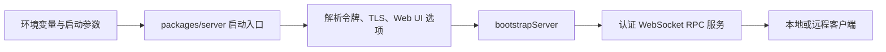

本页聚焦无头服务器的运行时配置、服务端令牌与传输安全：说明环境变量如何进入启动流程、哪些参数会影响监听和 Web UI，以及远程连接时 TLS 与显式不安全覆盖的边界。桌面应用、工作区凭据和 Docker 部署步骤分别见[桌面应用：配置模型、工作区与会话](3-zhuo-mian-ying-yong-pei-zhi-mo-xing-gong-zuo-qu-yu-hui-hua)与[Docker 与生产环境部署](6-docker-yu-sheng-chan-huan-jing-bu-shu)。  
Sources: [index.ts](packages/server/src/index.ts#L1-L27) [headless-start.ts](packages/server-core/src/bootstrap/headless-start.ts#L264-L306)

## 配置如何生效

服务器配置主要由环境变量提供；启动入口读取相关值、解析 TLS 与 Web UI 选项，再将令牌和 TLS 配置传给 `bootstrapServer`。引导层负责检查令牌、确定监听地址与端口，并创建要求身份验证的 WebSocket RPC 服务。默认监听地址为 `127.0.0.1`，默认端口为 `9100`。  
Sources: [index.ts](packages/server/src/index.ts#L68-L128) [headless-start.ts](packages/server-core/src/bootstrap/headless-start.ts#L264-L306)

Sources: [index.ts](packages/server/src/index.ts#L68-L128) [headless-start.ts](packages/server-core/src/bootstrap/headless-start.ts#L264-L306)

## 服务器环境变量

| 变量 | 用途与行为 |
|---|---|
| `CRAFT_SERVER_TOKEN` | 必需的客户端认证令牌；未设置时启动失败。 |
| `CRAFT_RPC_HOST` | RPC 监听地址，默认 `127.0.0.1`。设置为非本机地址会触发无 TLS 保护检查。 |
| `CRAFT_RPC_PORT` | RPC 监听端口，默认 `9100`；引导层校验数值范围为 `0`–`65535`。 |
| `CRAFT_RPC_TLS_CERT`、`CRAFT_RPC_TLS_KEY` | PEM 证书与私钥；必须同时设置，提供后启用 `wss://`。 |
| `CRAFT_RPC_TLS_CA` | 可选 PEM CA 链；仅在读取 TLS 配置时一并加载。 |
| `CRAFT_WEBUI_DIR` | Web UI 静态资源目录；目录存在且设置服务器令牌时才创建 Web UI handler。 |
| `CRAFT_WEBUI_PASSWORD` | Web UI 登录密码；未提供时回退使用 `CRAFT_SERVER_TOKEN`。 |
| `CRAFT_WEBUI_SECURE_COOKIE` | Web UI 会话 Cookie 的 `Secure` 标志覆盖值；接受 `true/false`、`1/0`、`yes/no`、`on/off`，其他非空值会导致启动退出。 |
| `CRAFT_WEBUI_WS_URL` | 可选浏览器端 WebSocket 地址，只接受 `ws://` 或 `wss://`。 |
| `CRAFT_HEALTH_PORT` | 可选健康检查 HTTP 服务端口；未设置时解析为 `0`。 |

Sources: [index.ts](packages/server/src/index.ts#L1-L27) [index.ts](packages/server/src/index.ts#L68-L128) [index.ts](packages/server/src/index.ts#L320-L327) [headless-start.ts](packages/server-core/src/bootstrap/headless-start.ts#L297-L306)

启动入口还支持 `CRAFT_DEBUG=true` 或 `CRAFT_DEBUG=1` 开启调试日志。`CRAFT_IS_PACKAGED` 在未设置时默认为 `false`；`CRAFT_VERSION` 默认取服务器包版本，`CRAFT_BUNDLED_ASSETS_ROOT` 默认取仓库资产根目录（开发环境）或当前工作目录（打包环境）。WhatsApp 子进程相关的 `CRAFT_MESSAGING_WA_WORKER` 与 `CRAFT_MESSAGING_NODE_BIN` 分别覆盖 worker 路径与 Node 可执行文件，默认 worker 路径基于资产根目录解析，Node 命令默认为 `node`。  
Sources: [index.ts](packages/server/src/index.ts#L29-L66) [index.ts](packages/server/src/index.ts#L128-L133)

## 令牌强度与认证

`CRAFT_SERVER_TOKEN` 不只是连接参数，也是 RPC 身份验证凭据：服务器要求认证，并通过令牌相等性校验客户端提供的令牌。令牌长度少于 16 个字符或由同一个字符重复组成时，引导失败；长度足够但唯一字符少于 8 个时会记录警告。内置 `--generate-token` 选项生成 48 位十六进制字符串，使用 24 个随机字节，即 192 位熵。  
Sources: [index.ts](packages/server/src/index.ts#L29-L32) [headless-start.ts](packages/server-core/src/bootstrap/headless-start.ts#L80-L116) [headless-start.ts](packages/server-core/src/bootstrap/headless-start.ts#L264-L275) [headless-start.ts](packages/server-core/src/bootstrap/headless-start.ts#L300-L304)

令牌应作为秘密凭据管理，不应提交到仓库或通过未加密连接发送。安装脚本会生成令牌并打印可直接运行服务器的命令，因此应限制该终端输出和命令历史的访问；脚本也明确提示令牌无法恢复。`.env.example` 中的 `ANTHROPIC_API_KEY`、`CRAFT_MCP_URL` 等示例属于示例环境配置，不等同于无头服务器入口所要求的 `CRAFT_SERVER_TOKEN`。  
Sources: [install-server.sh](scripts/install-server.sh#L50-L76) [.env.example](.env.example#L1-L13)

## 远程监听与 TLS

当监听地址不是 `127.0.0.1`、`localhost` 或 `::1`，且当前传输协议为明文 `ws` 时，入口会拒绝启动并停止服务器。原因是认证令牌会以明文传输。要在网络地址上监听，应同时配置 `CRAFT_RPC_TLS_CERT` 和 `CRAFT_RPC_TLS_KEY`，使 RPC 使用 `wss://`；只配置其中之一会立即报错。代码还提供 `--allow-insecure-bind` 覆盖选项，但会输出令牌明文传输警告，不应将其视为生产环境的安全配置。  
Sources: [index.ts](packages/server/src/index.ts#L89-L104) [index.ts](packages/server/src/index.ts#L327-L350)

| 场景 | 传输与结果 |
|---|---|
| 绑定回环地址，未配置 TLS | 使用 `ws://`；仍要求令牌认证。 |
| 绑定非回环地址，已配置证书和私钥 | 使用 `wss://`；服务器可继续启动。 |
| 绑定非回环地址，未配置 TLS | 默认拒绝启动。 |
| 绑定非回环地址，未配置 TLS，且显式传入 `--allow-insecure-bind` | 允许继续，但认证令牌会以明文传输。 |

Sources: [index.ts](packages/server/src/index.ts#L89-L104) [index.ts](packages/server/src/index.ts#L327-L350) [headless-start.ts](packages/server-core/src/bootstrap/headless-start.ts#L300-L306)

## Web UI 与 Cookie 会话

Web UI 与 RPC 共用 RPC 端口。只有在 `CRAFT_WEBUI_DIR` 指向存在的目录且设置了 `CRAFT_SERVER_TOKEN` 时，启动入口才创建 Web UI handler；该 handler 默认以服务器令牌作为登录秘密，也可以通过 `CRAFT_WEBUI_PASSWORD` 设置单独密码。启用 Web UI 后，服务器还会在 WebSocket 升级时校验会话 Cookie。`CRAFT_WEBUI_SECURE_COOKIE` 可显式覆盖会话 Cookie 的 Secure 标志；此配置影响 Cookie 行为，不会替代远程连接所需的 TLS。  
Sources: [index.ts](packages/server/src/index.ts#L106-L128) [index.ts](packages/server/src/index.ts#L155-L166) [index.ts](packages/server/src/index.ts#L270-L291)

## 安全配置检查顺序

1. 为 `CRAFT_SERVER_TOKEN` 设置强随机值；可使用服务器入口的 `--generate-token` 生成。
2. 本机使用时保留默认回环监听地址；需要远程访问时，配置证书与私钥并启用 TLS。
3. 确认远程监听没有依赖 `--allow-insecure-bind` 绕过保护。
4. 若启用 Web UI，检查资源目录、登录密码和 Cookie 配置；避免将服务器令牌暴露给无关人员。

源码中的安装脚本展示了生成令牌后的运行参数以及 TLS 变量名称。其“TLS（推荐用于非 localhost）”提示与服务器启动时对非回环明文监听的拒绝逻辑一致。  
Sources: [install-server.sh](scripts/install-server.sh#L50-L100) [index.ts](packages/server/src/index.ts#L327-L350)

继续了解部署方式可参阅[无头服务器：启动、鉴权与远程桌面连接](4-wu-tou-fu-wu-qi-qi-dong-jian-quan-yuan-cheng-zhuo-mian-lian-jie)与[Docker 与生产环境部署](6-docker-yu-sheng-chan-huan-jing-bu-shu)。