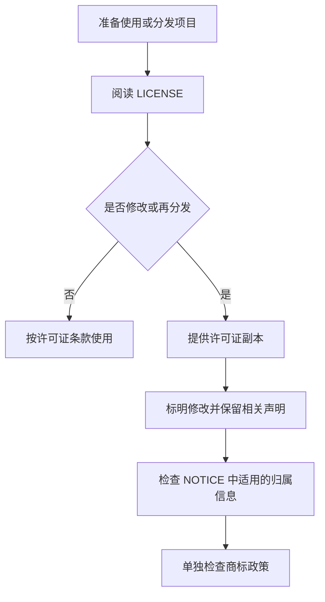

本页说明 Craft Agents 仓库中可核实的许可证、第三方声明和商标政策，帮助开发者在使用、修改或分发项目时找到需要遵循的文件。它是项目文件的导航与摘要，不替代法律意见；具体条件请以对应文件全文为准。Sources: [LICENSE](LICENSE#L1-L6), [NOTICE](NOTICE#L1-L16), [TRADEMARK.md](TRADEMARK.md#L1-L3)

## 项目代码许可证

仓库根目录的 `LICENSE` 使用 **Apache License 2.0**。项目根 `package.json` 也将许可证标记为 `Apache-2.0`。许可证授予使用、复制、修改、分发及再许可等权利，但分发时须满足许可证条件；不能仅凭“开源”或“可商用”的概括，忽略这些条件。Sources: [LICENSE](LICENSE#L67-L72), [LICENSE](LICENSE#L90-L105), [package.json](package.json#L1-L7)

对于分发项目或其衍生作品，初学者可先核对以下事项：

| 情况 | 需要注意的事项 |
|---|---|
| 向他人提供项目或衍生作品 | 向接收者提供 Apache 2.0 许可证副本。 |
| 修改了文件 | 在修改过的文件中显著标明已作修改。 |
| 分发衍生作品的源代码 | 保留与衍生作品相关的原始版权、专利、商标和归属声明。 |
| 原项目附有 `NOTICE` 文件 | 按许可证要求，在分发物、随附文档或适当的显示位置提供相关归属声明。 |

这些是许可证条款的摘要；是否适用及如何履行，应以 Apache 2.0 原文为准。Sources: [LICENSE](LICENSE#L90-L122)

此图仅用于定位检查顺序：许可证规定代码使用和分发条件，`NOTICE` 提供归属信息，而商标使用还须单独遵守商标政策。Sources: [LICENSE](LICENSE#L90-L122), [LICENSE](LICENSE#L139-L142), [NOTICE](NOTICE#L1-L16), [TRADEMARK.md](TRADEMARK.md#L14-L22)

## 第三方声明与依赖许可证

根目录 `NOTICE` 说明产品包含 Craft Docs Ltd. 开发的软件，列出 Claude Agent SDK 所受的 Anthropic 商业服务条款，并指出第三方依赖列在各 `package.json` 文件中、受各自许可证约束。因此，根许可证不能被理解为自动覆盖所有依赖或 SDK；使用、打包或分发包含这些组件的版本时，应进一步检查相关组件的条款。Sources: [NOTICE](NOTICE#L1-L16)

仓库根 `package.json` 的依赖清单可帮助识别根工作区声明的依赖，但 `NOTICE` 明确将第三方依赖指向各 `package.json` 文件。检查时应根据实际包含的工作区与依赖，查阅相应清单及其许可证信息；不要仅凭某个包名或根目录许可证推断第三方组件的许可条件。Sources: [NOTICE](NOTICE#L14-L16), [package.json](package.json#L18-L22), [package.json](package.json#L140-L150)

## Craft 与 Craft Agents 商标

`TRADEMARK.md` 将 **Craft**、**Craft Agents** 名称，以及 Craft 和 Craft Agents 的标志与图标列为 Craft Docs Ltd. 的商标。Apache 2.0 许可证本身不授予使用许可方商品名、商标、服务标志或产品名称的权利；其列出的例外限于合理、惯常地描述作品来源，以及复制 `NOTICE` 内容所需的使用。Sources: [TRADEMARK.md](TRADEMARK.md#L5-L12), [LICENSE](LICENSE#L139-L142)

商标政策允许对项目作准确、事实性的描述，例如“基于 Craft Agents”或“与 Craft Agents 兼容”。政策也明确区分了**使用代码**与**使用品牌**：代码可依 Apache 2.0 条款使用，但这不等于可以把 Craft 品牌用作自己的产品名称或标志。Sources: [TRADEMARK.md](TRADEMARK.md#L14-L31), [TRADEMARK.md](TRADEMARK.md#L48-L63)

| 场景 | 仓库政策中的说明 |
|---|---|
| 描述项目关系 | 可使用准确的事实表述，例如“基于 Craft Agents”。 |
| 为分叉或衍生作品命名 | 必须选择不含 “Craft” 的其他名称。 |
| 分叉作品使用图形品牌 | 必须移除或替换 Craft 标志和图标。 |
| 产品外观可能暗示官方关系 | 不得暗示作品是官方版本、由 Craft Docs Ltd. 创建或获其背书。 |
| 更新分叉项目中的品牌配置 | 政策列出 Electron 构建配置、应用资源和共享品牌文件作为需要检查的位置。 |

以上要求摘自仓库商标政策；政策还要求分叉项目更新 bundle identifier，并移除 `craft.do` 域名引用（连接官方 Craft 服务的情况除外）。Sources: [TRADEMARK.md](TRADEMARK.md#L37-L63), [TRADEMARK.md](TRADEMARK.md#L65-L73)

## 实际检查顺序

准备分发项目或创建分叉时，可按以下顺序核对：先阅读 `LICENSE`，确认 Apache 2.0 的分发条件；再阅读 `NOTICE` 并检查相关工作区的依赖清单；最后阅读 `TRADEMARK.md`，确认名称、图标、产品标识和服务域名的使用符合政策。遇到具体许可或商标问题，仓库政策建议通过项目 issue 或 `legal@craft.do` 联系。Sources: [LICENSE](LICENSE#L90-L122), [NOTICE](NOTICE#L9-L16), [TRADEMARK.md](TRADEMARK.md#L65-L73), [TRADEMARK.md](TRADEMARK.md#L90-L96)

## 延伸阅读

如需继续了解仓库开发与交付背景，可阅读[贡献流程、行为准则与安全问题报告](9-gong-xian-liu-cheng-xing-wei-zhun-ze-yu-an-quan-wen-ti-bao-gao)；如果关注构建产物如何生成，可阅读[跨平台打包、资源构建与发布流程](25-kua-ping-tai-da-bao-zi-yuan-gou-jian-yu-fa-bu-liu-cheng)。本页只说明许可证、第三方声明与商标使用，不展开这些主题。Sources: [TRADEMARK.md](TRADEMARK.md#L65-L73), [LICENSE](LICENSE#L90-L122)