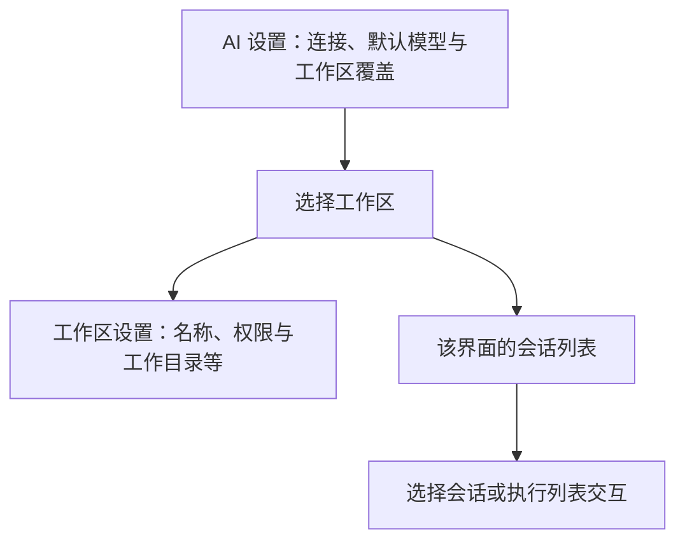
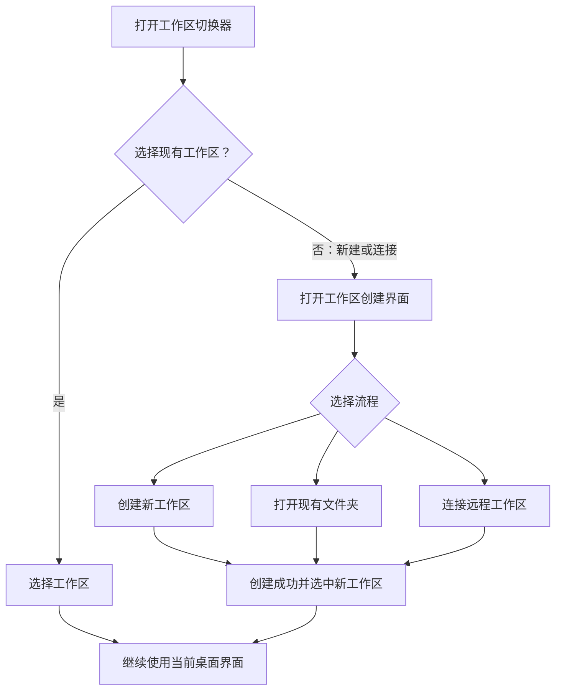

桌面应用中的日常使用可以理解为三个相互关联的层次：先配置可用的 AI 连接与模型，再选择工作区，最后在该工作区中查看和使用会话。本页聚焦这些桌面界面及其可验证的交互关系；服务器部署、凭据存储机制和会话持久化细节不在本页展开。Sources: [AiSettingsPage.tsx](apps/electron/src/renderer/pages/settings/AiSettingsPage.tsx#L1-L8)、[WorkspaceSwitcher.tsx](apps/electron/src/renderer/components/app-shell/WorkspaceSwitcher.tsx#L18-L41)、[SessionList.tsx](apps/electron/src/renderer/components/app-shell/SessionList.tsx#L34-L40)

## 先理解三者的关系

**模型配置**决定应用可使用哪些连接和模型；**工作区**是桌面应用选择和管理的工作环境；**会话列表**则展示当前界面提供的会话条目，并通过工作区 ID 等上下文执行筛选、导航等交互。AI 设置页的说明明确区分应用级默认值与工作区覆盖项；工作区设置页则通过当前工作区 ID 加载工作区配置。Sources: [AiSettingsPage.tsx](apps/electron/src/renderer/pages/settings/AiSettingsPage.tsx#L1-L8)、[WorkspaceSettingsPage.tsx](apps/electron/src/renderer/pages/settings/WorkspaceSettingsPage.tsx#L38-L68)、[SessionList.tsx](apps/electron/src/renderer/components/app-shell/SessionList.tsx#L55-L96)

图中表达的是界面层的职责关联，而不是模型配置、工作区与会话之间的完整后台调用链。特别是会话列表接收 `items` 和可选 `workspaceId` 等属性；列表本身不负责在组件内加载全部会话数据。Sources: [AiSettingsPage.tsx](apps/electron/src/renderer/pages/settings/AiSettingsPage.tsx#L1-L8)、[WorkspaceSettingsPage.tsx](apps/electron/src/renderer/pages/settings/WorkspaceSettingsPage.tsx#L38-L68)、[SessionList.tsx](apps/electron/src/renderer/components/app-shell/SessionList.tsx#L34-L96)

| 概念 | 在桌面界面中的作用 | 初学者应记住 |
|---|---|---|
| AI 连接与模型 | 在 AI 设置中管理连接，并设置默认值或工作区级覆盖 | 连接与模型属于 AI 设置，不等同于工作区本身 |
| 工作区 | 通过切换器选择；可以进入创建流程或选择其他工作区 | 当前工作区会成为工作区设置页面的目标 |
| 会话列表 | 接收会话条目，并提供选择、搜索、分组等列表交互 | 列表组件不是会话数据的唯一来源 |

Sources: [AiSettingsPage.tsx](apps/electron/src/renderer/pages/settings/AiSettingsPage.tsx#L1-L8)、[WorkspaceSwitcher.tsx](apps/electron/src/renderer/components/app-shell/WorkspaceSwitcher.tsx#L18-L41)、[WorkspaceSettingsPage.tsx](apps/electron/src/renderer/pages/settings/WorkspaceSettingsPage.tsx#L38-L68)、[SessionList.tsx](apps/electron/src/renderer/components/app-shell/SessionList.tsx#L34-L96)

## 配置 AI 连接与默认模型

在设置界面进入 AI 设置，可管理 AI 相关配置。该页面的设计说明将内容划分为默认连接、模型与思考级别、按工作区覆盖，以及连接的添加、编辑和删除。这里的“默认值”和“工作区覆盖”是理解配置优先范围的关键：页面支持应用级默认配置，也支持工作区级差异配置。Sources: [AiSettingsPage.tsx](apps/electron/src/renderer/pages/settings/AiSettingsPage.tsx#L1-L8)

首次设置时，桌面应用提供分步向导。向导包含欢迎、Windows Git Bash 检查、提供方选择、本地模型、凭据和完成等步骤；并非每次都会经过所有步骤，实际显示内容由当前向导状态决定。根据界面流程选择提供方或本地模型，再按界面提示完成相应设置。Sources: [OnboardingWizard.tsx](apps/electron/src/renderer/components/onboarding/OnboardingWizard.tsx#L1-L20)、[OnboardingWizard.tsx](apps/electron/src/renderer/components/onboarding/OnboardingWizard.tsx#L87-L169)

模型选项取决于连接提供的数据：若连接带有显式模型列表，页面用该列表生成选项；否则回退到该提供方类型对应的模型注册表。这解释了为什么不同连接的模型下拉选项可能不同，也说明模型列表并非对所有连接固定一致。Sources: [AiSettingsPage.tsx](apps/electron/src/renderer/pages/settings/AiSettingsPage.tsx#L60-L88)

| 配置项 | 页面呈现的范围 | 使用时的理解 |
|---|---|---|
| 默认连接、模型与思考级别 | AI 设置中的默认配置 | 作为应用级 AI 配置的一部分 |
| 工作区覆盖 | 针对具体工作区的 AI 设置 | 可让不同工作区使用不同配置 |
| 连接管理 | 添加、编辑、删除连接 | 连接是模型选项来源之一 |
| 模型选项 | 连接显式模型列表，或提供方注册表回退 | 可选项会随连接而变化 |

Sources: [AiSettingsPage.tsx](apps/electron/src/renderer/pages/settings/AiSettingsPage.tsx#L1-L8)、[AiSettingsPage.tsx](apps/electron/src/renderer/pages/settings/AiSettingsPage.tsx#L60-L88)

**操作步骤：**

1. 打开应用设置中的 AI 页面。
2. 首次使用时，按向导当前显示的步骤选择提供方或本地模型，并继续完成凭据或连接设置。
3. 在 AI 设置中检查默认连接和模型；如果需要按工作区区分配置，查看相应的工作区覆盖项。
4. 保存设置后，回到工作区和会话界面继续使用。

以上步骤描述的是界面操作顺序；具体按钮名称和可用选项可能随当前向导步骤及连接类型变化。Sources: [OnboardingWizard.tsx](apps/electron/src/renderer/components/onboarding/OnboardingWizard.tsx#L87-L169)、[AiSettingsPage.tsx](apps/electron/src/renderer/pages/settings/AiSettingsPage.tsx#L1-L8)

## 选择或创建工作区

工作区切换器展示可选择的工作区，并使用当前活动工作区 ID 标记选择状态。选择其他工作区会调用父级提供的选择回调；切换器还提供创建工作区的入口。对于远程工作区，组件会在下拉菜单打开时检查非当前远程工作区的连通状态，并在界面中体现连接状态。Sources: [WorkspaceSwitcher.tsx](apps/electron/src/renderer/components/app-shell/WorkspaceSwitcher.tsx#L18-L41)、[WorkspaceSwitcher.tsx](apps/electron/src/renderer/components/app-shell/WorkspaceSwitcher.tsx#L48-L104)

新建工作区的桌面流程由创建界面管理，提供创建新工作区、打开现有文件夹和连接远程工作区等选项。创建成功后，切换器关闭创建界面、通知成功，并通过回调将新工作区选为当前工作区。Sources: [WorkspaceCreationScreen.tsx](apps/electron/src/renderer/components/workspace/WorkspaceCreationScreen.tsx#L19-L46)、[WorkspaceCreationScreen.tsx](apps/electron/src/renderer/components/workspace/WorkspaceCreationScreen.tsx#L78-L105)、[WorkspaceSwitcher.tsx](apps/electron/src/renderer/components/app-shell/WorkspaceSwitcher.tsx#L136-L151)

对于连接远程服务器后尚未指定工作区的薄客户端，`WorkspacePicker` 会向服务器获取工作区列表，并允许选择其中一个；该界面也提供输入名称创建服务器工作区的入口。这是连接服务器后的工作区选择界面，不应与桌面端本地的完整创建工作流混为一谈。Sources: [WorkspacePicker.tsx](apps/electron/src/renderer/components/workspace/WorkspacePicker.tsx#L1-L29)、[WorkspacePicker.tsx](apps/electron/src/renderer/components/workspace/WorkspacePicker.tsx#L31-L56)、[WorkspacePicker.tsx](apps/electron/src/renderer/components/workspace/WorkspacePicker.tsx#L77-L123)

## 查看工作区设置

工作区设置页读取应用上下文中的 `activeWorkspaceId`，并以该 ID 请求工作区设置。切换活动工作区后，页面会重新加载对应设置；代码中可见的设置包括名称、权限模式、工作目录、本地 MCP 启用状态，以及默认启用的来源列表。来源列表还会根据当前可用来源清理无效条目。Sources: [WorkspaceSettingsPage.tsx](apps/electron/src/renderer/pages/settings/WorkspaceSettingsPage.tsx#L38-L68)、[WorkspaceSettingsPage.tsx](apps/electron/src/renderer/pages/settings/WorkspaceSettingsPage.tsx#L70-L118)

AI 设置已从工作区设置页分离，集中到 AI 设置页面管理。因此，若要调整模型或连接，应查看 AI 设置；若要调整工作区身份、权限或工作目录，则查看工作区设置。Sources: [WorkspaceSettingsPage.tsx](apps/electron/src/renderer/pages/settings/WorkspaceSettingsPage.tsx#L1-L12)、[AiSettingsPage.tsx](apps/electron/src/renderer/pages/settings/AiSettingsPage.tsx#L1-L8)

## 使用会话列表

会话列表组件接收会话条目及其操作回调；接口还支持搜索状态、分组方式、工作区 ID、标签和视图评估等属性。列表默认按日期分组，也支持按状态或未读状态分组。对于初学者，最实用的理解是：列表负责呈现和交互，数据与操作由上层通过属性传入。Sources: [SessionList.tsx](apps/electron/src/renderer/components/app-shell/SessionList.tsx#L34-L96)、[SessionList.tsx](apps/electron/src/renderer/components/app-shell/SessionList.tsx#L101-L135)

列表支持会话选择、多选、重命名、搜索、导航和键盘操作；其接口注释列出的键盘操作包括上下方向键移动选择、左右方向键在区域间移动、Enter 聚焦聊天输入框，以及 Home/End 跳转到首尾会话。实际行为由具体界面状态和回调共同决定。Sources: [SessionList.tsx](apps/electron/src/renderer/components/app-shell/SessionList.tsx#L101-L135)、[SessionList.tsx](apps/electron/src/renderer/components/app-shell/SessionList.tsx#L140-L181)

| 想做什么 | 桌面界面入口或行为 | 注意事项 |
|---|---|---|
| 切换工作区 | 使用工作区切换器选择目标 | 工作区设置随活动工作区变化 |
| 创建工作区 | 从切换器打开创建界面，选择相应流程 | 创建完成后会回调选中新工作区 |
| 配置模型 | 在 AI 设置中管理默认值或工作区覆盖 | 模型选项取决于连接 |
| 查找或浏览会话 | 使用会话列表的搜索、筛选及分组交互 | 列表接收上层提供的数据与回调 |

Sources: [WorkspaceSwitcher.tsx](apps/electron/src/renderer/components/app-shell/WorkspaceSwitcher.tsx#L136-L151)、[WorkspaceCreationScreen.tsx](apps/electron/src/renderer/components/workspace/WorkspaceCreationScreen.tsx#L78-L105)、[AiSettingsPage.tsx](apps/electron/src/renderer/pages/settings/AiSettingsPage.tsx#L1-L8)、[SessionList.tsx](apps/electron/src/renderer/components/app-shell/SessionList.tsx#L34-L96)

## 常见困惑

**模型下拉列表没有预期选项：**先确认当前连接是否提供显式模型列表；没有时页面会使用该提供方类型的注册表模型。不同连接出现不同选项符合代码中的回退逻辑。Sources: [AiSettingsPage.tsx](apps/electron/src/renderer/pages/settings/AiSettingsPage.tsx#L60-L88)

**工作区设置看起来不一致：**工作区设置页按活动工作区 ID 加载配置。先确认当前选中的工作区，再检查对应设置；不要把 AI 设置页面中的默认配置与工作区设置页中的其他工作区属性当成同一类设置。Sources: [WorkspaceSettingsPage.tsx](apps/electron/src/renderer/pages/settings/WorkspaceSettingsPage.tsx#L38-L68)、[WorkspaceSettingsPage.tsx](apps/electron/src/renderer/pages/settings/WorkspaceSettingsPage.tsx#L1-L12)

**远程工作区显示连接问题：**切换器会检查非当前远程工作区的连接状态；当前工作区则参考实时传输连接状态。界面状态用于提示连通情况，并不等于工作区配置本身已被删除或更改。Sources: [WorkspaceSwitcher.tsx](apps/electron/src/renderer/components/app-shell/WorkspaceSwitcher.tsx#L48-L104)

## 下一步

如需从用户操作转向实现细节，可继续阅读[共享 UI 组件、桌面渲染与状态交互](22-gong-xiang-ui-zu-jian-zhuo-mian-xuan-ran-yu-zhuang-tai-jiao-hu)，了解桌面渲染与界面状态模式；若关注工作区配置和凭据管理的底层机制，可阅读[工作区配置、凭据管理与 OAuth 流程](19-gong-zuo-qu-pei-zhi-ping-ju-guan-li-yu-oauth-liu-cheng)。Sources: [WorkspaceSwitcher.tsx](apps/electron/src/renderer/components/app-shell/WorkspaceSwitcher.tsx#L18-L41)、[AiSettingsPage.tsx](apps/electron/src/renderer/pages/settings/AiSettingsPage.tsx#L1-L8)