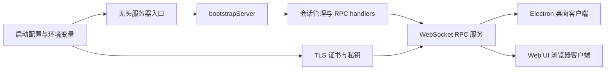

无头服务器将会话管理、RPC 处理和工具执行放在远端运行；桌面端作为客户端连接。本文聚焦如何启动服务器、配置访问鉴权，以及通过浏览器 Web UI 或 Electron 桌面客户端连接。**远程绑定时，服务器要求使用 TLS，避免认证令牌以明文传输。**  
Sources: [index.ts](packages/server/src/index.ts#L98-L119) [headless-start.ts](packages/server-core/src/bootstrap/headless-start.ts#L300-L307)

## 运行关系

服务器入口读取环境配置，并调用 `bootstrapServer` 初始化运行时、会话管理器和 RPC 处理器。RPC 通过 WebSocket 提供；配置 TLS 时使用 `wss://`。如果启用 Web UI，它的 HTTP 请求也可以由同一 RPC 端口处理。  
Sources: [index.ts](packages/server/src/index.ts#L127-L152) [index.ts](packages/server/src/index.ts#L166-L180) [headless-start.ts](packages/server-core/src/bootstrap/headless-start.ts#L324-L347) [server.ts](packages/server-core/src/transport/server.ts#L79-L113)



## 启动服务器

在仓库根目录使用 Bun 启动服务器。`CRAFT_SERVER_TOKEN` 是客户端认证所需的 bearer token；可用 `--generate-token` 生成随机令牌后，再将其配置为环境变量。代码生成的令牌为 48 个十六进制字符。  
Sources: [index.ts](packages/server/src/index.ts#L5-L14) [index.ts](packages/server/src/index.ts#L40-L44) [headless-start.ts](packages/server-core/src/bootstrap/headless-start.ts#L108-L116)

```bash
# 生成令牌
bun run packages/server/src/index.ts --generate-token

# 将生成结果作为 CRAFT_SERVER_TOKEN，并启动服务
CRAFT_SERVER_TOKEN=<生成的令牌> bun run packages/server/src/index.ts
```

服务器默认绑定 `127.0.0.1:9100`。若要从其他机器访问，需将 `CRAFT_RPC_HOST` 设置为可远程访问的地址，例如 `0.0.0.0`，并配置 TLS 证书和私钥。服务器启动后会打印 `CRAFT_SERVER_URL` 和 `CRAFT_SERVER_TOKEN`；连接时使用对应 URL 和令牌。  
Sources: [index.ts](packages/server/src/index.ts#L8-L14) [index.ts](packages/server/src/index.ts#L98-L112) [index.ts](packages/server/src/index.ts#L308-L310)

| 配置项 | 必需性 | 默认值 | 作用 |
|---|---|---|---|
| `CRAFT_SERVER_TOKEN` | 必需 | 无 | RPC 客户端认证令牌 |
| `CRAFT_RPC_HOST` | 否 | `127.0.0.1` | 监听地址；远程访问需选择可被客户端访问的绑定地址 |
| `CRAFT_RPC_PORT` | 否 | `9100` | RPC 监听端口 |
| `CRAFT_RPC_TLS_CERT` | 否 | 无 | PEM 证书文件路径；须与私钥配套 |
| `CRAFT_RPC_TLS_KEY` | 否 | 无 | PEM 私钥文件路径；须与证书配套 |
| `CRAFT_RPC_TLS_CA` | 否 | 无 | 可选的 PEM CA 链文件 |
| `CRAFT_DEBUG` | 否 | 未启用 | 设置为 `true` 或 `1` 启用调试日志 |

Sources: [index.ts](packages/server/src/index.ts#L8-L23) [index.ts](packages/server/src/index.ts#L98-L112)

## 远程绑定与 TLS

TLS 证书和私钥必须同时提供；只设置其中一个时，服务器会报错并退出。若服务器绑定到非本机回环地址而未启用 TLS，启动流程会拒绝继续，并提示使用 TLS，或通过 `--allow-insecure-bind` 明确覆盖。后者会让认证令牌以明文传输，代码明确标记为不推荐生产使用。  
Sources: [index.ts](packages/server/src/index.ts#L98-L112) [index.ts](packages/server/src/index.ts#L315-L335)

```bash
CRAFT_SERVER_TOKEN=<令牌> \
CRAFT_RPC_HOST=0.0.0.0 \
CRAFT_RPC_TLS_CERT=/path/to/cert.pem \
CRAFT_RPC_TLS_KEY=/path/to/key.pem \
bun run packages/server/src/index.ts
```

TLS 启用后，服务器输出的连接协议为 `wss://`；未启用时为 `ws://`。客户端应使用服务器实际输出的 URL，不要将明文 `ws://` 用于未经保护的远程网络连接。  
Sources: [server.ts](packages/server-core/src/transport/server.ts#L68-L77) [server.ts](packages/server-core/src/transport/server.ts#L164-L171) [index.ts](packages/server/src/index.ts#L308-L310)

## RPC 鉴权与 Web UI 登录

无头启动流程将 RPC 服务设置为必须鉴权，并将客户端提供的令牌与服务器令牌比较；令牌长度少于 16 个字符或由同一字符重复组成时会被拒绝，低字符多样性的令牌会产生警告。  
Sources: [headless-start.ts](packages/server-core/src/bootstrap/headless-start.ts#L82-L105) [headless-start.ts](packages/server-core/src/bootstrap/headless-start.ts#L300-L307)

若配置 `CRAFT_WEBUI_DIR` 指向存在的静态资源目录，且同时设置了 `CRAFT_SERVER_TOKEN`，入口会创建 Web UI handler，并将其挂载到 RPC 端口。Web UI 登录密码默认复用服务器令牌；可通过 `CRAFT_WEBUI_PASSWORD` 设置独立密码。浏览器登录成功后取得签名 JWT，并通过名为 `craft_session` 的 HttpOnly、SameSite=Strict cookie 维持会话；该会话也可用于 WebSocket upgrade 鉴权。  
Sources: [index.ts](packages/server/src/index.ts#L114-L152) [index.ts](packages/server/src/index.ts#L172-L180) [http-server.ts](packages/server-core/src/webui/http-server.ts#L121-L147) [auth.ts](packages/server-core/src/webui/auth.ts#L16-L30) [auth.ts](packages/server-core/src/webui/auth.ts#L47-L68) [headless-start.ts](packages/server-core/src/bootstrap/headless-start.ts#L49-L55)

Web UI 登录采用 argon2id 密码哈希和滑动窗口限流：默认每 IP 每分钟最多 5 次尝试，全局每分钟最多 20 次。JWT 有效期为 24 小时。若 Web UI 位于反向代理之后，应根据实际代理 HTTPS 配置 cookie Secure 属性；`CRAFT_WEBUI_SECURE_COOKIE` 可显式覆盖该行为。  
Sources: [http-server.ts](packages/server-core/src/webui/http-server.ts#L183-L190) [auth.ts](packages/server-core/src/webui/auth.ts#L16-L16) [auth.ts](packages/server-core/src/webui/auth.ts#L95-L112) [auth.ts](packages/server-core/src/webui/auth.ts#L123-L163) [http-server.ts](packages/server-core/src/webui/http-server.ts#L53-L87) [index.ts](packages/server/src/index.ts#L21-L23)

## 连接桌面客户端

Electron 桌面端可通过 `CRAFT_SERVER_URL` 与 `CRAFT_SERVER_TOKEN` 以 thin-client 模式连接。服务器使用 TLS 时，URL 使用 `wss://`；桌面端呈现 UI，但会话逻辑、工具执行和模型调用在远端服务器运行。  
Sources: [README.md](README.md#L176-L184) [README.md](README.md#L198-L200)

```bash
CRAFT_SERVER_URL=wss://<服务器地址>:9100 \
CRAFT_SERVER_TOKEN=<服务器令牌> \
bun run electron:start
```

## 通过浏览器远程连接

容器镜像默认将服务器绑定到 `0.0.0.0:9100`，并将 Web UI 资源目录设置为 `/app/apps/webui/dist`。该镜像默认配置没有启用 TLS 证书；若将其用于远程访问，需另外配置证书和私钥，并确保客户端使用 `wss://`。  
Sources: [Dockerfile.server](Dockerfile.server#L104-L119)

启用 Web UI 后，可使用服务器打印的 `CRAFT_WEBUI_URL` 访问浏览器界面。反向代理部署时，如果自动推导出的浏览器 WebSocket 地址不符合外部访问方式，可通过 `CRAFT_WEBUI_WS_URL` 指定浏览器使用的 `ws://` 或 `wss://` 地址；入口会校验该值的协议。  
Sources: [index.ts](packages/server/src/index.ts#L77-L91) [index.ts](packages/server/src/index.ts#L114-L119) [index.ts](packages/server/src/index.ts#L308-L313) [http-server.ts](packages/server-core/src/webui/http-server.ts#L89-L106)

## 排查启动与连接问题

| 现象 | 检查方向 |
|---|---|
| 提示 TLS 必须同时配置证书与私钥 | 确认 `CRAFT_RPC_TLS_CERT` 和 `CRAFT_RPC_TLS_KEY` 均已设置，且文件可读取。 |
| 远程绑定时拒绝启动 | 配置 TLS；仅在明确接受令牌明文风险时才考虑 `--allow-insecure-bind`。 |
| 连接被鉴权拒绝 | 确认客户端令牌与服务器的 `CRAFT_SERVER_TOKEN` 一致，并检查令牌长度及字符多样性。 |
| Web UI 未启用 | 检查 `CRAFT_WEBUI_DIR` 是否指向存在的目录，并确认已配置 `CRAFT_SERVER_TOKEN`。 |
| 浏览器无法建立 WebSocket 连接 | 检查浏览器使用的 WebSocket URL、协议与端口；反向代理场景可检查 `CRAFT_WEBUI_WS_URL`。 |

Sources: [index.ts](packages/server/src/index.ts#L98-L116) [index.ts](packages/server/src/index.ts#L315-L335) [headless-start.ts](packages/server-core/src/bootstrap/headless-start.ts#L82-L105) [http-server.ts](packages/server-core/src/webui/http-server.ts#L89-L106)

## 后续阅读

部署到容器或生产环境前，请继续阅读 [Docker 与生产环境部署](6-docker-yu-sheng-chan-huan-jing-bu-shu)；如需了解所有远程连接配置与安全边界，请参阅 [配置项、环境变量与远程连接安全](26-pei-zhi-xiang-huan-jing-bian-liang-yu-yuan-cheng-lian-jie-an-quan)。