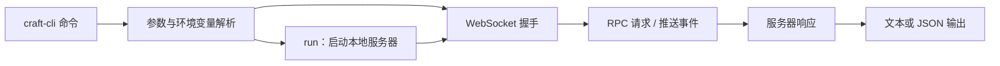

`craft-cli` 是 Bun 运行的终端客户端，通过 WebSocket 连接 Craft Agent 服务器，并将资源查询、会话操作、消息流式输出和 RPC 调用暴露为命令。本文聚焦如何安装、连接、发送消息，以及把 CLI 用于脚本；自包含运行和服务器验证也仅说明其与这些工作流直接相关的部分。 [CLI 文档](docs/cli.md#L1-L12) [CLI 入口与参数](apps/cli/src/index.ts#L1-L37)

## 工作方式

常规命令连接已经运行的服务器；`run` 则可启动本地无头服务器，再创建会话、发送提示并输出响应。普通命令与自动化脚本通常组合为“连接 → 选择工作区 → 查询或操作会话 → 断开连接”。CLI 的 RPC 客户端负责 WebSocket 握手、请求/响应匹配和事件分发；命令入口负责解析参数、执行具体操作并格式化输出。 [CLI 文档](docs/cli.md#L3-L12) [RPC 客户端](apps/cli/src/client.ts#L1-L32) [CLI 入口](apps/cli/src/index.ts#L1-L37)



图中 `run` 与常规命令的区别在于它会先启动服务器，再复用 CLI 的连接与消息处理路径；常规命令则要求目标服务器已经可用。 [CLI 参数解析](apps/cli/src/index.ts#L20-L145) [RPC 客户端](apps/cli/src/client.ts#L43-L117) [服务器启动器](apps/cli/src/server-spawner.ts#L1-L13)

## 安装与首次连接

仓库提供直接运行和全局链接两种使用方式。直接运行适合仓库开发环境；全局链接会将 `craft-cli` 加入 PATH。运行时依赖 Bun。 [CLI 文档](docs/cli.md#L14-L30) [CLI 包定义](apps/cli/package.json#L1-L19)

```bash
bun install

# 直接运行
bun run apps/cli/src/index.ts --url ws://127.0.0.1:9100 --token <token> ping

# 或在 apps/cli 中执行 bun link 后使用
craft-cli --url ws://127.0.0.1:9100 --token <token> ping
```

连接参数可通过命令行选项或环境变量提供；命令行值优先。省略 `--workspace` 时，CLI 会尝试获取工作区列表并选择第一个工作区。TLS 服务器可使用 `wss://`；自签名证书场景可通过 `--tls-ca` 指定 CA 文件。 [CLI 参数解析](apps/cli/src/index.ts#L20-L145) [CLI 文档](docs/cli.md#L32-L47) [工作区解析](apps/cli/src/index.ts#L150-L174)

| 用途 | 选项 | 环境变量 | 默认行为 |
|---|---|---|---|
| 服务器地址 | `--url` | `CRAFT_SERVER_URL` | 未提供时为空 |
| 鉴权令牌 | `--token` | `CRAFT_SERVER_TOKEN` | 未提供时为空 |
| 工作区 | `--workspace` | — | 尝试自动选择第一个工作区 |
| RPC 超时 | `--timeout` | — | 10 秒 |
| 自定义 TLS CA | `--tls-ca` | `CRAFT_TLS_CA` | 未提供时使用运行时默认信任配置 |
| 流式发送超时 | `--send-timeout` | — | 300 秒 |
| JSON 输出 | `--json` | — | 关闭 |

来源： [CLI 参数解析](apps/cli/src/index.ts#L20-L145) [CLI 文档](docs/cli.md#L32-L47)

## 查询资源与管理会话

先用 `ping` 检查连接，再按需查看工作区、会话、模型连接或来源。会话列表和会话操作需要工作区上下文；可显式传入 `--workspace`，也可以使用自动选择逻辑。 [CLI 文档](docs/cli.md#L49-L76) [工作区与会话命令](apps/cli/src/index.ts#L240-L320)

```bash
craft-cli ping
craft-cli workspaces
craft-cli --workspace <workspace-id> sessions

craft-cli session create --name "自动化任务"
craft-cli session messages <session-id>
craft-cli cancel <session-id>
craft-cli session delete <session-id>
```

`--json` 使命令输出适合后续脚本解析；未启用时，部分列表命令输出便于终端阅读的文本。脚本应明确处理空工作区或空列表，而不要假定查询一定返回资源。 [CLI 文档](docs/cli.md#L49-L76) [CLI 输出与会话命令](apps/cli/src/index.ts#L185-L200) [工作区与会话命令](apps/cli/src/index.ts#L240-L320)

## 发送消息并读取流式响应

`send` 接收会话 ID 和消息文本；也可省略消息文本，通过管道或 `--stdin` 输入。该命令订阅会话事件并将生成内容实时输出。事件处理约定包括：文本增量写入标准输出、工具启动显示标记、工具结果截断后显示；错误写入标准错误并以非零状态退出，完成正常结束，中断以状态码 130 结束。 [CLI 文档](docs/cli.md#L78-L100)

```bash
craft-cli send <session-id> "总结本仓库的测试结果"

# 从标准输入读取
type document.txt | craft-cli send <session-id>
type error.log | craft-cli send <session-id> --stdin
```

在脚本中，为发送设置适当的等待上限，并区分标准输出与标准错误：前者用于获取模型响应，后者用于诊断错误。`--send-timeout` 的默认值为 5 分钟；实际消息事件和命令行为以 CLI 文档所列约定为准。 [CLI 参数解析](apps/cli/src/index.ts#L20-L36) [CLI 文档](docs/cli.md#L32-L47) [CLI 文档](docs/cli.md#L78-L100)

## 自动化脚本模式

利用 `--json` 与常见 JSON 工具，可以把资源查询、会话创建、发送和清理串成可重复的工作流。下面展示文档中的模式：先获取工作区 ID，按工作区统计会话，再创建会话、发送消息并删除会话。执行清理时应保留创建命令返回的会话 ID，并确保失败路径也能执行清理。 [CLI 文档](docs/cli.md#L190-L218)

```bash
# 获取工作区 ID
WORKSPACES=$(craft-cli --json workspaces | jq -r '.[].id')

# 按工作区统计会话
for ws in $WORKSPACES; do
  COUNT=$(craft-cli --json --workspace "$ws" sessions | jq length)
  echo "$ws: $COUNT sessions"
done

# 创建、发送、清理
SESSION_ID=$(craft-cli --json session create --name "CI Run" | jq -r '.id')
craft-cli send "$SESSION_ID" "运行测试并报告结果"
craft-cli session delete "$SESSION_ID"
```

需要直接访问未封装成专用命令的 RPC 时，可用 `invoke <channel> [json-args...]`；需要持续接收推送事件时，可用 `listen <channel>`，并通过 Ctrl+C 停止监听。 [CLI 文档](docs/cli.md#L102-L120)

## 自包含运行与验证

`run` 适合不需要预先配置远程服务器连接的单次任务：它启动本地无头服务器、创建会话、发送提示、流式输出响应，最后退出。API 密钥可通过 `--api-key`、`LLM_API_KEY` 或提供商专属环境变量提供；还可选择提供商、模型和自定义 API 地址。 [CLI 文档](docs/cli.md#L122-L174)

```bash
ANTHROPIC_API_KEY=<key> craft-cli run "Hello, world!"

craft-cli run \
  --workspace-dir ./project \
  --provider openai \
  --model gpt-4o \
  "总结这个项目"
```

自包含运行的服务器启动器会为子进程生成令牌、将 RPC 监听地址设为本地回环及动态端口，并等待服务器输出 `CRAFT_SERVER_URL=` 后返回连接信息；启动超时默认 30 秒。`--server-entry` 可指定服务器入口。 [服务器启动器](apps/cli/src/server-spawner.ts#L20-L41) [服务器启动与就绪检测](apps/cli/src/server-spawner.ts#L43-L150) [CLI 文档](docs/cli.md#L122-L174)

`--validate-server` 可对已运行服务器执行集成验证；不提供 URL 时会自动启动本地服务器。验证会创建并删除临时会话、来源和技能，因此应在理解其工作区变更后运行；可使用 `--json` 获取机器可读结果。 [CLI 文档](docs/cli.md#L176-L189)

## 故障排查

| 症状 | 文档列出的原因 | 处理方向 |
|---|---|---|
| `Connection timeout` | 服务器未运行或不可达 | 确认服务器已启动并检查 URL |
| `AUTH_FAILED` | 令牌不正确 | 核对 CLI 与服务器令牌 |
| `PROTOCOL_VERSION_UNSUPPORTED` | CLI 与服务器版本不匹配 | 更新至兼容版本 |
| `WebSocket connection error` | 网络或 TLS 问题 | 检查网络；自签名证书使用 `--tls-ca` |
| `No workspace available` | 尚无工作区 | 创建工作区后重试 |

来源： [CLI 文档](docs/cli.md#L228-L241)

## 延伸阅读

若要先了解如何启动并鉴权无头服务器，请阅读 [无头服务器：启动、鉴权与远程桌面连接](4-wu-tou-fu-wu-qi-qi-dong-jian-qu-yu-yuan-cheng-zhuo-mian-lian-jie)。进一步理解 CLI 所连接的 RPC 与 WebSocket 通道，可阅读 [RPC 通道、WebSocket 传输与推送事件](13-rpc-tong-dao-websocket-chuan-shu-yu-tui-song-shi-jian)。 [CLI 文档](docs/cli.md#L3-L12)