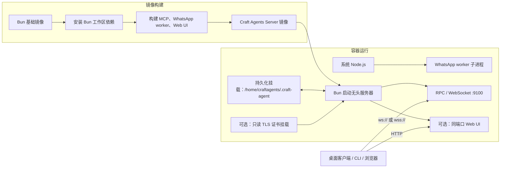

本文聚焦于仓库提供的 Craft Agents 无头服务器 Docker 镜像：镜像如何构建、如何启动、需要持久化哪些数据，以及部署前如何验证连接。Dockerfile 将服务器、Web UI 静态资源和 WhatsApp 工作进程打包到同一镜像中；服务器通过 **9100 端口**提供 RPC/WebSocket 服务，可选同时提供 Web UI，并可通过 TLS 配置启用 `wss://`。以下内容以仓库中的 `Dockerfile.server` 为准；仓库 README 中的 Docker 示例使用了不同的镜像名和 `/root` 数据路径，实际部署时应优先核对所构建镜像的用户与目录配置。Sources: [Dockerfile.server](Dockerfile.server#L1-L22) [README.md](README.md#L215-L246)

## 部署架构

Docker 镜像以 Bun 为基础运行服务器，同时安装 Node.js 供 WhatsApp worker 子进程使用。镜像构建阶段安装工作区依赖、构建 MCP 辅助服务与 WhatsApp worker，并生成 Web UI 资源；运行阶段由 Bun 启动 `packages/server/src/index.ts`。默认配置将服务器绑定到容器内的 `0.0.0.0:9100`，宿主机需通过端口映射才能访问。Sources: [Dockerfile.server](Dockerfile.server#L24-L37) [Dockerfile.server](Dockerfile.server#L76-L97) [packages/server/src/index.ts](packages/server/src/index.ts#L1-L22)



图中构建与运行阶段分别对应 Dockerfile 的依赖安装、资源构建和服务器启动设置。Web UI 只有在配置的资源目录存在且服务器令牌已设置时才启用；TLS 则要求同时提供证书和私钥。Sources: [Dockerfile.server](Dockerfile.server#L50-L75) [Dockerfile.server](Dockerfile.server#L89-L120) [packages/server/src/index.ts](packages/server/src/index.ts#L100-L150)

## 构建镜像

在仓库根目录执行构建命令。Dockerfile 注释给出的构建标签示例为 `craft-agent-server`；`--platform` 可用于指定 Buildx 的目标平台。此 Dockerfile 使用 `oven/bun:1.3-slim`，并默认安装 Node.js 20；WhatsApp worker 构建脚本的 Node 目标版本需要与 Dockerfile 的 `NODE_MAJOR` 保持一致。Sources: [Dockerfile.server](Dockerfile.server#L1-L4) [Dockerfile.server](Dockerfile.server#L24-L37)

```bash
docker buildx build --platform linux/amd64 -f Dockerfile.server -t craft-agent-server .
```

`.dockerignore` 排除依赖目录、构建产物、Git 元数据、文档及 Docker 文件等内容。忽略 `node_modules/` 和 `**/node_modules` 两种模式，是为了避免宿主机依赖目录覆盖镜像内 Bun 安装生成的链接。Sources: [.dockerignore](.dockerignore#L1-L10) [.dockerignore](.dockerignore#L12-L58)

## 启动与配置

启动时至少应设置 `CRAFT_SERVER_TOKEN`，并将容器端口映射到宿主机。Dockerfile 已设置监听地址、端口、Web UI 目录和 worker 路径；README 所列的无头服务器配置还包括 TLS 证书、私钥和可选 CA 链。下表只列出与本页 Docker 部署直接相关、且在服务器代码或镜像配置中可核实的变量。Sources: [Dockerfile.server](Dockerfile.server#L89-L120) [packages/server/src/index.ts](packages/server/src/index.ts#L1-L22)

| 变量 | 用途 | Docker 部署要点 |
|---|---|---|
| `CRAFT_SERVER_TOKEN` | 客户端认证令牌 | 启动时提供；不要将真实令牌写入公开镜像或版本控制。 |
| `CRAFT_RPC_HOST` | RPC 监听地址 | 镜像默认为 `0.0.0.0`，以便接受容器外部连接。 |
| `CRAFT_RPC_PORT` | RPC 监听端口 | 镜像默认为 `9100`；应与端口映射右侧端口一致。 |
| `CRAFT_RPC_TLS_CERT` | PEM 证书路径 | 与私钥配对使用；可指向只读挂载的容器内路径。 |
| `CRAFT_RPC_TLS_KEY` | PEM 私钥路径 | 必须与证书同时设置。 |
| `CRAFT_RPC_TLS_CA` | PEM CA 链路径 | 可选，用于客户端证书验证。 |
| `CRAFT_WEBUI_DIR` | Web UI 静态资源目录 | 镜像指向 `/app/apps/webui/dist`；目录存在且设置服务器令牌时才创建 Web UI handler。 |
| `CRAFT_MESSAGING_WA_WORKER` | WhatsApp worker 入口 | 镜像指定已构建的 CJS worker 文件路径。 |
| `CRAFT_MESSAGING_NODE_BIN` | WhatsApp worker 使用的 Node 可执行文件 | 镜像设置为 `node`。 |

以上默认值来自 Dockerfile；TLS 的必需配对检查和 Web UI 启用条件由服务器入口实现。Sources: [Dockerfile.server](Dockerfile.server#L89-L120) [packages/server/src/index.ts](packages/server/src/index.ts#L83-L98) [packages/server/src/index.ts](packages/server/src/index.ts#L100-L150)

基本启动示例：

```bash
docker run -d \
  --name craft-agent-server \
  -p 9100:9100 \
  -e CRAFT_SERVER_TOKEN="<替换为高熵令牌>" \
  -v craft-data:/home/craftagents/.craft-agent \
  craft-agent-server
```

镜像创建了 `craftagents` 非 root 用户，并预先创建 `/home/craftagents/.craft-agent`。命名卷可用于保留该目录中的运行数据；若改用宿主机 bind mount，Dockerfile 注释建议使用 `--user $(id -u):$(id -g)` 匹配宿主机 UID/GID，并设置 `HOME=/home/craftagents`。以自定义 UID/GID 运行时，应确认挂载目录权限允许该用户读写。Sources: [Dockerfile.server](Dockerfile.server#L39-L45) [Dockerfile.server](Dockerfile.server#L82-L87) [Dockerfile.server](Dockerfile.server#L1-L22)

启用 TLS 时，将证书目录只读挂载到容器，再把证书与私钥路径传入服务器。下面的示例展示 Dockerfile 注释所采用的挂载方式；实际路径应与宿主机证书位置一致。TLS 配置不完整时，服务器会在启动阶段报错退出。Sources: [Dockerfile.server](Dockerfile.server#L11-L22) [packages/server/src/index.ts](packages/server/src/index.ts#L83-L98)

```bash
docker run -d \
  --name craft-agent-server \
  -p 9100:9100 \
  -e CRAFT_SERVER_TOKEN="<替换为高熵令牌>" \
  -e CRAFT_RPC_TLS_CERT=/certs/cert.pem \
  -e CRAFT_RPC_TLS_KEY=/certs/key.pem \
  -v /宿主机证书目录:/certs:ro \
  -v craft-data:/home/craftagents/.craft-agent \
  craft-agent-server
```

## 上线前验证

仓库提供 `scripts/docker-smoke-test.sh`，接受一个已构建的镜像标签作为参数。脚本启动临时容器，将容器的 9100 端口映射到宿主机 9100，设置临时令牌，并等待日志出现 `CRAFT_SERVER_URL=`；服务就绪后，若当前环境有 Bun 和 CLI 源码，则执行 `--validate-server`，否则尝试 WebSocket 连通性检查，并在适用时退回端口检查。退出时脚本会打印容器日志并移除临时容器。Sources: [scripts/docker-smoke-test.sh](scripts/docker-smoke-test.sh#L1-L18) [scripts/docker-smoke-test.sh](scripts/docker-smoke-test.sh#L20-L63) [scripts/docker-smoke-test.sh](scripts/docker-smoke-test.sh#L65-L116)

```bash
bash scripts/docker-smoke-test.sh craft-agent-server
```

脚本的完整验证可能需要 `ANTHROPIC_API_KEY`；`STITCH_API_KEY` 是可选项，可启用额外检查。若服务未在 `SMOKE_TEST_TIMEOUT` 秒内就绪，脚本会报告错误并输出容器日志；超时默认值为 30 秒。Sources: [scripts/docker-smoke-test.sh](scripts/docker-smoke-test.sh#L7-L18) [scripts/docker-smoke-test.sh](scripts/docker-smoke-test.sh#L38-L63)

| 现象 | 脚本行为 | 检查方向 |
|---|---|---|
| 容器启动后退出 | 输出容器日志并失败退出 | 查看令牌、TLS 文件路径及服务器启动日志。 |
| 等待超时 | 报告未就绪并输出日志 | 确认端口映射、启动日志及 `SMOKE_TEST_TIMEOUT` 设置。 |
| CLI 不可用 | 改用 WebSocket 检查 | 确认宿主机有可用的连接检查工具；若均不可用，脚本会给出警告。 |
| Smoke test 结束 | 清理函数输出日志并删除容器 | 需要长期运行时，不要将此测试脚本当作生产容器管理方式。 |

表中检查方向依据脚本的实际失败分支与清理行为整理；具体故障原因需以容器日志为准。Sources: [scripts/docker-smoke-test.sh](scripts/docker-smoke-test.sh#L40-L63) [scripts/docker-smoke-test.sh](scripts/docker-smoke-test.sh#L65-L116)

## 生产部署边界

Dockerfile 提供可运行的服务器镜像、非 root 默认用户、RPC 端口和运行时资源路径，但仓库这些 Docker 文件并未定义编排平台、自动重启策略、反向代理、备份计划或监控告警配置。因此，这些内容需要由部署环境另行设置；不要将“镜像可启动”视为已经具备完整生产运维方案。README 建议远程访问使用 TLS，或由 nginx、Caddy 等反向代理终止 TLS。Sources: [Dockerfile.server](Dockerfile.server#L39-L45) [Dockerfile.server](Dockerfile.server#L89-L120) [README.md](README.md#L202-L246)

进一步了解远程连接与 TLS 配置，请参阅[无头服务器：启动、鉴权与远程桌面连接](4-wu-tou-fu-wu-qi-qi-dong-jian-quan-yu-yuan-cheng-zhuo-mian-lian-jie)；如需 CLI 验证与自动化用法，请参阅[命令行客户端：连接服务器、发送消息与自动化脚本](5-ming-ling-xing-ke-hu-duan-lian-jie-fu-wu-qi-fa-song-xiao-xi-yu-zi-dong-hua-jiao-ben)。Sources: [README.md](README.md#L162-L246) [scripts/docker-smoke-test.sh](scripts/docker-smoke-test.sh#L65-L90)