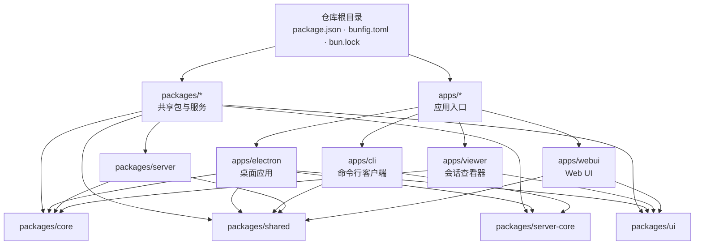

本页介绍仓库的顶层布局，以及 Bun 如何把 `apps/*` 和 `packages/*` 纳入同一个工作区。可以先记住一个简单模型：**`apps` 放面向用户运行的应用，`packages` 放可被应用复用的代码；根目录负责统一声明工作区、依赖安装布局和常用脚本。**本页聚焦目录与工作区关系，不展开具体应用的开发、构建或部署流程。  
Sources: [根 package.json](package.json#L18-L22) [Electron README](apps/electron/README.md#L13-L47)

## 先从目录看整体

下图展示仓库的主要组成。箭头表示由应用的 `package.json` 声明对内部包的依赖；它描述的是依赖关系，不代表运行时调用顺序。  
Sources: [根 package.json](package.json#L18-L22) [Electron package.json](apps/electron/package.json#L38-L44) [CLI package.json](apps/cli/package.json#L16-L19) [Server package.json](packages/server/package.json#L27-L32) [Viewer package.json](apps/viewer/package.json#L14-L19) [Web UI package.json](apps/webui/package.json#L13-L22)

| 目录 | 入门时可以怎样理解 | 仓库中的例子 |
|---|---|---|
| `apps/` | 可独立识别的应用或前端入口 | `electron`、`cli`、`viewer`、`webui` |
| `packages/` | 按职责拆分、供其他工作区成员使用的代码包 | `core`、`shared`、`server-core`、`ui` |
| `scripts/` | 仓库级辅助脚本 | 构建、安装和资源处理脚本 |
| `docs/` | 仓库内文档 | `cli.md` |
| 根目录配置 | 工作区和项目级工具的入口配置 | `package.json`、`bunfig.toml`、`bun.lock`、`tsconfig.json` |

此表按目录及现有文件名称归纳用途；它不表示每个目录都必须遵循相同的内部实现方式。  
Sources: [根目录 package.json](package.json#L18-L22) [Bun 配置](bunfig.toml#L1-L10) [根 TypeScript 配置](tsconfig.json#L1-L30)

## Bun 工作区：一个仓库中的多个包

根 `package.json` 的 `workspaces` 配置把 `packages/*` 和 `apps/*` 作为工作区路径，并显式排除 `apps/online-docs`。因此，判断某个子目录是否属于此工作区，应以该配置为准，而不能仅凭它位于 `apps/` 下就推断。根清单还声明项目为 `private`，因此它是仓库级管理入口，而不是可发布的根包。  
Sources: [根 package.json](package.json#L1-L7) [根 package.json](package.json#L18-L22)

工作区中的包通过各自 `package.json` 的名称互相引用。例如 CLI 声明依赖 `@craft-agent/shared` 和 `@craft-agent/server-core`，并以 `workspace:*` 表示它们是本工作区依赖。桌面应用也通过同样的方式依赖多个内部包。初学者可以把 `workspace:*` 理解为“使用仓库内对应工作区包”，而不是另一个需要手动填写本地文件路径的依赖。  
Sources: [CLI package.json](apps/cli/package.json#L1-L19) [Electron package.json](apps/electron/package.json#L38-L44)

| 包清单中的字段 | 例子 | 说明 |
|---|---|---|
| `name` | `@craft-agent/cli`、`@craft-agent/shared` | 供其他清单通过包名声明依赖 |
| `dependencies` | `"@craft-agent/shared": "workspace:*"` | 声明该包使用的内部工作区包 |
| `exports` | `@craft-agent/shared` 的子路径映射 | 定义消费者可通过哪些公开入口导入模块 |

例如，`@craft-agent/shared` 的清单将根入口及多个子路径映射到 `src/` 下的文件。它说明包可以提供多个有名称的导入入口；具体某个模块的功能不在本页展开。  
Sources: [Shared package.json](packages/shared/package.json#L1-L8) [Shared package.json](packages/shared/package.json#L14-L20) [Shared package.json](packages/shared/package.json#L23-L35)

## 根目录配置各自负责什么

`package.json` 不只是包清单，也集中定义工作区成员和仓库脚本；`bunfig.toml` 则配置 Bun 的安装行为。`bun.lock` 位于仓库根目录，是锁文件的位置。它们职责不同：工作区成员看 `package.json`，安装器行为看 `bunfig.toml`，依赖锁定信息看锁文件。  
Sources: [根 package.json](package.json#L18-L23) [Bun 配置](bunfig.toml#L1-L10)

本仓库在 `bunfig.toml` 中将安装器 linker 设置为 `hoisted`。文件注释说明，这一布局用于让传递依赖可在顶层 `node_modules` 解析，并指出 Vite 与 esbuild 打包对这一布局的需求；同一注释也提到 Windows 构建脚本使用相同 linker。对刚接触项目的人来说，关键是：这是仓库选择的依赖安装布局，不是每个包分别配置的别名或导入路径。  
Sources: [Bun 配置](bunfig.toml#L3-L10)

根 `tsconfig.json` 提供 TypeScript 编译器的通用选项，并将 `include` 限定为根目录下的 `src/**/*`。因此，不应把根配置误解为自动覆盖所有工作区子项目；例如 Electron 自己也有 `tsconfig.json`，各包可以拥有各自的 TypeScript 配置。  
Sources: [根 tsconfig.json](tsconfig.json#L1-L30) [仓库目录清单](apps/electron/tsconfig.json#L1-L1)

## 按职责认识主要工作区

从包清单可以看到，`packages/` 中既有共享基础包，也有服务器相关包；`apps/` 中则包含不同交付形态的入口。下面的概览只根据名称、描述和清单依赖归纳，不替代各自的架构说明。  
Sources: [Core package.json](packages/core/package.json#L1-L12) [Shared package.json](packages/shared/package.json#L1-L8) [Server package.json](packages/server/package.json#L1-L15) [CLI package.json](apps/cli/package.json#L1-L14) [Viewer package.json](apps/viewer/package.json#L1-L12) [Web UI package.json](apps/webui/package.json#L1-L10)

| 工作区 | 清单所示定位 |
|---|---|
| `packages/core` | 核心类型、存储和智能体逻辑 |
| `packages/shared` | 多个领域的共享业务逻辑，并通过多个 `exports` 子路径提供入口 |
| `packages/server` | Bun 运行时的独立无头服务器 |
| `apps/electron` | Electron 桌面应用 |
| `apps/cli` | 连接服务器的终端客户端 |
| `apps/viewer` | 会话查看器 |
| `apps/webui` | Web UI 前端 |

对于新贡献者，建议先从目标应用的 `package.json` 查看它声明依赖哪些内部包，再进入这些包的清单查看名称与公开入口。这样能先建立“谁依赖谁”的地图，之后再根据任务深入阅读源代码。  
Sources: [Electron package.json](apps/electron/package.json#L38-L44) [CLI package.json](apps/cli/package.json#L16-L19) [Shared package.json](packages/shared/package.json#L14-L35)

## 建议的阅读顺序

当前页位于“入门 → 开发准备”，目标是帮助你先掌握仓库地图和 Bun 工作区边界。了解这些概念后，可以按下面顺序继续：先准备开发环境与验证方式，再根据兴趣进入应用模块或系统架构专题。  
Sources: [根 package.json](package.json#L18-L28)

1. [本地开发、构建、类型检查与测试](8-ben-di-kai-fa-gou-jian-lei-xing-jian-cha-yu-ce-shi)：了解如何在工作区中进行开发和验证。
2. [应用形态与模块边界：Electron、Web UI、查看器和 CLI](10-ying-yong-xing-tai-yu-mo-kuai-bian-jie-electron-web-ui-cha-kan-qi-he-cli)：比较不同应用入口及其模块边界。
3. [核心数据模型与共享基础能力](11-he-xin-shu-ju-mo-xing-yu-gong-xiang-ji-chu-neng-li)：继续理解共享代码与核心包所承载的基础能力。