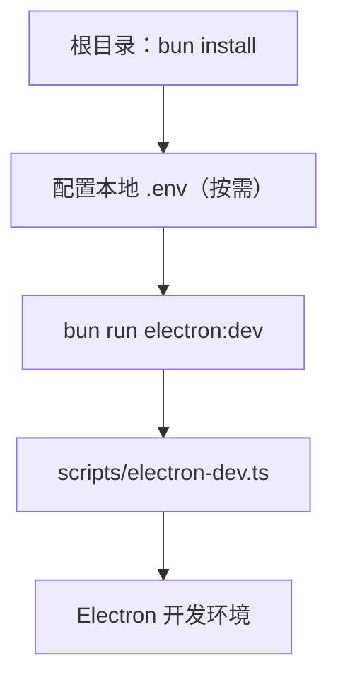

本页说明如何在仓库中安装依赖、启动桌面开发环境，并选择合适的构建、类型检查和测试命令。仓库使用 Bun workspaces 管理多个应用与共享包；根目录脚本提供统一入口，但各应用的检查范围并不完全相同。Sources: [package.json](package.json#L18-L28) [CONTRIBUTING.md](CONTRIBUTING.md#L7-L35)

## 开发环境与依赖安装

开始前安装 Bun；贡献指南也列出 Node.js 18+，用于部分工具。克隆仓库后，在根目录执行 `bun install`。仓库提交了 `bun.lock`，CI 使用 `bun install --frozen-lockfile`，可在本地需要严格复现锁文件依赖时采用同一参数。Sources: [CONTRIBUTING.md](CONTRIBUTING.md#L7-L24) [.github/workflows/validate.yml](.github/workflows/validate.yml#L19-L45)

根目录 `bunfig.toml` 将安装 linker 配置为 `hoisted`。文件注释指出，此布局是为 Vite 与 esbuild 的打包解析需求设置；安装依赖时应保留仓库配置，不要随意改用另一种 linker。Sources: [bunfig.toml](bunfig.toml#L3-L10)

如需本地环境变量，可按贡献指南从 `.env.example` 复制为 `.env` 并填写相应值。此处仅涉及开发环境准备；具体变量含义与连接安全配置请参阅[配置项、环境变量与远程连接安全](26-pei-zhi-xiang-huan-jing-bian-liang-yu-yuan-cheng-lian-jie-an-quan)。Sources: [CONTRIBUTING.md](CONTRIBUTING.md#L26-L30)

## 启动开发环境

常规桌面开发入口是从仓库根目录运行：

```bash
bun run electron:dev
```

贡献指南将此命令列为开发模式启动方式。根目录脚本进一步将其映射到 `scripts/electron-dev.ts`；需要在终端运行开发模式时，可使用 `bun run electron:dev:terminal`。Sources: [CONTRIBUTING.md](CONTRIBUTING.md#L32-L35) [package.json](package.json#L64-L68)



图示概括贡献指南给出的准备顺序，以及根脚本中开发命令的映射；它不代表开发服务器内部的完整启动时序。Sources: [CONTRIBUTING.md](CONTRIBUTING.md#L21-L35) [package.json](package.json#L64-L68)

## 构建命令如何选择

桌面应用的根目录构建入口为 `bun run electron:build`，脚本依次构建主进程、preload、renderer、资源并复制静态资产；它不等同于打包发布。若要构建后直接启动 Electron，可运行 `bun run electron:start`；平台分发任务则使用 `electron:dist` 或对应平台脚本。Sources: [package.json](package.json#L57-L66) [package.json](package.json#L75-L81)

| 目标 | 命令 | 用途 |
|---|---|---|
| 桌面应用构建 | `bun run electron:build` | 执行主进程、preload、renderer 与资源构建 |
| 构建并启动桌面应用 | `bun run electron:start` | 先构建，再启动 Electron |
| Web UI 构建 | `bun run webui:build` | 使用 Vite 构建 Web UI |
| Viewer 构建 | `bun run viewer:build` | 使用 Vite 构建 Viewer |
| Server 构建 | `bun run server:build` | 调用 `scripts/build-server.ts` |

这些命令由根目录脚本映射；Viewer 与 Web UI 的构建也分别定义在各自 workspace 的 `package.json` 中。Sources: [package.json](package.json#L31-L35) [package.json](package.json#L63-L66) [package.json](package.json#L84-L90) [apps/viewer/package.json](apps/viewer/package.json#L8-L13)

## 类型检查

根目录 `bun run typecheck` 默认只运行 `typecheck:shared`，即对 `packages/shared` 执行 `tsc --noEmit`；它不是全仓库类型检查。对更广范围的检查，使用 `bun run typecheck:all`。提交前贡献指南也建议运行该命令。Sources: [package.json](package.json#L25-L28) [CONTRIBUTING.md](CONTRIBUTING.md#L47-L68)

应用可单独检查：Electron 使用 `bun run typecheck:electron`，Viewer 与 Web UI 分别使用 `bun run viewer:typecheck` 和 `bun run webui:typecheck`。Pi Agent Server 在自身 workspace 中通过 `bun run typecheck` 检查，并以独立的 `tsconfig.typecheck.json` 为配置。Sources: [package.json](package.json#L36-L36) [package.json](package.json#L84-L90) [apps/electron/package.json](apps/electron/package.json#L30-L36) [packages/pi-agent-server/package.json](packages/pi-agent-server/package.json#L11-L14)

## 测试与验证

根目录 `bun run test` 会先运行 `bun test`，再查找并逐个运行仓库中的 `*.isolated.ts` 测试文件。共享包也提供 `bun test` 与 `bun test:watch` 脚本，可在 `packages/shared` workspace 内执行。Sources: [package.json](package.json#L23-L24) [packages/shared/package.json](packages/shared/package.json#L9-L12)

如果只需要验证共享包中列出的 LLM 连接、模型与配置测试，可运行 `bun run test:shared:all`。根目录 `bun run validate:dev` 则串联全量类型检查、上述共享包测试和文档工具 smoke tests；`bun run validate:ci` 在此基础上追加国际化 parity、排序和覆盖率检查。Sources: [package.json](package.json#L37-L43)

| 需求 | 命令 |
|---|---|
| 快速检查共享包类型 | `bun run typecheck` |
| 检查更广的 workspace 范围 | `bun run typecheck:all` |
| 运行仓库测试入口 | `bun run test` |
| 运行共享包指定测试组 | `bun run test:shared:all` |
| 执行开发验证组合 | `bun run validate:dev` |
| 执行 CI 验证组合 | `bun run validate:ci` |

表中命令均来自根目录脚本；`validate:ci` 是 CI workflow 实际调用的验证入口。Sources: [package.json](package.json#L24-L28) [package.json](package.json#L37-L43) [.github/workflows/validate.yml](.github/workflows/validate.yml#L39-L45)

## 提交前验证与 CI 对照

建议根据改动范围先运行对应 workspace 的构建、类型检查或测试，再在提交前运行 `bun run typecheck:all`。若需要复现主 CI 验证，执行 `bun run validate:ci`；GitHub Actions 使用 Bun 1.3.10，冻结 lockfile 安装依赖后运行该命令。Sources: [CONTRIBUTING.md](CONTRIBUTING.md#L47-L68) [.github/workflows/validate.yml](.github/workflows/validate.yml#L19-L45)

另有独立的服务器集成验证 workflow：它通过手动触发，在 Ubuntu、macOS、Windows 矩阵中运行 CLI 的 `--validate-server`。这不同于日常的 `validate:ci`，运行时还需要 workflow 配置的 API 密钥，因此不应将其与本地常规测试入口混为一谈。Sources: [.github/workflows/validate-server.yml](.github/workflows/validate-server.yml#L1-L35)

完成开发环境准备后，可继续阅读[贡献流程、行为准则与安全问题报告](9-gong-xian-liu-cheng-xing-wei-zhun-ze-yu-an-quan-wen-ti-bao-gao)；若希望理解应用与 workspace 的模块边界，可参阅[应用形态与模块边界：Electron、Web UI、查看器和 CLI](10-ying-yong-xing-tai-yu-mo-kuai-bian-jie-electron-web-ui-cha-kan-qi-he-cli)。Sources: [CONTRIBUTING.md](CONTRIBUTING.md#L37-L68) [package.json](package.json#L18-L21)