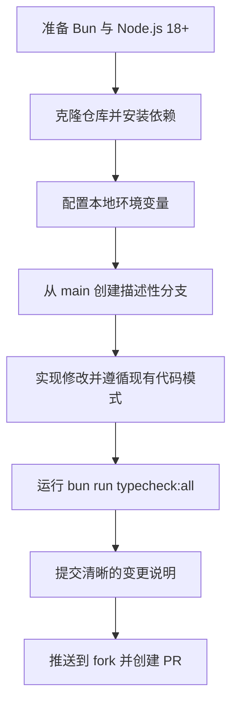

本页说明如何从准备开发环境到提交 Pull Request（PR），以及如何选择合适的渠道报告一般问题、社区行为问题和安全漏洞。**安全漏洞不得通过公开 GitHub issue 报告**；其他贡献则按问题类型使用相应流程。Sources: [CONTRIBUTING.md](CONTRIBUTING.md#L3-L4) [SECURITY.md](SECURITY.md#L5-L11)

## 贡献流程

项目贡献流程可以概括为：准备环境、基于 `main` 创建分支、修改并检查、提交 PR。开始前需要 Bun、Node.js 18+（用于部分工具），并可在 macOS、Linux 或 Windows 上开发。仓库指南给出的环境准备方式是克隆仓库、运行 `bun install`、根据 `.env.example` 配置 `.env`，再用 `bun run electron:dev` 启动开发模式。Sources: [CONTRIBUTING.md](CONTRIBUTING.md#L5-L35)

创建分支时应使用能表达改动类型和目的的名称，例如 `feature/add-new-tool`、`fix/resolve-auth-issue`、`refactor/simplify-agent-loop` 或 `docs/update-readme`。修改应遵循仓库已有模式，采用有意义的变量和函数名称；复杂逻辑应补充注释。提交 PR 前，贡献指南要求运行 `bun run typecheck:all`。Sources: [CONTRIBUTING.md](CONTRIBUTING.md#L37-L68)

提交 PR 时，使用清晰、具体的标题，并说明改动内容及原因、测试方式；如果涉及 UI，附上截图。仓库中的 PR 描述建议包含 Summary、Changes、Testing，以及适用时的 Screenshots。Sources: [CONTRIBUTING.md](CONTRIBUTING.md#L70-L91)

| 改动类型 | 分支名称示例 | PR 中应说明 |
|---|---|---|
| 新功能 | `feature/add-new-tool` | 功能改动及其目的、测试方式；UI 改动附截图 |
| 缺陷修复 | `fix/resolve-auth-issue` | 修复内容、测试方式 |
| 重构 | `refactor/simplify-agent-loop` | 变更内容、测试方式 |
| 文档 | `docs/update-readme` | 文档改动内容 |

Sources: [CONTRIBUTING.md](CONTRIBUTING.md#L39-L53) [CONTRIBUTING.md](CONTRIBUTING.md#L70-L91)

## 一般问题与功能建议

报告缺陷或提出功能建议时，可从仓库的 GitHub issue 模板开始。缺陷模板要求提供应用版本、操作系统及版本、AI 提供商、问题描述、复现步骤、预期行为和实际行为；模型、截图或录屏、调试日志及额外背景信息可按适用情况补充。对于非 UI 问题，模板建议附上调试会话中的相关日志，并提示可使用 `-- --debug` 启动应用后复现。Sources: [.github/ISSUE_TEMPLATE/bug_report.yml](.github/ISSUE_TEMPLATE/bug_report.yml#L10-L17) [.github/ISSUE_TEMPLATE/bug_report.yml](.github/ISSUE_TEMPLATE/bug_report.yml#L19-L63) [.github/ISSUE_TEMPLATE/bug_report.yml](.github/ISSUE_TEMPLATE/bug_report.yml#L65-L124)

功能建议模板要求说明问题或动机，以及期望的解决方案；也可以补充尝试过的替代方案、截图、原型图、链接等背景信息。若问题属于一般提问或想法交流，贡献指南还建议通过 discussion 讨论。Sources: [.github/ISSUE_TEMPLATE/feature_request.yml](.github/ISSUE_TEMPLATE/feature_request.yml#L10-L37) [CONTRIBUTING.md](CONTRIBUTING.md#L114-L117)

## 行为准则与反馈渠道

项目承诺为所有参与者提供友好、包容的环境，并期望参与者保持尊重、欢迎并帮助新成员学习、以建设性态度接受反馈，以及关注社区整体利益。若遇到不符合这些标准的行为，可发送邮件至 `conduct@craft.do`；项目说明所有投诉都会得到及时、公正的审查和调查。Sources: [CODE_OF_CONDUCT.md](CODE_OF_CONDUCT.md#L3-L20)

## 安全漏洞报告

**不要通过公开 GitHub issue 报告安全漏洞。**请将漏洞报告发送至 `security@craft.do`，并尽可能包含漏洞描述、复现步骤、潜在影响；建议修复方案为可选信息。政策适用于 Craft Agents 桌面应用、`@craft-agent/*` npm 包及官方 Craft Agents 仓库。第三方依赖问题应报告给对应维护者；社会工程攻击和拒绝服务攻击列为范围外。Sources: [SECURITY.md](SECURITY.md#L3-L17) [SECURITY.md](SECURITY.md#L25-L36)

项目表示会在 48 小时内确认收到报告、在 7 天内提供初步评估，并以 30 天内解决严重问题为目标。安全更新仅支持最新版本；有效漏洞报告者可在征得其同意后获得致谢。Sources: [SECURITY.md](SECURITY.md#L19-L23) [SECURITY.md](SECURITY.md#L38-L45) [SECURITY.md](SECURITY.md#L56-L59)

| 事项 | 应使用的渠道 | 需要提供的信息 |
|---|---|---|
| 一般缺陷 | GitHub 缺陷报告模板 | 版本、系统、复现步骤、预期与实际表现等 |
| 功能建议 | GitHub 功能建议模板 | 问题或动机、提议方案；可补充替代方案及背景 |
| 社区行为问题 | `conduct@craft.do` | 投诉事项；准则承诺及时、公正审查和调查 |
| 安全漏洞 | `security@craft.do`，不要发公开 issue | 漏洞描述、复现步骤、潜在影响；修复建议可选 |

Sources: [.github/ISSUE_TEMPLATE/bug_report.yml](.github/ISSUE_TEMPLATE/bug_report.yml#L10-L124) [.github/ISSUE_TEMPLATE/feature_request.yml](.github/ISSUE_TEMPLATE/feature_request.yml#L10-L37) [CODE_OF_CONDUCT.md](CODE_OF_CONDUCT.md#L16-L20) [SECURITY.md](SECURITY.md#L7-L23)

## 贡献许可

贡献指南说明，参与贡献即表示同意：你的贡献将依据 Apache License 2.0 授权。Sources: [CONTRIBUTING.md](CONTRIBUTING.md#L119-L121)

准备开发环境可继续阅读[本地开发、构建、类型检查与测试](8-ben-di-kai-fa-gou-jian-lei-xing-jian-cha-yu-ce-shi)；若要了解项目自动化校验，可参阅[测试策略、CI 校验与集成验证](24-ce-shi-ce-lue-ci-xiao-yan-yu-ji-cheng-yan-zheng)。Sources: [CONTRIBUTING.md](CONTRIBUTING.md#L47-L68)